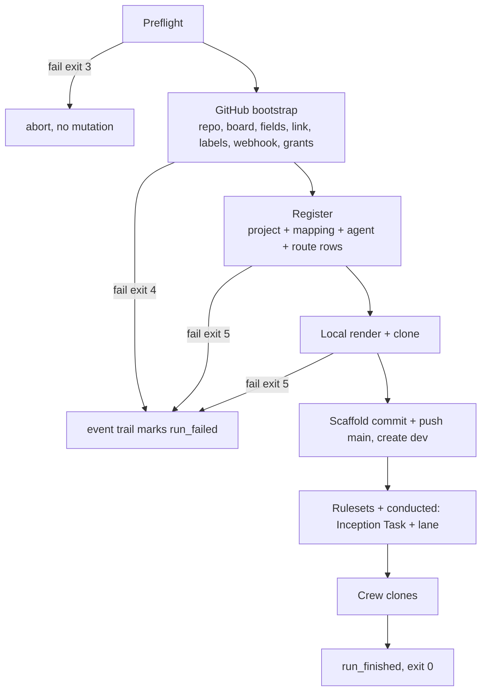

# Foundry

Foundry turns a Principal-supplied input bundle into a fully `PROJECT.md`-compliant Project container in one invocation — GitHub side, platform registry, and local side — creates the Inception Stage Task that starts conduction, and records the audit trail as append-only run events. A `project` row is the project's creation: bootstrap writes the registry through foundry's own DB layer (`specs/data/spec_database.md §11`), routes included — a project the crew cannot be dispatched on is not created. It also opens milestones: `kickoff` creates the Draft Stage Task the project manager takes over. Foundry scaffolds structure; Stage Tasks fill content. Contracts: `spec_foundry-interface.md`. Artifacts and identifiers: `spec_foundry-data.md`. `docs/milestones/milestone_v2026.08.18_foundry-v1/milestone.md` — governing milestone.

Source lives at `apps/foundry/` (TypeScript/Node CLI, Node 22 + tsx, `@octokit/rest` + `@octokit/graphql`; the PAT-file model is the single auth surface — ambient `gh` auth is never consulted). It runs on the gateway host, where the crew's agents, clones, and keystore live (`manual.md`).

## Bootstrap flow

Every act streams a `resource` event into the run event log as it completes (`spec_foundry-data.md §Run events`) — a failed run's trail already covers everything that ran.

### Preflight

No state mutates until every check passes:

- Load the environment (`spec_foundry-interface.md §Environment`); a missing required var exits 2.
- Validate the bundle per `spec_foundry-interface.md §Input bundle`.
- Load the owner PAT from `FOUNDRY_OWNER_TOKEN_PATH`; its `GET /user` login is the owner; verify scopes.
- Resolve each crew agent and specialist to `<FOUNDRY_AGENT_TOKEN_DIR>/<name>.token`: file must exist and authenticate (`GET /user`); the returned login + node id are that agent's GitHub identity (work tokens share one account — logins dedupe).
- `FOUNDRY_WEBHOOK_URL` must be a valid HTTPS URL; the secret file readable and non-empty.
- Repo name: exists under the owner → resume case, continue; exists under a foreign owner → abort. Board title: more than one existing match → abort.
- Storage path writable; `<project_key>/` may pre-exist only when it is a prior run of the same project — its `main/` clone's git origin points at the owner's `<project_key>` repo. Anything else at that path aborts.
- Startup lint on the committed skeleton (`spec_foundry-data.md §Verification`).

### GitHub bootstrap

Sub-steps in order, each streaming its resource event; artifact shapes per `spec_foundry-data.md §GitHub artifacts`:

- Create the repo (REST `POST /user/repos` under the owner token), then PATCH settings.
- Create the board (GraphQL `createProjectV2`); existing same-title board → capture node ID.
- Create `Status`/`Audit` fields (`createProjectV2Field`), capturing option IDs. GitHub seeds every new board with a default `Status` field (Todo / In Progress / Done): an existing field whose option set differs is converged to the canonical set (`updateProjectV2Field`, then a fresh read of the field — the mutation's response carries placeholder option ids, not the persisted ones) while the board holds no items — nothing can lose a value; once items exist the option set is operator state and the difference is recorded as drift, untouched.
- Link repo to board (`linkProjectV2ToRepository`, idempotent).
- Upsert the label inventory by name; an existing different color is recorded as drift; GitHub's auto-generated defaults are left untouched — Foundry adds, never subtracts.
- Configure the webhook; a hook already matching `config.url` is compared on events + active, drift recorded.
- Grants, per distinct login over crew ∪ specialists: probe repo membership → invite `push` under the owner token → accept with a token of the invited account (any agent token whose login matches) → GraphQL Project `WRITER` grant (`updateProjectV2Collaborators` — an upsert applied every run: ProjectV2 exposes no collaborator listing to probe). A single failed entry records `failed` and continues — grants never abort the bootstrap.
- Failure anywhere here: the event trail already carries the completed sub-steps plus `run_failed`; exit 4.

### Register

The platform registry rows, written through foundry's own DB layer (runtime DML, app-local — `@vork/data` stays the schema-lifecycle facility and the home of the route template) as the `vork_app` seeding act, immediately after the GitHub coordinates exist so webhook deliveries during later stages already resolve and dispatch:

- `project` (slug + name — its existence IS the project's creation), the `github_repo_project` integration mapping (platform `project_id` + the `github_`-prefixed coordinates), a `github_agent` row per crew agent and specialist (keyed by agent name; platform-global, so most pre-exist — the Principal's own row is platform seed, `@vork/data`), and the project's route set from the route template (`specs/data/spec_database.md §2 Route provisioning`) — the crew's default lanes plus one exact assignee route per specialist task. All idempotent: existing rows report `existing`, re-runs converge; an existing route with a different agent for the same `(task_type, actor)` is recorded as drift and left alone — ops overrides stand.
- Connection from `VORK_DATABASE_*` (`spec_foundry-interface.md §Environment`). Host absent → the stage is skipped with an event — the extraction seam's standalone mode.
- Failure exits 5; the GitHub artifacts stand and a re-run resumes into the registration.

### Local render + clone

- `mkdir -p` the project folder; clone the repo into `main/`. On a fresh founding the remote is empty — the scaffold is the repository's first commit — so the clone sits on an unborn branch named by the machine's default; Foundry pins it to `main` (`git symbolic-ref HEAD refs/heads/main`) before rendering, and any `main/` left by a run that never pushed is removed and re-cloned. With history on the remote, a `main/` left by a run interrupted mid-clone — origin set, `HEAD` unresolvable — is removed and re-cloned, recorded as drift: its only possible content was Foundry's own render.
- Render the skeleton inventory deterministically; existing path → skip and record. Unknown variable or filesystem failure → exit 5, nothing half-written (render aborts before the first write on a missing required variable).

### Scaffold commit, push, `dev`

- Identity for the scaffold commit is the owner's: `user.name = <owner_login>`, `user.email = <owner_login>@<project_key>.localhost`; `git add -A`; message `Foundry-v1: initial project scaffold` — the repository's first commit; push `main` under the owner token (the push creates the branch) — no ruleset exists yet, which is the lockout guard; a rejection from an operator-created ruleset is reported by name, exit 5.
- Create `dev` at the scaffold commit (`POST git/refs`), so both standing branches exist before protection.
- Re-bind `main/` to the AI Lead: `user.name = main`, `user.email = <main login>@<project_key>.localhost` — from here on `main/` is the AI Lead's working clone (`PROJECT.md §Structure`); the owner's identity leaves with the push.

### Rulesets, Inception Task, inception lane

- Apply `protect-main` and `protect-dev` per the committed shapes (skipped wholly when `FOUNDRY_RULESET=none`); an existing same-name ruleset converges by delta, recording it.
- With `--conducted`: create the Inception Stage Task under the owner PAT — the act is the Principal's: title `Project Inception — <project_name>`, labels `type:project_inception` + `agent:owner`, Owner = the owner login (the Principal), **Assignee = the AI Lead's login**, board placement `Init`/`Gated`, body per `spec_foundry-interface.md §Task body`; then the **creation comment** under the same token (`spec_foundry-interface.md §Stage Task creation`) — ingress resolves it principal-handled at once.
- Create the inception lane through the Task: `createLinkedBranch`, branch `feature/inception/charter` — Branch↔Task binding from birth (`PROJECT.md §Branching`); the Principal deletes the lane on accepting the Charter.
- Idempotency: an open `type:project_inception` issue → **converged**, never duplicated — board placement, `Init`/`Gated`, the linked lane, and the creation comment each ensured (a run interrupted between creation and placement leaves exactly this); a closed one with no open successor → drift for the operator (a re-run does not resurrect Inception). A resumed run without `--conducted` never creates the Task; one with it creates the Task only if the earlier run did not.
- Without `--conducted`: no Stage Task, no lane, no comment — the rendered Charter is the founding record and the Principal proceeds in conversation. The register stage, routes included, is unaffected: the crew is dispatchable whenever conduction starts.

### Crew clones

For each crew agent other than `main` (whose clone is `main/`), and each specialist:

- `team/<name>/` (0755) ← full-history clone via one-shot credential injection (`GIT_ASKPASS` helper — the token never lands in `.git/config`).
- Per-clone identity: `user.name = <name>`, `user.email = <github_login>@<project_key>.localhost`.
- Probe `git ls-remote origin`; failure exits 5 naming the agent — it indicates a broken invite acceptance upstream.

### Run close

- `run_finished` ends the event trail; the log's path prints. The new project's repo never carries the trail — an execution by-product is runtime data, not repo content.

## Idempotency and resume

Re-running with the same bundle always resumes, state-based: existing artifacts are skipped with node IDs captured, drift is recorded in the event trail, registry rows report `existing`, nothing is clobbered. `foundry verify` is the validation surface.

| Resource | Detect by | On collision |
|---|---|---|
| repo / board | name / title under owner | capture node ID, continue |
| field | name on board | verify options; converge on an itemless board, else record drift |
| label | name on repo | record color drift |
| skeleton file | path exists | skip — existing wins |
| webhook | `config.url` match | record event/active drift |
| repo grant / Project grant | membership probe / none (upsert) | `already_collaborator` / `granted` again |
| `main/` clone | `HEAD` resolves | torn → remove, re-clone, drift |
| registry row | slug / `github_repo_id` / `agent_id` / `(project_id, task_type, actor)` | `existing`; a route bound to another agent → drift, untouched |
| `dev` / ruleset | ref / name | skip / converge by delta, recorded |
| Inception Task | open `type:project_inception` issue | converge placement, lane, comment; record issue number |

A failed run re-runs and resumes, whatever stage it died at — resumption is state-based against the live surfaces, and the run's event trail names what completed (the cleanup targets; no auto-rollback ever). Rate limits honored with bounded waits; the non-idempotent issue-forms commit is GET-verified before any retry.

## Verify

`foundry verify --against <path>`: render (in memory) what the bundle would produce — or the bundle-independent subset — and compare structure only: every canonical path present, record templates byte-identical, README stubs present. Report per-path, mutate nothing, exit 0/7. Vork's own tree is the standing fixture: a failure there means Foundry's committed skeleton is stale — fix Foundry before bootstrapping anything real.

## Kickoff

Opens a milestone, two ways. **Conducted** (`--conducted`): the same shape as the Inception Task at bootstrap — create the Stage Task directly with its creation comment; ingress mints the owner-lane wake; conduction takes over. **The creator token is the design**: the issue author is the task owner (`spec_wakery-github-adapter.md`), so the token that creates the issue decides the conduction outcome — Inception under the Principal's token resolves principal-handled (no dispatch; the Principal drives), the Draft task under the project manager's token fires the ordinary `Init:Gated` owner-lane cue through the route table, which the project's owner route lands on him. **Unconducted** (no flag): the milestone record is opened directly for the Principal and the AI Lead to draft in conversation — no Stage Task, no project-manager turn.

Conducted:

- Resolve the project manager's token and the AI Lead's login (`spec_foundry-interface.md §Crew`); authenticate; the manager's login is the task's author-owner.
- Probe the project repo for an open `type:project_draft` issue — one exists → converge its placement and creation comment, print its number and exit 0 without creating (the one-active-milestone invariant enforced at the source; `PROJECT.md §Milestones`).
- Create the issue under the manager's token: title `Project Draft — <title>`, labels `type:project_draft` + `agent:owner`, Assignee = the AI Lead, board placement `Init`/`Gated`, body per `spec_foundry-interface.md §Task body` with Scope carrying `--note` and naming the milestone slug; then the creation comment (`Actor: Owner (Sarge)`).
- Print the issue number, exit 0; GitHub failure exits 4. Nothing else: the comment delivery reaches ingress, the owner-lane wake lands the turn on the project manager, and he preps and transitions the task like any other he owns.

Unconducted:

- In the project's `main/` clone: `git fetch origin`; `docs/milestones/milestone_v<YYYY.MM.DD>_<slug>/` present on `origin/dev` or locally → print its path and exit 0 without creating.
- Create the lane `feature/milestone_v<YYYY.MM.DD>_<slug>/draft` from `origin/dev`; render `milestone.md` from the canonical template — title, slug, `Status: Active (started <date>)`, Scope seeded with `--note`, every other section left as the template's placeholder; append the row to `docs/milestones/README.md`; commit as the AI Lead (`kickoff: open milestone_v<date>_<slug>`); push the lane.
- Print the lane and the record path, exit 0; git or filesystem failure exits 5 naming the act.

## Verification

- Fresh bootstrap: every artifact in `spec_foundry-data.md` present; Inception Task open at `Init:Gated` with `feature/inception/charter` linked through it; the `project`/`github_repo_project`/`github_agent` rows and the full route set written by the register stage — exactly one active route per `(task_type, actor)` the template names; the run event trail under foundry's var ending `run_finished`; the Inception delivery resolves the new project at ingress as principal-handled, and a Stage Task on the new project dispatches through its routes with no seeding act and no manual configuration.
- Kill the run after the board-fields step → re-run completes the remainder without disturbing existing artifacts; the two event trails together cover every resource exactly once as created-or-skipped, and the registry holds exactly one row set.
- Manual label-color change → re-run completes, the event trail records the drift, live label untouched.
- `--dry-run` leaves GitHub and the registry untouched and the storage path empty.
- `verify --against <project-storage-path>/vork/main` exits 0; deleting one canonical README from a copy exits 7 naming the path.
- Start drill: `kickoff --project <key> --milestone <slug> --conducted` → Draft task authored by the project manager's token at `Init:Gated`, assigned to the AI Lead, creation comment posted; ingress mints the owner-lane wake from the comment delivery and the turn dispatches to Sarge with no wakery configuration touched; a second call while it stays open reports the existing issue, no duplicate.
- Unconducted kickoff → the milestone folder, `milestone.md`, and index row on the pushed draft lane; a second call reports the existing folder.
- Bootstrap with `--conducted` → the Inception Task assigned to the AI Lead with its creation comment, resolved principal-handled at ingress from the delivery — no sweep wait; without the flag → no issue, no lane.
