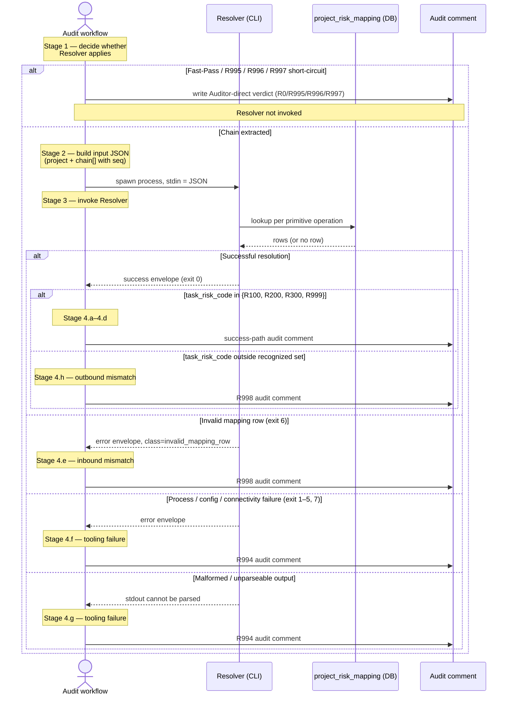

# Resolver — Audit Workflow Integration

## Introduction

This spec defines how the audit workflow invokes Resolver and how Resolver's output is recorded in the audit comment. The caller is "the audit workflow" — Heimdall is v1's instance, but the contract here makes no Heimdall-specific assumptions and admits any future caller that satisfies the audit-workflow role per `SECURITY.md §Resolver`. Resolver's CLI surface and algorithm are governed by `spec_resolver.md`; its data and interface contracts (input + output envelopes, exit codes, error classes) are governed by `spec_resolver-contracts.md`. This spec is the bridge between those two surfaces and the audit-record requirements of `SECURITY.md §Risk Codes`.

## Purpose

`SECURITY.md §Resolver` mandates that Auditor "use Resolver in the following way": extract the chain, submit it with the active Project, receive per-primitive-operation Risk Codes plus a Task Risk Code, fall through to `R999` on no valid mapping path, to `R998` on a vocabulary mismatch at the Resolver boundary (in either direction), or to `R994` on a Resolver tooling failure, and record Resolver output in the audit record before emitting the audit outcome. This spec turns those policy requirements into a concrete, caller-neutral invocation contract — when the audit workflow must invoke Resolver, what it must hand over, what it must read back, and what fields it must record in the audit comment per the Risk Code branches in `SECURITY.md §Risk Codes`.

The boundary is restated and held throughout this spec: **Resolver determines the Risk Code; the audit workflow determines the audit outcome.** The mapping table, the chain-aggregation rule, and the partial-overlay resolution rule live in Resolver. The translation from a Risk Code to `Approved` / `Govern` / `Revise`, plus the per-code recording requirements, live in the audit workflow per `SECURITY.md §Risk Codes`. The audit workflow also owns the **recognized Risk Code set** for outbound-side vocabulary-mismatch detection (see Stage 4.h).

## Scope

### In scope

- When the audit workflow must invoke Resolver, when it must not.
- The CLI invocation contract: command, stdin JSON document, stdout JSON parsing.
- How Resolver's success envelope maps into the audit comment for `R100`, `R200`, `R300`, `R999`.
- How Resolver's error envelope and process failures map into the audit comment for the `R994` (Resolver tooling failure) and `R998` (inbound vocabulary mismatch) cases.
- Outbound-side vocabulary mismatch detection by the audit workflow and the `R998` audit comment that results.
- Failure handling: Resolver process failures (non-zero exit), DB failures surfaced through Resolver, malformed Resolver output.
- Caller-neutral surface: any caller filling the audit-workflow role must satisfy this contract.

### Out of scope

- Resolver's algorithm, CLI behavior, error model — `spec_resolver.md`.
- DB schema, JSON envelope field shapes, exit-code-to-error-class table — `spec_resolver-contracts.md`.
- Heimdall's tool surface (`~/.openclaw/agents/heimdall/TOOLS.md`) — Execution-stage updates this. The contract here is what Heimdall's surface must satisfy, not how it's coded.
- The audit-comment format on `R0`, `R993`, `R995`, `R996`, `R997` — these are Auditor-direct codes; Resolver is never invoked for them and they fall outside this spec's bridge.

## Authority Boundary

The integration surface enforces a single boundary that holds across all callers and releases:

- **Resolver determines the Risk Code.** Given a normalized operation chain and an active Project, Resolver returns the per-primitive-operation Risk Codes and the aggregate Task Risk Code from `{R100, R200, R300, R999}`. The mapping table, the partial-overlay resolution rule, and the aggregation rule are Resolver's authority.
- **The audit workflow determines the audit outcome.** Translation from a Risk Code to `Approved` / `Govern` / `Revise` lives in `SECURITY.md §Risk Codes` and is the audit workflow's responsibility. The audit comment is the audit workflow's artifact.
- **The audit workflow holds the recognized Risk Code set** — the codes it knows how to handle per `SECURITY.md §Risk Codes`. When Resolver returns a `task_risk_code` outside this set, the audit workflow detects the outbound vocabulary mismatch and emits `R998` per Stage 4.h.

The audit workflow must not branch on Resolver's internal state, mapping data, or implementation. The audit workflow must not assign `R100`, `R200`, `R300`, or `R999` directly — those are Resolver's emit set. The audit workflow is the sole emitter of `R0` and `R993`–`R998` per `SECURITY.md §Resolver`.

## Procedure

The integration procedure runs once per audit that reaches primitive extraction. It is a four-stage sequence.

### Stage 1 — Decide whether Resolver applies

**Objective**
- gate Resolver invocation behind the policy requirement that Resolver applies only when primitive extraction has produced a chain.

**Rules**
- If `SECURITY.md §Principal Fast-Pass` applies, the audit workflow emits `R0` and `Approved` directly. Resolver is not invoked.
- If `SECURITY.md §Audit Entry Validation` fails (mandatory Task core missing), the audit workflow emits `R996` and `Revise` directly. Resolver is not invoked.
- If `SECURITY.md §Dependency Declaration Check` fails, the audit workflow emits `R995` and `Revise` directly. Resolver is not invoked.
- If primitive extraction produces a blocked or incomplete chain per `SECURITY.md §Extraction`, the audit workflow emits `R997` and `Revise` directly. Resolver is not invoked.
- Otherwise — a complete operation chain was extracted — the audit workflow must invoke Resolver and must not assign a Resolver-emit Risk Code directly.

**Writes / Side Effects**
- audit comment carrying the Auditor-direct code (`R0` / `R995` / `R996` / `R997`) when Resolver is skipped; per-code recording requirements per `SECURITY.md §Risk Codes`.
- no Resolver invocation when skipped.

### Stage 2 — Build the Resolver input

**Objective**
- assemble the JSON input document Resolver expects on stdin.

**Rules**
- `project` is the active Project's canonical key (per the **Key** field of `charter.md §Mission`), not a path or repo full-name. For Vork, the key is `vork`.
- `chain` is the operation chain produced by primitive extraction. Each primitive operation carries `action`, `subject`, and `zone` as lowercase strings from `SECURITY.md §Classification`, plus a 1-indexed `seq` assigned by the audit workflow in extraction order. `seq` values are unique and contiguous across the chain.
- The input document conforms to `spec_resolver-contracts.md §Wire Contracts § Input envelope`. Field names match exactly; case is preserved exactly.
- The audit workflow does not synthesize, infer, or substitute primitive-operation component values; if extraction did not produce a complete primitive operation, the audit workflow returns to Stage 1 and emits `R997` instead.

**Writes / Side Effects**
- one JSON document, ready for stdin; nothing else.

### Stage 3 — Invoke Resolver

**Objective**
- run the Resolver CLI, capture stdout, and read the process exit code.

**Rules**
- Invoke the CLI at the stable path `~/.local/bin/resolver` (or via the configured equivalent on the caller's host).
- Pipe the Stage 2 JSON document to stdin. Capture stdout in full.
- After the process exits, branch on the exit code per `spec_resolver-contracts.md §Wire Contracts § Exit-Code-to-Error-Class mapping`:
  - `0` — successful resolution. Parse stdout as the success envelope. Proceed to Stage 4.
  - non-zero — failed resolution. Parse stdout as the error envelope. Proceed to Stage 4's error branches.
- If the process produces no parsable JSON on stdout (irrespective of exit code), treat the invocation as a malformed-output failure and follow Stage 4.g (`R994`).
- The audit workflow does not retry Resolver. A single non-zero exit is a Resolver failure and goes through the error path. The audit workflow does not interpret transient failures (e.g. DB connect) differently from terminal ones at v1 — every non-zero exit is surfaced to the audit comment per Stage 4.

**Writes / Side Effects**
- one Resolver process spawned; stdout parsed; exit code captured.
- no audit-comment writes at this stage.

### Stage 4 — Record outcome in the audit comment

**Objective**
- map Resolver's output to the audit-comment fields required by `SECURITY.md §Risk Codes` and emit the audit transition.

**Rules**

The mapping from Resolver output to audit comment is fully determined by the exit code and the parsed envelope. Branches 4.a through 4.d cover the success-path outcomes; 4.e through 4.h cover the failure paths.

All audit comments render the per-primitive-operation chain (whether echoed from Resolver's success envelope or pulled verbatim from the Stage 2 input) in `seq` order so the operation chain reads top-to-bottom in extraction order.

#### 4.a — Success envelope, `task_risk_code = R100`

Audit workflow emits `Gated → Approved` with `R100` per `SECURITY.md §R100`. Audit comment carries:

- the Risk Code (`R100`)
- the exact operation chain rendered in `seq` order (verbatim from the input — `chain[].seq`, `chain[].action`, `chain[].subject`, `chain[].zone`)

The `resolution_context` field and the per-primitive-operation `risk_code` values are not required by `§R100` and may be omitted from the comment under the lean-by-default principle.

#### 4.b — Success envelope, `task_risk_code = R200`

Audit workflow emits `Gated → Approved` with `R200` per `SECURITY.md §R200`. Audit comment carries:

- the Risk Code (`R200`)
- the exact operation chain in `seq` order
- the per-primitive-operation Risk Code for each operation (from `chain[].risk_code`)
- short reasoning explaining how the operation chain was determined (Auditor-authored; not Resolver output)

#### 4.c — Success envelope, `task_risk_code = R300`

Audit workflow emits `Gated → Govern` with `R300` per `SECURITY.md §R300`. Audit comment carries:

- the Risk Code (`R300`)
- the exact operation chain in `seq` order
- the per-primitive-operation Risk Code for each operation
- short reasoning explaining how the operation chain was determined
- the required human intervention or authority boundary (Auditor-authored; not Resolver output)

#### 4.d — Success envelope, `task_risk_code = R999`

Audit workflow emits `Gated → Govern` with `R999` per `SECURITY.md §R999`. Audit comment carries:

- the Risk Code (`R999`)
- the exact operation chain in `seq` order
- the unmappable operation, mapping failure, or policy insufficiency identified by the Resolver output (which operation(s) returned `R999`; whether any primitive resolved from a `project:<name>` overlay or the chain resolved purely `wildcard` — pulled from the success envelope's `resolution_context` and per-primitive-operation `chain[].risk_code` values)

`R999` may arise from either of two concrete situations, both carried by the success envelope:
- one or more primitive operations have no row in either mapping partition
- an operation matched a designated-`R999` cell (the cell exists in the mapping set with `risk_code = R999`, in either partition)

The audit comment identifies which of these applied by citing the per-primitive-operation `risk_code` values and the `resolution_context` directly.

#### 4.e — Error envelope, `error.class = invalid_mapping_row` (Resolver exit code 6)

The active mapping set contained a row with an unsupported `risk_code` — an **inbound vocabulary mismatch** caught by Resolver per `SECURITY.md §R998`. The audit workflow emits `Gated → Govern` with `R998`. Audit comment carries:

- the Risk Code (`R998`)
- the exact operation chain submitted to Resolver (from the Stage 2 input) rendered in `seq` order
- the unsupported `risk_code` value and the offending mapping row identity (from `error.detail`) — flagged as **inbound** (Resolver caught the mapping data drift)
- a one-line statement of the contract divergence between the mapping table and Resolver's supported Risk Codes (Auditor-authored, citing `SECURITY.md §Resolver`)

#### 4.f — Error envelope, Resolver process / config / connectivity failure (Resolver exit codes 1–5, 7)

These cover Resolver-side **tooling failures** that prevented a resolution from being computed at all — input parse / input validation / config / DB connect / DB query / internal exception. None of these reflect a mapping-data outcome; Resolver itself failed to produce a usable result. The audit workflow emits `Gated → Govern` with `R994` per `SECURITY.md §R994`. Audit comment carries:

- the Risk Code (`R994`)
- the exact operation chain submitted to Resolver (from the Stage 2 input) rendered in `seq` order
- the Resolver error class and message (from `error.class` and `error.message`)
- the operator-action note identifying the recovery path implied by the error class — fix Resolver binary or deployment, fix Resolver env config, restore DB connectivity, patch Resolver code, etc. The audit workflow does not retry; recovery is operator-driven through the Govern lane.

`R994` is distinct from `R999`: `R999` is a *mapping-side* outcome (no valid mapping path; signal to grow the wildcard set); `R994` is a *tooling-side* outcome (Resolver cannot produce a result; signal to restore Resolver functionality). Keeping them separate preserves the operational signal.

#### 4.g — Malformed Resolver output (no parsable JSON on stdout)

Resolver did not honor its output contract — stdout could not be parsed as either the success or error envelope. This is a **tooling failure** (Resolver malfunctioned), not a contract mismatch on the mapping data. The audit workflow emits `Gated → Govern` with `R994` per `SECURITY.md §R994`. Audit comment carries:

- the Risk Code (`R994`)
- the exact operation chain submitted to Resolver rendered in `seq` order
- a one-line statement that Resolver's output did not parse, with the captured stdout snippet (truncated) for diagnostic reference
- the operator-action note: Resolver's output path is broken; inspect Resolver code and restore the JSON envelope contract.

#### 4.h — Success envelope with unrecognized `task_risk_code` (outbound vocabulary mismatch)

Resolver exited `0` and returned a parseable success envelope, but the `task_risk_code` value is outside the audit workflow's recognized Risk Code set per `SECURITY.md §Risk Codes`. This is an **outbound vocabulary mismatch** — Resolver's emit set has drifted ahead of (or apart from) the audit workflow's recognized set, typically because a future Resolver release expanded its emit codes without a corresponding `SECURITY.md` and audit-workflow update. The audit workflow emits `Gated → Govern` with `R998` per `SECURITY.md §R998`. Audit comment carries:

- the Risk Code (`R998`)
- the exact operation chain submitted to Resolver rendered in `seq` order
- the unrecognized `task_risk_code` value Resolver returned, plus any per-primitive-operation `risk_code` values that are similarly unrecognized — flagged as **outbound** (audit workflow caught the Resolver-output drift)
- a one-line statement that Resolver's emit set has drifted from the audit workflow's recognized set; the contract divergence to be reconciled is between Resolver's constants and `SECURITY.md §Risk Codes` plus the audit workflow's recognized-code set (Auditor-authored).

The audit workflow recognizes the same `task_risk_code` value set Resolver may emit per `SECURITY.md §Resolver` — currently `{R100, R200, R300, R999}`. Any other value at Stage 4 lookup hits this branch.

**Writes / Side Effects**
- one audit comment per the appropriate `§Risk Codes` branch (4.a–4.h).
- the `Gated → Approved` / `Gated → Govern` transition per `TASK.md §Audit`.

## Invariants

- Resolver is invoked at most once per audit run that reaches primitive extraction. The audit workflow does not retry Resolver on a single audit.
- Resolver is not invoked for `R0` (Principal Fast-Pass), `R995` (dependency declaration), `R996` (Audit Entry Validation), or `R997` (extraction blocked). These remain Auditor-direct.
- The audit workflow never assigns `R100`, `R200`, `R300`, or `R999` from its own logic — those values come only from Resolver's success envelope.
- The audit workflow is the sole emitter of `R994` (Stage 4.f, 4.g — Resolver tooling failure) and of `R998` in both directions (Stage 4.e — inbound vocabulary mismatch detected by Resolver; Stage 4.h — outbound vocabulary mismatch detected by the audit workflow).
- The audit workflow never modifies Resolver's per-primitive-operation `risk_code` or `task_risk_code` values. The audit comment records them verbatim from the success envelope.
- The audit workflow carries the input chain verbatim into the audit comment per `SECURITY.md §Risk Codes`. No primitive operation is dropped, renamed, or reordered between extraction and the audit-comment record; rendering preserves `seq` order.
- The audit workflow does not pass any field to Resolver beyond `project` and `chain` (with `seq` on each chain entry). It does not pass caller identity, runtime state, or upstream task fields.
- The audit workflow does not read the `project_risk_mapping` table directly. The table is Resolver's authority surface; the audit workflow consumes only the Resolver output envelope.

## Failure / Recovery

| Failure mode | Audit workflow response |
|---|---|
| Resolver process spawn fails (binary not on path) | Stage 4.f: `R994`. Operator fixes the symlink or deployment and re-audits. |
| Resolver exit 1 / 2 (input parse / input validation) | Stage 4.f: `R994` with the Resolver error class. Operator fixes the audit-workflow's input-construction bug (this is a contract violation on the audit-workflow side, surfaced through the Resolver-tooling-failure lane). |
| Resolver exit 3 (config) | Stage 4.f: `R994`. Operator fixes Resolver's env config (typically missing `RESOLVER_DATABASE_PASSWORD_PATH` or unreadable password file). |
| Resolver exit 4 / 5 (DB connect / query) | Stage 4.f: `R994`. Operator restores Postgres availability and re-audits. |
| Resolver exit 6 (invalid mapping row) | Stage 4.e: `R998` (inbound vocabulary mismatch). Operator corrects the offending row's `risk_code`; re-audit. |
| Resolver exit 7 (internal exception) | Stage 4.f: `R994`. Operator inspects Resolver logs / stderr (Resolver's own diagnostic surface, not this spec's), patches, re-audits. |
| Malformed JSON on stdout regardless of exit code | Stage 4.g: `R994`. Operator inspects Resolver and patches the output path. |
| Resolver returns a Risk Code in `success_envelope.task_risk_code` outside the audit workflow's recognized set | Stage 4.h: `R998` (outbound vocabulary mismatch). Operator reconciles Resolver's constants with `SECURITY.md §Risk Codes` and the audit workflow's recognized-code set. |

The audit workflow does not pause, retry, or escalate. Every Resolver failure converts to one audit-comment outcome (`R994` or `R998`) and the audit transition fires. Recovery is operator-driven, surfacing through the Govern lane.

## Observability

The audit comment is the authoritative trace of the integration: Resolver invocation, per-primitive-operation Risk Codes (rendered in `seq` order), aggregate Task Risk Code, error class on failure, and the audit outcome are all written into the comment per `SECURITY.md §Risk Codes` and the per-branch rules above.

Resolver's own observability surface (its stdout JSON envelope and exit code) is consumed by the audit workflow and reflected into the audit comment. No additional log emission is required from the audit workflow for v1 — the audit-comment chain on the Task issue is the durable record.

## Deliverables

This spec governs the audit-integration contract for any audit workflow that invokes Resolver. The artifacts produced under this spec's authority are caller-side:

- **The audit-workflow runtime** must satisfy this contract whenever it invokes Resolver. For v1 the runtime is Heimdall's audit loop; the Execution-stage Heimdall update (changes to `~/.openclaw/agents/heimdall/TOOLS.md` and Heimdall's audit-comment templates) implements this contract.
- **The sample test issues** exercise each Stage-4 outcome end-to-end: one each for `R100`, `R200`, `R300`, `R999` on a designated-`R999` cell, `R999` on a cell unmapped in both partitions, and `R994` (Stage 4.f branch — simulated Resolver tooling failure, e.g. binary removed or DB unreachable).

The implementation of Heimdall's tool surface and the sample issues are Execution-stage artifacts, not Resolver-app artifacts. This spec defines the contract they must satisfy.

## Verification

The integration is judged satisfied when:

- Every audit comment recorded by the audit workflow on an audit that reached primitive extraction carries a `task_risk_code` and a per-primitive-operation `chain` (rendered in `seq` order) matching the corresponding Resolver invocation's success envelope (or carries `R994` / `R998` per the error branches when Resolver failed).
- No audit comment recorded after the integration ships self-assigns `R100`, `R200`, `R300`, or `R999` outside Resolver's success envelope.
- The sample test issues each end-to-end exercise their respective Stage-4 branch and produce the corresponding audit comment in `<owner>/vork`, including the `R994` Resolver-tooling-failure path.
- A test issue whose extraction surfaces a missing dependency, missing Task core, blocked extraction, or Principal Fast-Pass-eligible identity still emits `R995` / `R996` / `R997` / `R0` directly without invoking Resolver — the Stage 1 gating holds.
- A simulated `invalid_mapping_row` outcome (a mapping row carrying a deliberately-unsupported `risk_code`) produces an `R998` audit comment per Stage 4.e (inbound vocabulary mismatch).
- A simulated Resolver process failure (binary removed, DB unreachable, malformed stdout) produces an `R994` audit comment per Stage 4.f / 4.g without halting the audit workflow.
- A simulated outbound vocabulary mismatch (a Resolver build that returns a `task_risk_code` outside the audit workflow's recognized set) produces an `R998` audit comment per Stage 4.h.

## References

- `specs/apps/resolver/prd_resolver.md` — product requirements; caller-neutral surface + Risk-Code-emit-boundary requirements that this spec implements at the integration layer.
- `specs/apps/resolver/spec_resolver.md` — Resolver architecture; the CLI surface and process model Stage 3 invokes.
- `specs/apps/resolver/spec_resolver-contracts.md` — Resolver wire contracts; the JSON envelopes Stage 2 builds and Stage 3 parses, plus the exit-code-to-error-class mapping Stage 4 branches on.
- `docs/policy/SECURITY.md` — `§Resolver` (the Resolver-emit / Auditor-direct boundary the authority section restates), `§Risk Codes` (the per-code recording requirements Stage 4 implements), `§Extraction` (the precondition for invoking Resolver), `§Principal Fast-Pass` (Stage 1 gate), `§Audit Entry Validation` (Stage 1 gate), `§Dependency Declaration Check` (Stage 1 gate).
- `docs/policy/TASK.md` — `§Audit` (the `Gated → Approved` / `Gated → Revise` / `Gated → Govern` transitions Stage 4 emits).
- `docs/policy/PROJECT.md` — `§Specs` (the section shape this document conforms to).
