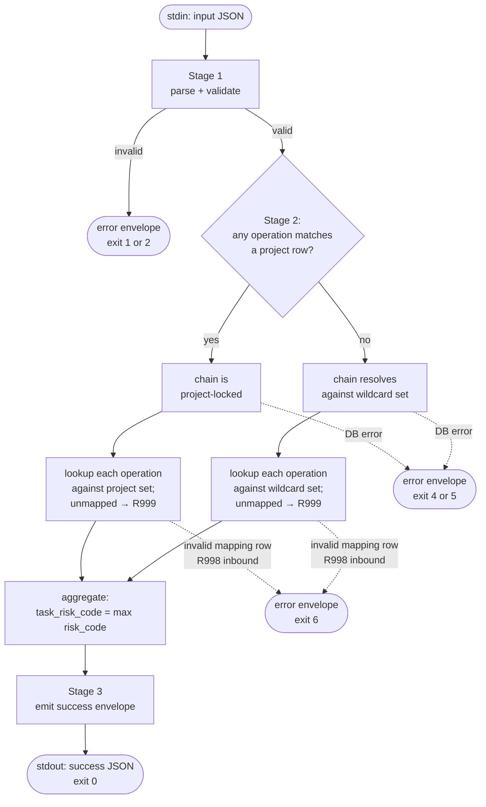

# Resolver — Architecture

## Introduction

Resolver is a CLI utility that takes a normalized operation chain plus a Project name and returns the per-primitive-operation Risk Codes and the aggregate Task Risk Code. It is the deterministic resolution layer between Auditor's primitive extraction (`SECURITY.md §Extraction`) and Auditor's audit-outcome emission (`SECURITY.md §Risk Codes`). This spec defines Resolver's CLI surface, its chain-resolution algorithm, the partial-overlay resolution rule, the aggregation rule, the Risk-Code emit boundary, the error model, and the deployment surface. The DB schema and JSON envelope contracts live in `spec_resolver-contracts.md`; the audit-workflow integration contract lives in `spec_resolver-audit-integration.md`; the operator-facing summary lives in `manual.md`.

## Purpose

`SECURITY.md §Resolver` requires Auditor to determine Risk Codes through Resolver rather than self-assigning them. The architecture must:

- accept a normalized operation chain and a Project context, and return Risk Codes deterministically against the active mapping data
- enforce the partial-overlay resolution rule so each primitive resolves against its project-specific row first, falling back per cell to the wildcard row
- enforce the unmapped-cell behavior (`R999`) so the strictest-concern default holds and `Govern` audits surface the cells the wildcard set should next absorb
- enforce the Risk-Code emit boundary (`R100`, `R200`, `R300`, `R999`) and leave `R0` / `R993`–`R998` for direct Auditor emission
- carry a CLI surface that is stable across releases (the Auditor's tool reference path does not change when releases roll)
- remain caller-neutral — Heimdall is v1's first caller, but Resolver does not branch on caller identity

## Scope

### In scope

- CLI invocation surface (`resolver` binary): JSON-in via stdin, JSON-out via stdout, exit codes per error class.
- Chain resolution algorithm: per-primitive-operation row lookup against `project_risk_mapping`, partial-overlay resolution, aggregation across the chain, unmapped-cell `R999` default.
- Risk-Code emit boundary (`{R100, R200, R300, R999}`).
- Process model and error model.
- Tech stack and binary layout.
- Deployment via `~/.local/bin/resolver` symlink rotating across release worktrees.

### Out of scope

- DB schema for `project_risk_mapping`, JSON envelope field shapes, naming rules — `spec_resolver-contracts.md`.
- Audit-workflow caller behavior, audit-comment recording — `spec_resolver-audit-integration.md`.
- Operator-facing summary (DB seeding procedure, symlink rotation steps, CLI invocation examples) — `manual.md`.
- HTTP API surface — CLI-only for v1.
- Weighted chain aggregation — `max` only for v1.
- Mapping-data administration tooling — direct DB writes for v1.

## Definitions

- **Primitive component:** one of `Action`, `Subject`, `Zone` — the three dimensions defined in `SECURITY.md §Classification`.
- **Primitive operation:** one normalized `(Action, Subject, Zone)` triple — three primitive components combined into one unit of operation.
- **Operation chain:** an ordered list of one or more primitive operations extracted from a Task per `SECURITY.md §Extraction`, with each operation carrying a 1-indexed `seq` per `spec_resolver-contracts.md`.
- **Mapping row:** one row in `project_risk_mapping` keyed by `(project, action, subject, zone)`, carrying a `risk_code` from the Resolver-emit set.
- **Wildcard row:** a mapping row with `project IS NULL`. Applies as the default mapping for any primitive the project's partition does not cover.
- **Project-specific row:** a mapping row with `project = <key>`. Overrides the wildcard mapping for its cell when the chain's `project` matches — a partial overlay; other cells keep their wildcard resolution.
- **Active mapping set:** the set of rows Resolver consults during a single chain resolution — the project's partition overlaid on the wildcard partition, with the project row winning per cell.
- **Risk Code:** one of the supported `SECURITY.md §Risk Codes`. Resolver-emit set is `{R100, R200, R300, R999}`. Auditor-direct set is `{R0, R993, R994, R995, R996, R997, R998}`.
- **Task Risk Code:** the aggregate Risk Code for the whole chain. Computed as `max(risk_code)` across the chain under the order `R100 < R200 < R300 < R999`.

## Interfaces / Shared Contracts

Resolver exposes one interface — a CLI invocation. Process model is one-shot per call: process starts, reads stdin, queries the DB, writes stdout, exits.

```
$ resolver < input.json > output.json
$ echo "$input" | resolver
```

The exact JSON shape of input and output is defined in `spec_resolver-contracts.md`. At architectural granularity, the inputs Resolver must read are:

- the operation chain (one or more primitives, each `Action × Subject × Zone`)
- the project key (the resolution context)

And the outputs Resolver must write are:

- per-primitive-operation `risk_code` values, each carrying the input's `seq` echoed verbatim
- the aggregate `task_risk_code`
- the resolution context — which mapping set (`wildcard` or `project:<name>`) the chain resolved against — so the audit record can capture it verbatim

Resolver does not accept any other inputs (no caller identity, no runtime state, no upstream task fields). The audit-workflow caller hands Resolver the chain it extracted; nothing else.

Exit codes:

- `0` — Resolver completed; output JSON is valid; the `task_risk_code` is the resolved value (which may be `R999` — that is still a successful resolution).
- non-zero — Resolver did not complete; output JSON carries an `error` object describing the failure class. The specific code-to-class mapping lives in `spec_resolver-contracts.md`; at architectural level the contract is: zero-on-resolved, non-zero-on-failed-to-resolve.

## Inputs

### Configuration (env)

- `RESOLVER_DATABASE_*` — DB connection parameters for the project Postgres instance (`specs/data/spec_database.md`) (`HOST`, `PORT`, `USER`, `NAME`, `PASSWORD_PATH`). Defaults match Wakery's `WAKERY_DATABASE_*` env shape — see `specs/data/spec_config.md §Environment contracts` for the exact env-var names.

Resolver loads config at process start and connects to the DB once per invocation. No connection pool is retained between calls.

### Per-invocation

- one JSON document on stdin carrying the chain + Project name.

## Procedure

Three stages run in sequence per invocation: parse the input, resolve the chain against the active mapping set, emit the output.



### Stage 1 — Parse input

**Objective**

- read the chain + Project name from stdin and validate them against the JSON envelope before any DB work.

**Rules**

- Read the entire stdin stream and parse as JSON.
- Validate the document has the required fields and that each primitive operation in the chain has a valid `Action`, `Subject`, and `Zone` component value per `SECURITY.md §Classification` vocabulary, plus a unique 1-indexed `seq` forming a contiguous range across the chain.
- If parsing or validation fails, emit a JSON error envelope on stdout and exit with the configured non-zero code. No DB connection is opened.

**Writes / side effects**

- stdout (error JSON) on validation failure; nothing on success at this stage.

### Stage 2 — Resolve chain

**Objective**

- resolve each primitive in the chain against the active mapping set and compute the aggregate Task Risk Code.

**Rules**

The resolution rule and the aggregation rule:

**Partial-overlay resolution rule** — each primitive resolves independently: a project-specific row (`project = <name>`) for its cell wins; a cell without a project row falls back to its wildcard row; a cell mapped in **neither** partition resolves to `R999`. Strictest-concern is preserved — "unknown is strictest" — and the resulting `Govern` audits surface which cells the wildcard set should next absorb. A project overlay can therefore carry only its deltas (loosening *or* tightening individual cells, including designating a cell `R999`) without mirroring the whole wildcard set.

**Aggregation rule** — `task_risk_code = max(risk_code)` across the chain. Order: `R100 < R200 < R300 < R999`. Weighted aggregation is deferred.

Implementation guidance:

- Look up each primitive operation against the project's partition first (`project = <chain.project> AND action = ? AND subject = ? AND zone = ?`); on a miss, look up the wildcard partition (`project IS NULL`) for the same cell.
- A primitive with no row in either partition returns `R999`.
- Compute `task_risk_code = max(...)` across the per-primitive-operation `risk_code` values using the order above. The aggregation is order-independent; the `seq` field is not consumed at this stage but is preserved into the output envelope verbatim.

The DB query strategy (single query per primitive operation vs. batched lookup, prepared statement reuse, transaction boundaries) is an implementation detail — the algorithm above defines the semantics; the implementation must preserve them.

**Writes / side effects**

- DB reads only (no writes from Resolver itself).

### Stage 3 — Emit output

**Objective**

- write the resolution result to stdout in the documented JSON envelope and exit `0`.

**Rules**

- Write the output JSON envelope: per-primitive-operation `risk_code` values (each echoing the input's `seq`), `task_risk_code`, and the resolution context (`wildcard` or `project:<name>`).
- Close DB connection.
- Exit `0`.

**Writes / side effects**

- stdout (resolved JSON envelope); process exit.

## Invariants

- Resolver returns one of `{R100, R200, R300, R999}` for `task_risk_code` and for every per-primitive-operation `risk_code`. It never returns `R0` or any of `R993`–`R998`.
- Resolver never emits an audit verdict, never opens a GitHub session, and never mutates DB state — it only reads `project_risk_mapping`.
- Resolution is per-cell: each primitive resolves from its project row when one exists, else its wildcard row, else `R999` — a chain may mix project-resolved and wildcard-resolved primitives.
- An unmapped primitive in the active set resolves to `R999`. This is by design — the strictest-concern default is the growth-path signal.
- Given the same input JSON and the same mapping data, Resolver returns the same output. Resolution is deterministic.
- Resolver does not branch on caller identity, runtime state, or upstream task fields. The chain on stdin is the only behavioral input.
- The CLI invocation path (`~/.local/bin/resolver`) is stable across releases; the symlink redirects to the active deployment worktree binary.

## Failure / Recovery

| Failure | Behavior |
|---|---|
| Stdin parse failure (malformed JSON) | Emit error JSON; non-zero exit. No DB connection opened. |
| Input validation failure (missing field, invalid `Action`/`Subject`/`Zone` value, empty chain) | Emit error JSON identifying the validation gap; non-zero exit. |
| DB connection failure | Emit error JSON identifying the connection class; non-zero exit. |
| DB query failure mid-resolution | Emit error JSON identifying the query class; non-zero exit. Connection closed. |
| Resolved `task_risk_code = R999` | Successful resolution. Exit `0`. The caller (Auditor) sees the `R999` and emits `Govern` per `SECURITY.md §R999`. |
| Unsupported Risk Code stored in a mapping row (inbound vocabulary mismatch) | Emit error JSON identifying the offending row and Risk Code; non-zero exit (code `6`). The Auditor's response to this class is documented in `SECURITY.md §R998`. |
| Process / config / connectivity failure (Resolver could not produce a result) | Emit error JSON identifying the failure class; non-zero exit (codes `1`–`5`, `7`). The Auditor's response to this class is documented in `SECURITY.md §R994`. |

Resolver does not retry. Transient failures are surfaced to the caller; recovery (retry, escalation, manual mapping-data correction) is the caller's responsibility per the audit-integration contract.

## Observability

Resolver emits no structured events to the JSONL event log in v1. Its observability surface is its stdout JSON envelope (carried verbatim into the audit record per `SECURITY.md §Risk Codes` and `spec_resolver-audit-integration.md`) and its exit code.

`R999` outcomes are themselves the operational signal that the wildcard set should next absorb the cell — operators grep the audit record for `R999` resolutions and decide whether to add the cell to the wildcard or project-specific mapping. No additional event stream is required for this; the audit record is the durable trace.

## Deliverables

This spec governs the architecture and CLI behavior of `main/apps/resolver/`. The artifacts produced under this spec's authority:

- `main/apps/resolver/` — TypeScript source. Tech stack: Node 22 + tsx, no build step (mirrors Wakery). Single CLI entrypoint at `main/apps/resolver/bin/resolver`.
- `main/apps/resolver/test/` — unit tests for the chain resolution algorithm (partial-overlay rule across its three branches (project row, wildcard fallback, unmapped), aggregation rule across all four codes, malformed-input handling) and integration tests against a seeded `project_risk_mapping` table.
- The stable symlink convention: `~/.local/bin/resolver` → `products/deployments/v<YYYY.MM.DD>/apps/resolver/bin/resolver`. Symlink rotation is operator-driven per `manual.md`.

The `project_risk_mapping` DB migration and seed data are governed by `spec_resolver-contracts.md` and the seed-data PR respectively, not by this spec.

## Verification

The architecture is judged satisfied when:

- A chain submitted with at least one primitive matching a project-specific row resolves that cell from the project overlay, and sibling primitives without a project row fall back to their wildcard rows.
- A chain with no primitive matching any project-specific row resolves against the wildcard set.
- A primitive with no row in the active mapping set returns `R999`.
- `task_risk_code` equals `max(...)` across the per-primitive-operation Risk Codes under the order `R100 < R200 < R300 < R999`.
- Every Resolver invocation that completes returns one of `{R100, R200, R300, R999}` for `task_risk_code` — never an Auditor-direct code.
- Malformed input, missing input field, invalid `Action`/`Subject`/`Zone` value, and DB failure each produce a documented error JSON and a non-zero exit code.
- `~/.local/bin/resolver` resolves to the binary inside the active release worktree on the operator's host.
- The Wakery v1 + v2 test suite continues to pass after the additive `project_risk_mapping` migration governed by the contracts spec.

## References

- `docs/research/research_20260527_resolver-survey/research.md` — the practical wildcard primitive set the Stage 2 algorithm consults; not a code-pinned set in Resolver — it lives in DB rows seeded from this record.
- `specs/apps/resolver/prd_resolver.md` — product requirements; this architecture spec satisfies the PRD's caller-neutral surface and Risk-Code-boundary requirements.
- `specs/apps/resolver/spec_resolver-contracts.md` — DB schema for `project_risk_mapping`, JSON envelope shapes (including the `seq` field on chain entries), env-var names, exit-code-to-error-class mapping.
- `specs/apps/resolver/spec_resolver-audit-integration.md` — audit-workflow caller behavior, audit-comment output shape, including `R994` / `R998` handling for Resolver-tooling and vocabulary-mismatch failures.
- `specs/apps/resolver/manual.md` — operator-facing summary covering DB seeding, symlink rotation, and invocation examples.
- `docs/policy/SECURITY.md` — `§Classification` (Action/Subject/Zone vocabulary), `§Extraction` (chain extraction rules), `§Resolver` (the Resolver-emit / Auditor-direct authority boundary), `§Risk Codes` (the supported set and Auditor's response per code).
- `docs/policy/PROJECT.md` — `§Specs` (the section shape this document conforms to), `§Release`.
- `specs/apps/wakery/spec_wakery.md` — adjacent app spec; the section-shape reference for this document.
