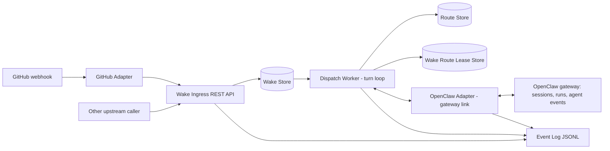
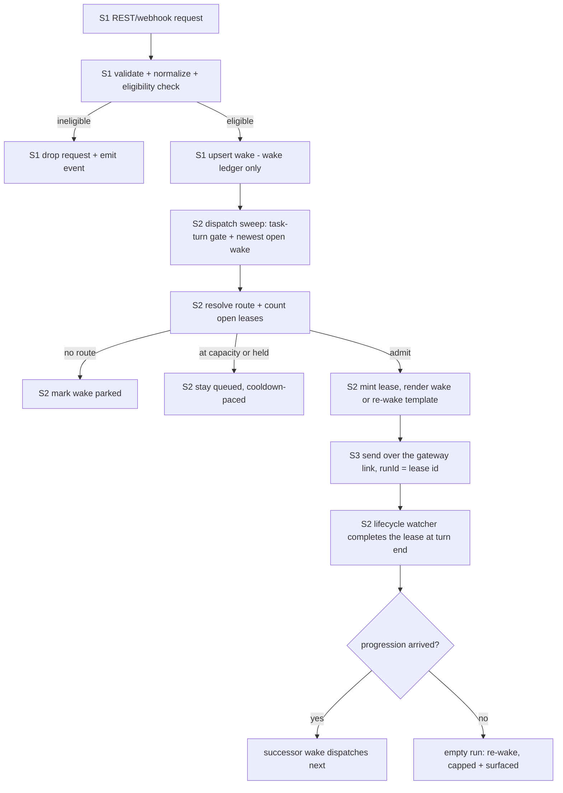

# Wakery Spec Set

## Purpose

This spec set defines the Wakery as a three-stage service system:
1. a REST/webhook ingress surface that accepts wake requests and either drops or stores them as local `wake` records — the **wake ledger**, written from GitHub
2. an async dispatch worker that owns the **turn loop**: task-turn-gate selection, lease creation (the **turn ledger**), the persistent gateway link with its lifecycle watcher and reconcile, and empty-run recovery
3. an OpenClaw adapter implementing the gateway link's transport: the persistent operator connection carrying sends, `agent.wait`, and the event stream

The important boundaries are:
- **web requests end at Stage 1**
- **local `wake` records begin at Stage 1 and are owned by storage from that point onward**
- **two-ledger rule** (`spec_wakery-queue-and-leases.md`): wakes are written by ingress from GitHub webhooks; leases are written by the dispatch worker from gateway signals; neither ledger's events complete the other's rows

## Why This Exists

The router should be a routing facility, not a shadow task system. It should accept upstream task-change input, normalize it into a local wake abstraction, queue only eligible work, and route that work toward the correct downstream assignee.

## Visual Map

### End-to-end architecture

### Stage separation

## How to Read This Set

### If you are implementing tomorrow
1. `prd_wakery.md`
2. `spec_wakery.md`
3. `spec_wakery-contracts.md`
4. `spec_wakery-ingress-api.md`
5. `spec_wakery-queue-and-leases.md`
6. `spec_wakery-dispatch-worker.md`
7. `spec_wakery-task-relations.md`
8. `spec_wakery-openclaw-adapter.md`
9. `specs/data/spec_event.md`
10. `spec_wakery-github-adapter.md`
11. `spec_wakery-conduction-chaining.md`
12. `spec_wakery-snooze.md`
13. `spec_wakery-rewake-message.md`
14. `implementation-prerequisites.md`
15. `implementation-task-breakdown.md`
16. `manual.md`

## Spec Inventory

- `prd_wakery.md`
  - Why the utility exists and what it must not become.
- `spec_wakery.md`
  - Top-level architecture and strict stage boundaries.
- `spec_wakery-contracts.md`
  - Router ingress envelope contracts (`WakeRequest`/`WakeResponse`); durable entities live in `specs/data/spec_database.md`.
- `spec_wakery-ingress-api.md`
  - REST/webhook ingress service and request-to-wake normalization flow.
- `spec_wakery-queue-and-leases.md`
  - Wake storage, wake lifecycle, and wake-route lease handling.
- `spec_wakery-dispatch-worker.md`
  - The turn machine: task-turn-gate selection, one-lease-one-turn-one-send dispatch, the gateway link (lifecycle watcher + `agent.wait` reconcile), and empty-run recovery with the re-wake path.
- `spec_wakery-task-relations.md`
  - Defines the `wake.task_relations` JSON column (parent reference, children completion summary, blocked-by dependency summary, blocking dependency summary) and the two dispatch-time gates that use it: the **Parent gate** and the **Blocked gate**. Implements the routing-side enforcement of `docs/policy/TASK.md §Parent Task → Completion gate` and `§Dependency Tasks → Resolution gate`.
- `spec_wakery-openclaw-adapter.md`
  - The gateway link: persistent operator connection, runId contract, policy-free event intake, `agent.wait`.
- `implementation-env-contract.md`
  - Locked implementation-start environment contract, including the dedicated Wakery Gateway device direction.
- `spec_wakery-github-adapter.md`
  - GitHub webhook adapter for v1.
- `spec_wakery-task-type-registry.md`
  - Dynamic task-type registry: the `task_type_label` DB table as runtime authority for Stage-6 validation, the management surface, and drop observability (WS-B / #54).
- `spec_wakery-conduction-chaining.md`
  - Chain cues: terminal transitions (`Completed`/`Cancelled`) become owner-lane wakes cueing Sarge per `DELIVERY.md §Chaining`; the `wake.task_branch` binding and its conduction conventions (framework-autonomy scope #14).
- `spec_wakery-wake-message.md`
  - Content contract for the primary dispatch message and its placeholder source map.
- `spec_wakery-rewake-message.md`
  - Content contract for the empty-run re-wake turn message.
- `spec_wakery-govern-notice-message.md`
  - Content contract for the Govern checkpoint-notice turn.
- `spec_wakery-cap-alert-message.md`
  - Content contract for the cap-alert final-wake turn.
- `spec_wakery-stall-notice-message.md`
  - Content contract for the stall-alarm confession turn.
- `spec_wakery-template-renderer.md`
  - The renderer module behind all dispatch templates: artifact schemas, hot-reload, placeholder derivation.
- `spec_wakery-board-sweep.md`
  - Board-reconcile sweep + stall alarm: minting wakes for actionable tasks with none, and confessing full stops.
- `implementation-env-contract.md`, `implementation-prerequisites.md`, `implementation-task-breakdown.md`
  - Implementation-era baselines (env surface now owned by `specs/data/spec_config.md`).
- `spec_wakery-snooze.md`
  - The typed delay facility as a module, not a worker: the simplified `snooze` entity (three statuses, one key form), the stateless dispatch-admission hold predicate, PR/CI webhook intake, lazy-expiry timeout, and the event-timing fail-safe matrix.
- `spec_wakery-rewake-message.md`
  - Message template: outcome-blind self-heal re-dispatch of an empty run (turn ended, no progression observed); self-sufficient for fresh run sessions; carries the settled-holds context block (the folded resume message).
- `manual.md`
  - Human/operator usage and integration guide.
- Retired drafts (not carried in this release). Four retired: `spec_wakery-probe-worker.md` (absorbed into the dispatch worker's reconcile), `spec_wakery-probe-message.md` (nudges replaced by the re-wake path), `spec_wakery-dispatch-grace-window.md` (superseded by the task-turn gate), and `spec_wakery-resume-message.md` (folded into the re-wake template's settled-holds context).

## Notes

- Stage 1 owns request handling. Stage 2 and Stage 3 do not reason about web requests.
- The local system abstraction is `wake`, not `request`.
- `request_id` identifies the inbound request, not the local durable wake entity.
- Current MVP dispatch authority is intentionally conservative: allow existing-session dispatch and short-lived one-shot run-session creation, but do not allow creation of persistent long-standing sessions.
