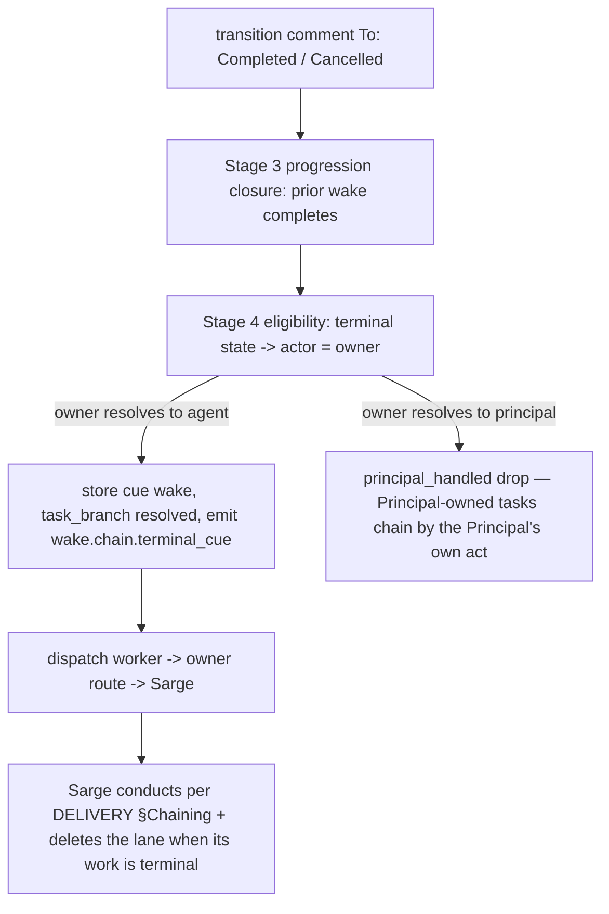
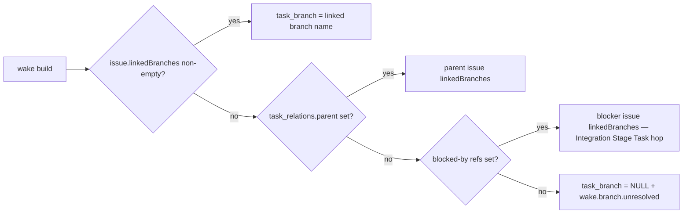

# Wakery Conduction Chaining

## Introduction

This spec defines the chain-cue mechanism: terminal task transitions (`Completed` / `Cancelled`) become owner-lane wakes that cue Sarge to conduct the next stage, and every wake carries the branch its task belongs to (`wake.task_branch`) so downstream mechanisms — the snooze correlation above all — can resolve a git event to its task.

## Purpose

`DELIVERY.md §Chaining` makes a stage's terminal state the signal that obligates Sarge to create what follows — the push mechanism of autonomy. Today wakery drops terminal transitions as ineligible, so no machine signal exists and conduction is chat-driven. This spec turns the terminal transition into that signal, and establishes the branch↔task binding the wider wakery upgrade builds on.

Design decisions encoded here:
- `Completed` **and** `Cancelled` transitions are the universal chain signal; `issues.closed` is the cue's completion signal — the consumer's acknowledgment (`§Acknowledgment`).
- Branch↔task binding is wakery-side (`wake.task_branch`), fed by GitHub's Development linked-branch surface at wake build.
- No PR↔issue links, ever; head-branch auto-delete is off — branch lifetime follows Task lifetime.

## Scope

This spec covers:
- the eligibility change making terminal transitions owner-lane chain cues
- the `wake.task_branch` column and its resolution at wake build
- the conduction conventions the mechanism assumes (born-linked lanes, Integration `Blocked-by`, branch deletion at terminal)
- the chain-cue events and wake-message state blocks

This spec does not cover:
- the snooze entity and holds (`spec_wakery-snooze.md`)
- the `pull_request` / `workflow_run` webhook intake (`spec_wakery-snooze.md`)
- the two-gate eligibility-matrix rework beyond the terminal rows (amendment to `spec_wakery-ingress-api.md` Stage 4)
- route table provisioning mechanics (data op; see `§Deliverables`)

## Definitions

- **chain cue** — a wake stored for an observed terminal transition, routed to the owner lane; its dispatch is Sarge's signal to conduct per `DELIVERY.md §Chaining`.
- **top-level Task** — the single Task of an unsubdivided feature/fix, or the Parent of a subdivided one; the Task a lane is born through.
- **lane** — a working branch per `PROJECT.md §Branching` (`feature/**`, `fix/**`, `hotfix/**`).
- **born-linked lane** — a branch created through its top-level Task via the GraphQL `createLinkedBranch` mutation, so the branch and its Development link to the Task exist as one act.
- **binding** — the branch-name → task association wakery persists on `wake.task_branch`.

## Upstream / Downstream Context

### Upstream
- Stage 1 ingress observes terminal transitions via transition comments (`spec_wakery-ingress-api.md` Stage 3/4).
- Sarge (Task creation) and the GitHub adapter (wake build) feed the binding surfaces this spec reads.

### Downstream
- The owner-lane route delivers chain cues to Sarge (`agent:sarge:<project_key>` once the owner routes repoint at the deploy; `agent:main:<project_key>` until then).
- `spec_wakery-snooze.md` consumes `wake.task_branch` as the hold predicate's branch surface.

## Interfaces / Shared Contracts

- `wake.task_branch TEXT NULL` — new column (`specs/data/spec_database.md §wake`), partial index `wake_task_branch_idx ON wake(task_branch) WHERE task_branch IS NOT NULL`.
- Eligibility matrix terminal rows (`spec_wakery-ingress-api.md` Stage 4) — amended per `§Procedure` Stage 2.
- GraphQL issue query at wake build (`spec_wakery-github-adapter.md`) — gains `linkedBranches(first: 5) { nodes { ref { name } } }`.
- Events `wake.chain.terminal_cue` and `wake.branch.unresolved` (`specs/data/spec_event.md`).
- Wake-message state blocks `owner/Completed/Approved`, `owner/Cancelled/Gated|Revise|Approved|Govern` (`spec_wakery-wake-message.md`).

## Triggers

- A transition comment carrying `To: Completed` or `To: Cancelled` arrives at ingress (observed or hint-confirmed per the existing progression rules).
- Any wake build (the `task_branch` resolution runs for every wake, not only cues).

## Inputs

- normalized wake field set (existing)
- the issue's `linkedBranches` (GraphQL, wake-build query)
- `wake.task_relations` parent reference and blocked-by summary (existing column) for the resolution hops

## State Surfaces / Dependencies

- durable `wake` store (gains `task_branch`)
- `route` store — owner lane rows; chain cues ride the existing `(project, task_type IS NULL, actor=owner, delivery=run)` wildcard
- GitHub Development linked-branch surface (canonical source at wake build; **not** relied on after capture — the persisted `task_branch` survives branch deletion)

## Diagrams

### Chain-cue path

### task_branch resolution at wake build

## Procedure

### Stage 1 — Conduction conventions (Sarge-side, assumed by the mechanism)

**Objective**
- guarantee the binding surfaces exist before wakery ever needs them.

**Rules**
- **Lane birth rides Task birth.** Sarge creates each lane through its top-level Task with `createLinkedBranch` (issue id, branch name per `PROJECT.md §Branching`, `dev` tip oid; `main` tip for `hotfix/**`) at Task creation. This holds for Stage Task lanes as for feature/fix lanes. The mutation cannot link an existing branch (probe-verified); a lane that already exists is left unlinked — the binding still resolves via the hops below or the persisted `task_branch` of earlier wakes.
- **Integration declares Blocked-by.** Every `project_integration` Stage Task is created Blocked-by its lane's top-level Task (`TASK.md §Dependency Tasks`); born-satisfied (the blocker is already terminal), it exists for traceability and the resolution hop.
- **No PR↔issue links.** PR bodies never carry `Closes`/`Fixes`/`Resolves` keywords; plain `#N` mentions are allowed. No links → no GitHub auto-close on any branch.
- **Branch deletion is the Release sweep.** On the milestone's Release Stage Task terminal cue, Sarge deletes every working branch fully merged into `dev` and surfaces — never deletes — any unmerged one to the Principal. Lanes stand through the whole milestone for traceability; head-branch auto-delete stays off (`provisions/github/README.md`). Inception's lane is the one exception: the Principal deletes it on accepting the Charter at Inception close.

**Failure / No-op Behavior**
- A lane created without a link (pre-existing branch, human act) degrades resolution to the hop paths; it does not block wake storage.

### Stage 2 — Terminal transitions become chain cues (ingress eligibility delta)

**Objective**
- store one owner-lane cue wake per observed terminal state instead of dropping it.

**Reads**
- normalized wake fields after Stage 3 progression closure has completed prior wakes (ordering unchanged: closure first, cue second).

**Rules**
- The Stage 4 terminal rows change from "always ineligible" to:

| Lifecycle | Audit | Responsible actor | Notes |
|---|---|---|---|
| Completed | Approved | Owner | chain cue — `Reviewed+Approved → Completed+Approved` is the only arrival (`TASK.md §Transition`) |
| Cancelled | Gated \| Revise \| Approved \| Govern | Owner | chain cue — Cancelled carries its source lane's audit |

- Identity rules are unchanged: the cue stores only when the resolved owner is an agent. A Principal-owned task's terminal transition takes the existing `principal_handled` drop — correct by design: Principal-owned checkpoints chain on the Principal's own direction (`DELIVERY.md §Checkpoints`), not on a cue.
- **The hint-lagged terminal takes the same rules at its own materialization point.** When the terminal transition arrives field-lagged (comment hint `To: Completed` while ProjectV2 still reads the prior state), ingress stores the row `pending` at the pre-terminal observed state — its eligibility and identity checks ran against that state, not the terminal one. The row *becomes* the cue at the field-sync sweep's graduation, so the sweep re-runs the owner identity check there (`spec_wakery-dispatch-worker.md` Stage 0 terminal-graduation gate): principal owner → suppressed to `completed` + `principal_handled` (1009); unmapped owner → suppressed + `dropped_ineligible` (1003); agent owner → graduates and emits `wake.chain.terminal_cue` (1016, `trigger: field_sync`). The invariant is path-independent: **no Principal-owned chain cue ever dispatches**, and every materialized cue pairs with a 1016.
- The cue is a normal wake occurrence (`task_key` + new terminal `state_key`): dedupe, upsert, and progression closure behave per `spec_wakery-queue-and-leases.md` with no special casing. A reopened (`Cancelled → Init`) and re-cancelled task produces a fresh occurrence — a fresh cue — by the existing state-key rules.
- the cue itself rides the owner lane's `delivery=run` route and holds a run lease like any owner wake, completed per `§Acknowledgment`.

### Acknowledgment

The cue is acknowledged delivery. Progression completes every other wake — the next signal on the same task closes the prior one — and a terminal task's final signal is the consumer's close, so the cue's lifecycle is:

- **Open through the chain turn.** The terminal transition leaves the issue open (`TASK.md §Enforcement`); the dispatched cue's wake stays `dispatched` and its lease `active` while Sarge conducts.
- **Completed on the ack.** Sarge closes the predecessor issue as the cue turn's final act, after the chained work is done (`DELIVERY.md §Chaining`). The `issues.closed` webhook completes the cue's wake and lease (event 1018 `kind: chain_ack`), releasing the owner lane. The same handler completes a non-terminal open wake on close (`kind: straggler` — its transition comment was lost), and a pre-dispatch terminal cue survives the close to reach its consumer first.
- **Re-woken until acked.** The dispatch worker's empty-run path re-wakes the un-acked cue — the salvage path for a chain turn that died before its close. The terminal verifier checks the live issue on each empty-run pass: a closed issue completes the cue (event 2018, covering a close event wakery missed and cues closed while pre-dispatch); an open issue re-wakes.
- **Idempotent on re-delivery.** A re-nudged cue turn verifies the successor's existence before creating it and proceeds to the close, so repeated delivery converges on one chained state.

**Writes / Side Effects**
- cue wake row (status `queued`) in the wake store.
- `wake.chain.terminal_cue` record on the JSONL event log — emitted at cue materialization on the same event stream every wakery mechanism writes (`specs/data/spec_event.md`): by ingress at cue storage (`trigger: observed`), or by the field-sync sweep at terminal graduation (`trigger: field_sync`). It is observability, not a dispatch mechanism.

**Failure / No-op Behavior**
- No active owner route → the cue parks (`wake.status = parked`), visible for recovery — a stalled chain is inspectable, never silent.

### Stage 3 — `task_branch` resolution at wake build (GitHub adapter delta)

**Objective**
- persist the branch binding on every wake while the binding surfaces are alive.

**Reads**
- `issue.linkedBranches` (added to the existing wake-build GraphQL query — no extra round trip for the self case)
- `task_relations.parent`, `task_relations` blocked-by refs (existing)

**Rules**
- Resolution order: own `linkedBranches` → parent issue's `linkedBranches` (one extra query, Child Tasks) → first Blocked-by blocker's `linkedBranches` (one extra query, Integration Stage Tasks). First non-empty wins; a multi-entry `linkedBranches` takes the first and emits `wake.branch.unresolved` with reason `ambiguous`.
- Unresolved → `task_branch = NULL` + `wake.branch.unresolved` (warn). Never blocks storage or dispatch.
- Wakes for tasks with no lane by design expect NULL; the warn is suppressed for the laneless task types (`project_operation`, `project_deployment`, `dbops` — no repo lane exists for any of them; `specs/data/spec_event.md` code 1017).

**Writes / Side Effects**
- `wake.task_branch` on the stored row.

### Stage 4 — Cue dispatch and the Sarge contract

**Objective**
- deliver the cue with the conduction instruction; keep wakery decision-free.

**Rules**
- Dispatch is the existing owner-lane path; no new worker behavior.
- The wake message selects the new state blocks; their instruction is exactly `DELIVERY.md §Chaining` + the Stage 1 duties: read milestone state; create the next Stage Task (mechanical), the branch's Integration with its Blocked-by (judgment, top-level completions only — Child cues are read-and-stand-down), or the Deployment Stage Task per the manuals (Directed); on the Release Stage Task's cue, additionally run the branch sweep (Stage 1).
- Wakery never decides what follows a cue — Sarge does. A cue on a Child Task, a mid-milestone fix, or an already-chained stage is a cheap no-op for Sarge, not a wakery filtering concern.

## Invariants

- Every lane exists — linked where the API allows — before its top-level Task's first wake (lane birth rides Task birth).
- At most one chain cue per terminal state occurrence (wake `task_key + state_key` identity).
- Progression closure always precedes cue storage within one ingress pass.
- A wake row's `task_branch` is immutable once stored; deletion of the GitHub branch never nulls it. Each wake resolves at its own build — no retroactive updates across rows.
- Wakery emits cues; it never creates Tasks, never deletes branches, never judges what a cue means.

## Failure / Retry / Idempotency / Recovery

- Duplicate terminal comments → same `state_key` → wake upsert, one cue.
- GraphQL resolution failure at wake build → NULL + warn event. Resolution concerns only the wake being built: each wake resolves at its own build; earlier rows are never retroactively updated.
- Owner route missing/inactive → cue parks; operator or the field-sync sweep path recovers it per existing parked-wake handling.
- Sarge misses/loses a cue after dispatch → the empty-run re-wake path applies as for any dispatched owner wake (`spec_wakery-dispatch-worker.md` Stage 5).

## Observability / Debugging

- `wake.chain.terminal_cue` (info): task_key, task_type, terminal state, task_branch, trigger (`observed` at ingress storage | `field_sync` at hint-lagged graduation) — the chain audit trail.
- `wake.branch.unresolved` (warn): task_key, reason (`no_link` | `ambiguous` | `query_failed`) — binding health.
- Health: every top-level terminal transition on a conducted project pairs with a cue event; a terminal transition without one (and without `principal_handled`) is a defect.
- Debug: `SELECT task_branch, status FROM wake WHERE task_key = :k ORDER BY create_time` shows the binding and cue history of a task.

## Deliverables

- `migrate.ts`: `wake.task_branch` column + partial index.
- `eligibility.ts` + `spec_wakery-ingress-api.md` Stage 4 amendment: terminal rows per Stage 2.
- GitHub adapter: `linkedBranches` in the wake-build query + the two hop queries + resolution order.
- `codes.ts` + `specs/data/spec_event.md`: the two new events (+ laneless-type suppression set).
- `wake-message.json` + `spec_wakery-wake-message.md`: the five owner-terminal state blocks (one `Completed`, four `Cancelled` sharing content).
- Route data op at the #15 deploy: owner-lane rows repointed to `agent:sarge:<project_key>` (`bootstrap-owner-route.ts` sibling script).
- Tests: `ingress.test.ts` (terminal → owner cue; principal-owned drop), `github-adapter.test.ts` (resolution order, hops, unresolved), `route-resolution.test.ts` (cue → owner wildcard), `templates-wake-message-artifact.test.ts` (new blocks), `integration.test.ts` (terminal comment → cue dispatched end-to-end).

## Verification

- Happy path: `Reviewed+Approved → Completed+Approved` transition comment on a top-level feature Task → prior wake/lease completed, cue stored with `task_branch` = its lane, dispatched on the owner route, both events emitted.
- Cancelled path: `Done+Approved → Cancelled+Approved` on the last open Integration Stage Task → cue fires (the stalled-milestone case this signal exists for).
- Hop cases: Child Task wake resolves branch via parent; Integration Stage Task wake resolves via Blocked-by.
- Negative: Principal-owned task terminal → `principal_handled`, no cue; laneless task type → NULL branch, no warn; duplicate terminal comment → single cue; owner route disabled → cue parked, visible.
- Hint-lagged paths: agent-owned lagged terminal graduates → 1016 (`trigger: field_sync`) + dispatches; Principal-owned lagged terminal → suppressed at graduation (`completed`, 1009, never queued); unmapped-owner lagged terminal → suppressed with 1003.
- Invariant check: no code path updates `task_branch` on a stored row.

## References

- `docs/policy/DELIVERY.md §Chaining`, `§Checkpoints`; `docs/policy/TASK.md §Transition`, `§Dependency Tasks`; `docs/policy/PROJECT.md §Branching`.
- `docs/milestones/milestone_framework-autonomy_v2026.06.13/wakery-upgrade-handoff.md` — decisions and probe evidence.
- `spec_wakery-ingress-api.md`, `spec_wakery-queue-and-leases.md`, `spec_wakery-github-adapter.md`, `specs/data/spec_database.md`, `spec_wakery-wake-message.md`, `spec_wakery-snooze.md`.

## Open Questions / Deferred Hardening

- `issues.closed` backstop cue: deferred until a real missed-close case.
- Laneless task-type set: seeded as (`project_operation`, `project_deployment`, `dbops`); revisit when a laneless type gains a lane convention.
- Multi-lane features (one Task, several branches) are out of the model by policy (`one feature ↔ one branch`); if policy ever changes, `task_branch` becomes a set and this spec reopens.
