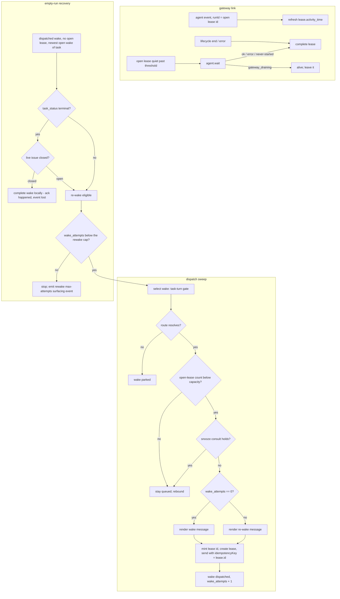

# Wakery Dispatch Worker

## Introduction

This spec defines Stage 2 of the Wakery: the worker that advances stored wakes through the lifecycle defined in `specs/data/spec_database.md` and owns the **lease ledger** end to end. The dispatch worker is the gateway's standing peer: it holds the persistent OpenClaw connection, hears every agent run's lifecycle, and completes leases on the **true end of turn** instead of inferring completion from upstream task progression.

The dispatch worker owns four responsibilities:

1. **Field-sync sweep** — graduate `pending` wakes to `queued` when upstream source-of-truth fields catch up to the expected target captured at intake.
2. **Dispatch sweep** — select the next eligible wake under the task-turn gate, resolve its route, check capacity, and start an agent turn (create lease, send).
3. **Gateway link** — the persistent OpenClaw connection: complete a lease when its run's lifecycle ends, track run activity, reconcile open leases against gateway run state on reconnect and on a quiet-lease cadence (the absorbed probe duty).
4. **Empty-run recovery** — detect a dispatched wake whose turn ended without task progression and re-wake the agent with the re-wake template, capped and surfaced.

The former probe worker is retired; its remaining duty (long-open leases) is responsibility 3. The former snooze worker is retired to a **module** (`spec_wakery-snooze.md`): its consult predicate and its only periodic duty — the timeout bookkeeping flip — ride this worker (Stage 4 and the tick). The former dispatch grace window is retired; the task-turn gate supersedes it by fact.

## Purpose

Stage 2 exists to:
- re-read upstream fields for `pending` wakes on a configurable retry cadence
- select the next dispatch-eligible wake under the task-turn gate, in priority/age order
- resolve routes, check capacity, and start agent turns — one lease = one turn = one send
- complete leases from the gateway's lifecycle events — the canonical turn-end boundary — never from wake arrivals
- recover empty runs (turn ended, no progression) through re-wake dispatches
- emit event logs

Stage 2 does not work with REST/web requests.

## Scope

This spec covers:
- field-sync sweep behavior, retry budget, and exit conditions (unchanged from the pre-turn-signal design)
- the task-turn gate and dispatch selection
- route resolution and capacity checks
- lease creation, the runId contract, and template selection (wake vs re-wake)
- the gateway link: connection lifecycle, the lifecycle watcher, activity tracking, reconcile
- empty-run detection, the terminal-verifier guard, re-wake dispatch, and the attempt cap
- counter-field accounting (`queue_attempts`, `dispatch_attempts`, `wake_attempts`)

This spec does not cover:
- request validation or wake creation/upsert logic (see `spec_wakery-ingress-api.md`)
- wake-ledger completion — wakes are closed by ingress on observed progression and by the `issues.closed` handlers; never by this worker's lease events (see `spec_wakery-queue-and-leases.md`)
- OpenClaw send/connection mechanics in adapter detail (see `spec_wakery-openclaw-adapter.md`)
- snooze hold semantics (see `spec_wakery-snooze.md`); this worker only consults them at admission and flips expired rows on its tick

## Definitions

- **turn / run** — one agent execution in OpenClaw, identified by a `runId`, bounded by lifecycle `start` and `end`/`error` events. The gateway is the source of truth for a turn's boundaries.
- **two-ledger rule** — wake and lease record different things and are written by different sources: the **wake** is the task-state record, written by ingress from GitHub webhooks; the **lease** is the turn record, written by this worker from gateway events. Neither ledger's events complete the other's rows.
- **task-turn gate** — the single admission rule: a wake is dispatch-eligible only when its task has **no open lease on any route** and it is the task's **newest open wake**.
- **empty run** — a `dispatched` wake with no open lease that is still its task's newest open wake: the turn ended and no progression arrived. The self-heal trigger.
- **gateway link** — the worker's persistent authenticated OpenClaw connection carrying outbound RPCs (`chat.send`, `agent`, `agent.wait`) and the inbound event stream.
- **lifecycle watcher** — the link's event handler: completes the matching open lease on a run's lifecycle `end`/`error`, refreshes `activity_time` on any event carrying an open lease's runId, ignores unknown runIds.
- **reconcile** — asking the gateway for the truth about an open lease's run via `agent.wait`, and completing the lease when the run is provably not alive.

## Upstream / Downstream Context

### Upstream
- stored wakes (`pending`, `queued`, `dispatched`) and stored routes
- upstream source-of-truth field reader (e.g. GitHub adapter `fetchIssueState`) — field-sync and the terminal verifier
- the OpenClaw gateway: send acknowledgments and the event stream (`agent` family lifecycle/assistant/heartbeat events)
- the snooze module's consult predicate (admission holds; `spec_wakery-snooze.md`)

### Downstream
- updated wake status (`pending → queued`, `queued → dispatched`, `queued|dispatched → parked`)
- lease rows: created at dispatch, completed by the watcher or reconcile
- rendered wake / re-wake messages delivered to OpenClaw sessions
- JSONL event logs

## Interfaces / Shared Contracts

Depends on:
- `wake`, `route`, `wake_route_lease`, `event`
- upstream source-of-truth field reader (per source adapter)
- the OpenClaw gateway protocol: `chat.send`, `agent`, `agent.wait`, and the `agent` event family (`spec_wakery-openclaw-adapter.md`)
- the snooze module's `consultSnoozes(wake)` predicate (pure read)

## Worker Runtime Model

The dispatch worker runs as a long-running daemon holding the gateway link for the life of the process.

Poll behavior per tick:
- run the field-sync sweep, then the dispatch sweep, then the lease-reconcile check when its interval is due, then the snooze timeout sweep (bookkeeping flip + warn — `spec_wakery-snooze.md` Stage 4; holding-correctness is lazy-expiry in the predicate and never depends on this sweep)
- when no sweep has work, sleep `WAKERY_WORKER_IDLE_POLL_MS` before the next tick; when work was processed, continue immediately

Link behavior (event-driven, independent of ticks):
- maintain the persistent connection: challenge → authenticated `connect` (operator role, wakery's token + device identity); reconnect with backoff on drop
- issue the explicit event subscriptions at connect where they exist — the `agent`/`chat` broadcast to operator connections is observed default behavior at OpenClaw 2026.6.11, not documented contract, so the subscriptions are belt-and-braces
- on every (re)connect, run a **bulk reconcile** over all open leases before trusting the event stream — events fired while disconnected are gone
- process watcher events as they arrive; watcher writes are idempotent (completing a completed lease is a no-op)

Configurable knobs:

| env | default | meaning |
|---|---|---|
| `WAKERY_WORKER_IDLE_POLL_MS` | `10000` | base sleep between ticks when all sweeps are idle (pre-milestone legacy name, kept to avoid touching the deployed config surface) |
| `WAKERY_DISPATCH_REBOUND_COOLDOWN_MS` | `10000` | minimum age (`update_time`) before a rebounded wake (`dispatch_attempts > 0`) is re-pulled; first-time queued wakes are not gated |
| `WAKERY_PENDING_RETRY_INTERVAL_MS` | `60000` | minimum age before a `pending` wake is re-checked |
| `WAKERY_PENDING_MAX_ATTEMPTS` | `3` | field-sync re-checks per `pending` wake |
| `WAKERY_REWAKE_MAX_ATTEMPTS` | `5` | maximum agent turns started per wake (`wake_attempts` cap); at the cap the worker stops re-waking and surfaces |
| `WAKERY_LEASE_QUIET_THRESHOLD_MS` | `300000` | run silence (`activity_time` age) before an open lease is reconcile-checked |
| `WAKERY_LEASE_RECONCILE_INTERVAL_MS` | `60000` | cadence of the quiet-lease reconcile check |
| `WAKERY_GATEWAY_RECONNECT_BACKOFF_MS` | `5000` | initial reconnect backoff (doubles to a max of 8×) |

## Diagrams

### The turn loop

## Procedure

### Stage 0 — Field-sync sweep

Unchanged from the pre-turn-signal design, including the **terminal-graduation gate** (`spec_wakery-conduction-chaining.md` Stage 2): re-read upstream fields for eligible `pending` rows; on match graduate to `queued` (terminal rows re-run the owner identity rules — a Principal-owned or unmapped-owner cue completes instead of queueing; an agent-owned cue graduates and pairs with its chain-cue event); on mismatch bump `queue_attempts` to the budget; the phantom backstop (#76) self-terminates rows whose expected position is behind observed state. See the pre-amendment rules preserved in `§Failure / Recovery` and `spec_wakery-ingress-api.md`.

### Stage 1 — Selection under the task-turn gate

**Objective**
- choose the next wake to start a turn for; never start a second concurrent turn for the same task.

**Reads**
- the selection pool: `queued` wakes, plus `dispatched` wakes with no open lease (empty-run candidates, Stage 5)
- open leases (all routes), for the task-turn gate

**Rules**
- **Task-turn gate (both conditions, evaluated fresh each sweep):**
  1. no open lease exists for the wake's `task_key` on **any** route — an open turn anywhere blocks every wake of that task, which supersedes the retired dispatch grace window by fact: the task's next actor cannot be engaged until the previous actor's turn has truly ended;
  2. the wake is its task's **newest open wake** — an older sibling never dispatches past its successor.
- selection ordering uses local wake fields only (`task_priority DESC, update_time ASC`); never re-reads upstream
- rebound pacing is unchanged: `dispatch_attempts > 0` requires `update_time` older than the rebound cooldown; first-time wakes are not gated
- the Parent (`task:parent`) and Blocked (`task:blocked`) relation gates apply unchanged (`spec_wakery-task-relations.md`)
- an empty-run candidate additionally passes Stage 5's guards (terminal verifier, `wake_attempts` cap) before entering the pool

### Stage 2 — Resolve route

Unchanged: derive the wake's `actor` from the eligibility matrix (`spec_wakery-ingress-api.md` Stage 4), resolve route by `project_id + task_type + actor + status='active'` with the project-level wildcard fallback. No route → `parked`, `dispatch_attempts` bumped. Stop.

### Stage 3 — Capacity

**Objective**
- respect route capacity by counting open leases. Nothing here is task-aware — the task-turn gate already serialized the task upstream.

**Rules**
- capacity is the count of **open** leases on the route versus `route.max_run` (default 1; `delivery=session` routes are capacity 1 by construction)
- at capacity → stay `queued`, bump `dispatch_attempts` + `update_time`, emit the capacity-rebound event; stop
- the pre-amendment task-aware session logic — held-lease `task_key` comparison, continuation re-pointing, `repointToWake` — is **removed**. The gateway serializes same-session turns internally (verified live); wakery's own admission control is the task-turn gate plus this count.

### Stage 4 — Start the turn

**Objective**
- one lease = one turn = one send, with the runId knowable before the send.

**Rules**
- **Snooze consult first** (`consultSnoozes(wake)`, both delivery modes — the stateless hold predicate, `spec_wakery-snooze.md` Stage 2): a holding result **defers admission** — leave the wake in its current status (`queued`, or `dispatched` for an empty-run candidate), bump `dispatch_attempts` for pacing, **never `wake_attempts`** (held waits don't consume the re-wake cap), and emit `wake.dispatch.hold_deferred` naming the holding types so a held branch reads as held, not stalled. No lease is created; no state is written anywhere.
- **Mint, render, persist, send — in that order:**
  1. mint the lease id (unique per lease; a wake accumulates one lease per turn over its life, at most one open)
  2. select the template, in precedence order: the `wakery:stall_alarm` label → the **stall-notice message** (`spec_wakery-stall-notice-message.md` — the synthetic wake exists only for that turn); `task_audit='Govern'` → the **govern-notice message** (`spec_wakery-govern-notice-message.md`); the cap-alert admission (Stage 5) → the **cap-alert message** (`spec_wakery-cap-alert-message.md`); else by `wake_attempts`: `0` → the **wake message** (`spec_wakery-wake-message.md`); `> 0` → the **re-wake message** (`spec_wakery-rewake-message.md`) — outcome-blind self-heal: the prior turn ended without an observed transition; read current state and finish, transition, or escalate; upstream event lag is named as a possible cause. The cap-alert turn additionally **bypasses the snooze consult** — a hold guards execution, never the report of a blockage.
  3. render; a render failure at this point has persisted nothing — park the wake (E7), emit the parked-on-error event, stop
  4. create the lease row: `status='active'`, `task_key`, `activity_time = now`; for `delivery=run` the rendered session key embeds this lease id (`run-session.ts`)
  5. send via the gateway link with **`idempotencyKey = lease.id`** — the gateway adopts it as the run's `runId` (verified at OpenClaw 2026.6.11; the gateway's dedupe makes a crash-resend of the same lease unable to double-fire the turn)
- on send success: `wake.status = 'dispatched'`, increment **`wake_attempts`** (the turns-started counter) and `dispatch_attempts`, emit the dispatched event
- on send failure (downstream error, link down): complete the lease with reason `send_failed`, leave the wake `queued` — the next sweep retries with a fresh lease
- a crash between lease-create and send leaves an open lease with no run; the reconcile check answers `never-started` and completes it, and the wake (still `queued`) retries normally

### Stage 5 — Empty-run recovery

**Objective**
- detect and self-heal the turn that ended without progression; never wait on a timer to do it.

**Rules**
- **The predicate (re-derived from durable rows every sweep; no event scheduling, restart-proof):** `wake.status='dispatched'` AND no open lease for the wake AND the wake is still its task's newest open wake — AND `task_audit != 'Govern'`: a Govern cue wake awaits the Principal, not an agent; one notice turn suffices, and the wake completes by progression when the verdict lands (`spec_wakery-govern-notice-message.md`) — AND the wake does not wear `wakery:stall_alarm`: the stall confession is likewise one turn, completed by the board sweep when the stall clears (`spec_wakery-stall-notice-message.md`).
- **Terminal guard** — when the empty-run wake's `task_status` is terminal (`Completed`/`Cancelled`), it is a chain cue whose ack may have been lost: run the **terminal verifier** (one live issue-state read) —
  - issue **closed** → the acknowledgment happened and the `issues.closed` event was lost; complete the wake locally, emit the terminal-completed event. No turn is spent. This is the only completion path a cue wake has after a lost close webhook — no successor state can ever arrive for a terminal task.
  - issue **open** → the ack genuinely has not happened; the cue is re-wake eligible (Sarge self-heals the chain).
  - lookup failed → conservative: leave it for the next sweep.
- non-terminal empty runs go straight to re-wake — **no upstream re-read** (Principal ruling): the agent absorbs the ambiguity with the context it has; a lost-webhook false positive costs one polite confirm turn and self-heals by content, not timing.
- re-wake rides the normal Stage 1→4 path (the wake enters the selection pool; `wake_attempts > 0` selects the re-wake template; the rebound cooldown paces successive re-wakes)
- **Cap (cap-alert amendment):** at `wake_attempts == WAKERY_REWAKE_MAX_ATTEMPTS` the worker emits the re-wake max-attempts surfacing event once (process-lifetime dedupe — a restart may re-emit once per capped wake) and dispatches **one additional one-duty cap-alert turn** (`spec_wakery-cap-alert-message.md`): report the blockage and its cause to the Principal, then end. The alert send consumes the wake past the cap (`2022 wake.cap_alert.dispatched` beside `wake.dispatched`; a failed alert send leaves the attempts at the cap and retries next sweep); past the cap the wake leaves the selection pool permanently — only external reconciliation (a progression closing the wake, or operator action) moves it after that. `2017` remains the machine record; the alert turn is its human delivery.

### Stage 6 — The gateway link

**Objective**
- own the lease ledger's completion side from the gateway's canonical signals.

**Rules**
- **Watcher:** on an `agent` event whose `runId` matches an **open** lease —
  - `stream:"lifecycle"` with `data.phase = "end"` or `"error"` → complete the lease (record the phase in the completion event). Nothing else happens: no wake writes, no succession checks. The lease lifecycle ends here, every time. **Only `end`/`error` complete** — other observed phases (`start`, `finishing`) are activity; a run may broadcast no `start` event at all (research T8), so nothing depends on observing one. The `agent` method's final same-request response (`status:"ok"|"error"`) arrives through the adapter as an auxiliary completion signal, handled identically and idempotently.
  - any other stream (assistant, tool, heartbeat) → refresh `lease.activity_time`
  - a `runId` matching no open lease is ignored — foreign runs in shared sessions, auxiliary sends, and completions already handled by reconcile all fall out silently
- **Quiet-lease reconcile (the absorbed probe duty), every `WAKERY_LEASE_RECONCILE_INTERVAL_MS`:** for each open lease with `activity_time` older than `WAKERY_LEASE_QUIET_THRESHOLD_MS`, call `agent.wait { runId: lease.id, timeoutMs: ~2000 }` on the link:

  | answer | meaning | action |
  |---|---|---|
  | `status:"ok"` | run finished; watcher missed it | complete the lease |
  | `status:"error"` | run died | complete the lease |
  | `timeout`, `timeoutPhase:"gateway_draining"` | run alive and working | nothing — long turns are legal |
  | `timeout`, `timeoutPhase:"queue"`, `providerStarted:false` | gateway does not know the run — never started, or ended past the retention window | complete the lease |

  Any verdict outside this table (an RPC failure, or an un-specced combination such as `timeout`+`queue`+`providerStarted:true`) skips the lease conservatively — it stays open for the next pass. The only write is "complete the lease"; the empty-run predicate reacts on the next sweep. Reconcile never messages an agent.
- **Reconnect reconcile:** the same routine over **all** open leases, run before the event stream is trusted after every (re)connect. Terminal-snapshot retention at the gateway is short (verified), so reconcile runs promptly — the ambiguous `never-started` answer is safe precisely because the empty-run path's re-wake is idempotent by content.

## Invariants

- **Two-ledger rule:** this worker is the only writer of lease rows; ingress and the `issues.closed` handlers are the only completers of wake rows (plus this worker's two narrow wake writes: `parked`/`dispatched` status moves it already owns, and the terminal-verifier local completion). A wake arrival never completes a lease; a lease completion never completes a wake.
- **Task-turn gate:** at most one open lease per `task_key`, system-wide, at any moment.
- **One lease = one turn = one send.** `runId = lease.id`. A lease sends exactly once and completes exactly once; re-waking is a new lease, never a reuse.
- A wake may hold many leases over its lifetime; at most one is open.
- `wake_attempts` counts turns started for the wake and selects the template; `dispatch_attempts` counts selection attempts (pacing); `queue_attempts` remains field-sync's counter. No counter is shared across sweeps.
- Lease completion is idempotent; watcher, reconcile, and send-failure completion converge on the same terminal row state.
- `update_time` is record bookkeeping only; operational recency lives in `activity_time` (`specs/data/spec_database.md §wake_route_lease`).
- The worker never creates persistent OpenClaw sessions; `delivery=run` session keys embed the lease id as before.
- Stage 0 touches only `pending` rows; the `pending → queued` transition remains exclusively field-sync's.

## Failure / Recovery

- no route → `parked`; capacity or snooze hold → stay `queued` with bumped pacing fields
- render failure → nothing persisted; wake `parked` (E7 poison-pill removal), `wake.dispatch.parked_on_error`
- send failure → lease completed `send_failed`, wake stays `queued`, retried with a fresh lease
- gateway link down → sends fail per the above; lifecycle events are lost while down; the reconnect bulk reconcile restores lease truth, and empty-run recovery restores wake flow. Wakery degrades to "leases complete late," never to a jammed lane.
- wakery restart → no in-memory state: the link reconnects, bulk reconcile runs, and every sweep predicate re-derives from durable rows
- webhook delay (progression exists upstream but the webhook has not arrived) → the empty-run path re-wakes; the outcome-blind re-wake costs one confirm turn per attempt, cooldown-paced, capped at `WAKERY_REWAKE_MAX_ATTEMPTS`, then surfaces — a multi-hour webhook outage is an incident and ends as an alert, not an infinite wait
- field-sync failure semantics unchanged (operational failures defer without burning attempts; exhausted budgets freeze in `pending` until external reconciliation)

## Observability

Must emit at minimum:
- `wake.selected`, `wake.parked`, `wake.dispatch.parked_on_error`, `wake.dispatch.capacity_rebound`, `wake.dispatched` — as before, `wake.dispatched` now carrying `wake_attempts` and the template used
- field-sync family unchanged (`resolved` / `retried` / `timeout` / `error` / `phantom_terminated`)
- `lease.completed` — one event for every lease completion, carrying the cause: `lifecycle_end`, `lifecycle_error`, `reconcile_ok`, `reconcile_error`, `reconcile_never_started`, `send_failed`
- `wake.rewake.dispatched` — an empty run re-waked (subsumed under `wake.dispatched` with `wake_attempts > 0`; kept as a named marker for grep-ability)
- `wake.rewake.max_attempts` — the cap reached; the surfacing/alert hook (emit once per wake)
- `wake.chain.terminal_verified` — the terminal verifier completed a cue wake locally (the relocated 4008)
- `link.connected` / `link.disconnected` / `link.reconciled` — connection lifecycle, the last carrying counts of leases checked/completed
- the `probe.*` event family is retired with the probe worker

## References

- `spec_wakery.md`
- `specs/data/spec_database.md` — lease semantics (turn record, `activity_time`; `paused` and `dispatch_time` retired)
- `spec_wakery-queue-and-leases.md` — the two-ledger contract
- `spec_wakery-ingress-api.md` — wake intake, eligibility matrix, wake-ledger closure
- `spec_wakery-openclaw-adapter.md` — gateway link mechanics, runId contract, `agent.wait`
- `spec_wakery-wake-message.md` / `spec_wakery-rewake-message.md` — the two dispatch templates
- `spec_wakery-snooze.md` — the hold predicate, settled-holds context, and the timeout sweep this worker's tick carries
- `spec_wakery-task-relations.md` — Parent/Blocked dispatch gates
- `spec_wakery-conduction-chaining.md` — chain cues, terminal-ack, the terminal verifier's protocol role
- `docs/research/research_20260729_openclaw-turn-signal-verification/research.md` — the verified gateway behavior this design builds on
- superseded: `spec_wakery-dispatch-grace-window.md` (replaced by the task-turn gate), `spec_wakery-probe-worker.md` (absorbed: reconcile here, terminal verifier in Stage 5), `spec_wakery-probe-message.md` (blind nudges retired)
