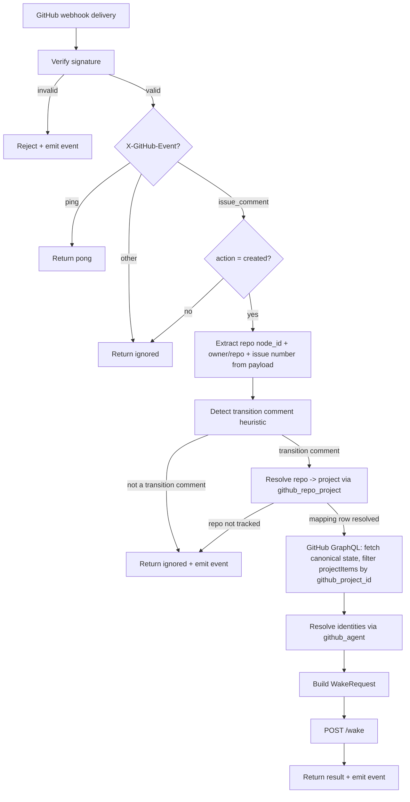

# Wakery GitHub Adapter

## Introduction

This spec defines the GitHub adapter that converts GitHub webhook deliveries into `WakeRequest` payloads for Stage 1.

## Purpose

GitHub is the primary upstream task/project binding for v1. The adapter keeps GitHub-specific webhook handling, API resolution, and payload mapping out of the generic router ingress API.

## Scope

This spec covers:
- GitHub webhook intake and event filtering
- comment-based wake trigger model
- GitHub GraphQL API resolution of canonical task state
- identity mapping from GitHub users to agents
- request mapping into `WakeRequest`

This spec does not cover:
- local wake storage semantics
- async routing logic
- OpenClaw dispatch behavior

## Upstream / Downstream Context

### Upstream
- GitHub `issue_comment` webhook events

### Downstream
- router ingress API (`POST /wake`)
- JSONL event logs

## Interfaces / Shared Contracts

Depends on:
- `WakeRequest`
- `WakeResponse`
- `github_agent`
- `github_repo_project`
- `event`

## Inputs

### Endpoint
- `POST /adapters/github/webhook`

Input:
- GitHub webhook payload + signature headers (`X-Hub-Signature-256`, `X-GitHub-Event`, `X-GitHub-Delivery`)

## State Surfaces / Dependencies

- webhook verification secret/config
- GitHub GraphQL API client (authenticated)
- `github_agent` store
- `github_repo_project` store
- router ingress API
- JSONL event writer

## Wake Trigger Model

### Comment events as the sole wake trigger

The GitHub adapter uses `issue_comment.created` as the sole wake trigger. This design follows from TASK.md policy which requires a structured transition comment as the final action of every lifecycle or audit state change.

The comment content is **not** parsed as the wake payload. The comment event is purely the signal that a transition has been completed. Canonical task state is fetched from the GitHub API after the trigger fires.

### Why not other webhook events

| Event | Why not |
|---|---|
| `issues.edited` | Fires on body/title edits that may not represent state transitions |
| `issues.labeled` | Labels are not the canonical source for lifecycle/audit state |
| `projects_v2_item` | Organization-only webhook; unavailable on repository webhooks |

### Atomicity guarantee

GitHub fires separate events for issue body edits, project field changes, and comments. By reacting only to the transition comment — which policy requires to be posted **after** all other changes — the adapter receives a single trigger that arrives after the full state update is visible through the API.

One comment = one transition = one atomic wake.

### Edge cases

- If the transition comment is never posted, no wake fires. This is correct — the transition is not complete per TASK.md policy.
- If a human changes project fields without posting a transition comment, no wake fires. The board-reconcile sweep (`spec_wakery-board-sweep.md`) repairs the resulting absence.
- Non-transition comments (discussion, questions) do not trigger wakes because they do not match the transition comment template detection heuristic.

## Diagrams

### GitHub adapter flow

## Procedure

### Stage 1 — Verify webhook signature
**Objective**
- authenticate that the delivery came from GitHub.

**Reads**
- raw request body
- `X-Hub-Signature-256` header
- configured webhook secret

**Rules**
- HMAC SHA-256 with timing-safe comparison
- reject on missing signature, missing secret, length mismatch, or failed comparison

**Writes / Side Effects**
- rejection response or proceed to event filtering
- JSONL event record on rejection

### Stage 2 — Filter event type
**Objective**
- accept only actionable webhook events.

**Reads**
- `X-GitHub-Event` header
- webhook payload `action` field

**Rules**
- `ping` → return `200 { status: "ok", message: "pong" }`
- `issue_comment` with `action: "created"` **and no `payload.issue.pull_request` key** → proceed. **PR-origin comment guard:** every pull request is an issue — `issue_comment` fires identically for both, and `payload.issue.pull_request` is the only discriminator. A comment on a PR never proceeds to wake building: drop with `wake.request.dropped_ineligible` (1003, payload `reason: pull_request_comment`). The guard reads the raw webhook payload — the GraphQL issue fetch does not carry this discriminator.
- `pull_request` and `workflow_run` → routed to the **snooze module's intake** (`spec_wakery-snooze.md` Stage 1), never to the wake path.
- all other events → return `200 { status: "ignored" }`

### Stage 3 — Detect transition comment
**Objective**
- determine whether the comment is a TASK.md transition comment.

**Reads**
- `comment.body` from webhook payload

**Rules**
- apply a heuristic to detect structured transition comments (presence of From/To/Actor fields)
- non-transition comments are ignored with an event log
- the comment body itself is never used as the wake payload; it is only used for trigger detection

### Stage 4 — Resolve repo to project via github_repo_project
**Objective**
- determine which GitHub Project the repository's issues should be routed under, using the authoritative `github_repo_project` mapping instead of any ambient/global configuration.

**Reads**
- repository global node ID from webhook payload (`payload.repository.node_id`)
- `github_repo_project` store

**Rules**
- look up the `github_repo_project` entry by matching `github_repo_id` to the repository node ID from the webhook payload
- if no entry is found, the repository is not tracked — return ignored with an event log, do not proceed to the GraphQL fetch
- if an entry is found with `status != active`, treat the repo as not tracked and return ignored with an event log
- this stage resolves both keys from the mapping row: `github_project_id` (used by Stage 5 to filter `projectItems`) and the platform `project_id` (stamped on the wake by Stage 8)
- `owner_id`, `owner_name`, and `repo` from the webhook payload are not the lookup key; they may be logged for diagnostics but must not be used to resolve the project

**Writes / Side Effects**
- either the resolved mapping row (continue to Stage 5) or an ignored response + event log

### Stage 5 — Fetch canonical state from GitHub GraphQL API
**Objective**
- retrieve the full canonical task state from GitHub as the single source of truth.

**Reads**
- repository owner and name from webhook payload
- issue number from webhook payload
- resolved mapping row from Stage 4

**GraphQL query resolves:**

| Data | GraphQL path |
|---|---|
| Issue number | `repository.issue.number` |
| Issue title | `repository.issue.title` |
| Issue body | `repository.issue.body` |
| Issue author | `repository.issue.author.login` |
| Issue assignees | `repository.issue.assignees.nodes[].login` |
| Issue labels | `repository.issue.labels.nodes[].name` |
| Project node ID | `repository.issue.projectItems.nodes[].project.id` |
| Project title | `repository.issue.projectItems.nodes[].project.title` |
| Project Status field | `projectItems.nodes[].fieldValues` → `SingleSelectValue` where `field.name = "Status"` |
| Project Audit field | `projectItems.nodes[].fieldValues` → `SingleSelectValue` where `field.name = "Audit"` |
| Linked branches | `repository.issue.linkedBranches.nodes[].ref.name` (Development section — the branch↔task binding surface) |

**Rules**
- the GraphQL response is the sole source of truth for all task fields
- filter `projectItems.nodes[]` to the single item whose `project.id` matches the mapping row's `github_project_id`
- if the issue has no project item matching `github_project_id`, the request is not eligible for wake processing — emit event log and return ignored
- `Status` and `Audit` field values are read from that single matched project item; other project items on the same issue (if any) are ignored
- **`task_branch` resolution** (`spec_wakery-conduction-chaining.md` Stage 3): own `linkedBranches` first (no extra round trip — it rides this query); empty → the parent issue's `linkedBranches` (one extra query, Child Tasks, parent from `task_relations`); empty → the first Blocked-by blocker's `linkedBranches` (one extra query, Integration Stage Tasks). First non-empty wins; multi-entry takes the first and emits `wake.branch.unresolved reason=ambiguous`; fully unresolved → NULL + `wake.branch.unresolved` (suppressed for laneless task types). The resolved value lands on the `WakeRequest` and stores as `wake.task_branch`, immutable per row.

### Stage 6 — Validate type label and extract `task_type`
**Objective**
- confirm the issue is a Task and produce its canonical `task_type` value before any further processing.

**Reads**
- issue labels from the GraphQL response (`repository.issue.labels.nodes[].name`)
- the canonical Task-type set, loaded from the `task_type_label` table — the runtime authority (`spec_wakery-task-type-registry.md §R1/§R2`) — via `TaskTypeLabelRepository.activeTypeValues()`. The set is read **per evaluation** (once per webhook), so a type added/retired via `add-task-type` takes effect without a wakery redeploy. The set is no longer a code constant; `docs/conventions/constants.md §Task types` is the human-readable reflection of the table.

**Rules**
- Extract all label names whose value starts with `type:`.
- **Exactly one canonical `type:*` label is required.** Any other combination is a drop:
  - **Zero** `type:*` labels → drop with `wake.request.dropped_not_a_task_issue`. The issue is not a Task.
  - **One** `type:*` label, value matches the canonical set → proceed; `task_type` is the value portion (without the `type:` prefix).
  - **One** `type:*` label, value does not match the canonical set → drop with `wake.request.dropped_unknown_task_type`. Payload includes the offending label so the operator can audit.
  - **More than one** `type:*` label, in any combination of canonical and non-canonical → drop with `wake.request.dropped_ambiguous_task_type`. Payload includes the full list of `type:*` labels observed. Picking silently from ambiguous input is not allowed — operator must remove duplicates.
- A non-`type:*` label co-existing with a single canonical `type:*` label does not affect the outcome. Only `type:*` labels participate in this filter.

**Writes / Side Effects**
- either the extracted `task_type` value (continue to Stage 7) or an ignored response + the corresponding drop event log

### Stage 6a — Drop stale/delayed webhook transitions (#76)
**Objective**
- reject a delayed delivery of an old transition comment that has been superseded, so it cannot resurrect a state the task has already moved past (the #69 late-webhook stuck-pending class).

**Reads**
- the parsed transition `To:` lifecycle target (from the comment)
- the current observed lifecycle state (from the Stage-5 GraphQL fetch)
- `comment.created_at` from the webhook payload
- the current-state wake's `create_time` (read-only `findCurrentByTaskKey`)
- the canonical lifecycle transition graph (`shared/lifecycle.ts`, mirroring `TASK.md §Lifecycle`)

**Rules**
- Applies only to lifecycle `To:` targets (audit-only transitions skip this stage).
- Drop with `wake.request.dropped_stale_webhook` (1015) iff **both** hold:
  1. the `To:` state is **not consistent with the current observed state** — neither equal to it nor one legal step ahead of it (`isReachableOrSame(observed, To)` is false); **and**
  2. `comment.created_at` **predates** the current-state wake's `create_time`.
- Condition 1 alone preserves legitimate backward transitions (the redo pass `Done+Revise→Progress+Gated`, reclaim `Pending→Init`) and still-lagging forward transitions — those remain reachable-from-current and pass. Condition 2 prevents dropping a fresh but out-of-order/malformed delivery.
- When no current-state wake exists, or the read-only wake view is unavailable, the stage is a no-op (conservative — never drops without timestamp evidence).

**Writes / Side Effects**
- either continue to Stage 7 or an ignored response + the `wake.request.dropped_stale_webhook` event. A field-sync backstop (`spec_wakery-dispatch-worker.md §Failure/Recovery`) self-terminates any phantom `pending` wake that slips past this gate.

### Stage 7 — Resolve identities via github_agent
**Objective**
- verify GitHub users are known agents and determine their roles for eligibility decisions.

**Reads**
- issue assignee login(s) and node ID(s) from GraphQL response
- issue author login and node ID from GraphQL response
- `github_agent` store

**Rules**
- look up each GitHub user by matching BOTH `github_login` AND `github_node_id` in the `github_agent` table — composite match ensures identity is airtight even if a GitHub username is reused after a rename
- resolved `agent_id` and `role` inform eligibility and routing decisions but are NOT stored in the WakeRequest — the wake carries upstream GitHub identities only
- if a login+node_id pair has no mapping entry, treat it as unmapped and log accordingly

### Stage 8 — Build WakeRequest and forward to ingress
**Objective**
- construct a canonical `WakeRequest` and forward it to Stage 1.

**Mapping:**

| WakeRequest field | GitHub source |
|---|---|
| `request_id` | `X-GitHub-Delivery` header or generated fallback |
| `source` | `"github"` |
| `project_id` | Platform `project.id` from the `github_repo_project` row (Stage 4) |
| `project_name` | GitHub Project title (= project key from `charter.md`) |
| `task_id` | Issue number (string) |
| `task_type` | The single canonical `type:<value>` label's value (without the `type:` prefix), validated by Stage 6 |
| `task_title` | Issue title |
| `task_status` | Project custom field `Status` value |
| `task_audit` | Project custom field `Audit` value |
| `task_payload` | Supplementary issue data (body, all labels, author login) |
| `assignee_id` | GitHub user node ID of the issue assignee |
| `assignee_name` | GitHub login of the issue assignee |
| `owner_id` | GitHub user node ID of the issue author |
| `owner_name` | GitHub login of the issue author |
| `timestamp` | Current time in unix milliseconds |

**Rules**
- each GitHub delivery becomes a plain `WakeRequest` and goes through the same Stage 1 API as any other upstream caller
- `project_id` is the platform `project.id`, never a GitHub identifier
- `project_name` comes from the GitHub Project title
- `task_id` is the issue number, not the issue node ID
- `task_status` and `task_audit` come from GitHub Project custom fields, not from labels or issue open/closed state

## Notes

- GitHub issue open/closed state is not used for lifecycle or audit determination
- labels are not used for lifecycle or audit determination; only `type:<value>` labels are used for task type classification, and exactly one canonical `type:*` label is required per Stage 6
- if GitHub emits frequent comment webhooks, the adapter should rely on Stage 1 upsert behavior rather than inventing its own local wake storage
- if task state is still ineligible, Stage 1 should drop it; later GitHub changes should simply send the next request

## References

- `spec_wakery.md`
- `spec_wakery-contracts.md`
- `spec_wakery-ingress-api.md`
- `specs/data/spec_event.md`
- `TASK.md` (canonical task lifecycle and audit policy)

## Platform keying and node-id addressing

- The adapter stamps `WakeRequest.project_id` with the platform `project.id` from the `github_repo_project` row (`specs/data/spec_database.md §5`); `github_project_id` is used only to filter `projectItems` for the tracked board.
- All three GraphQL reads address the repository as `node(id: $githubRepoId) { ... on Repository { ... } }` on the immutable `github_repo_id` — `github_owner_name` is display-only and never addresses the API.
