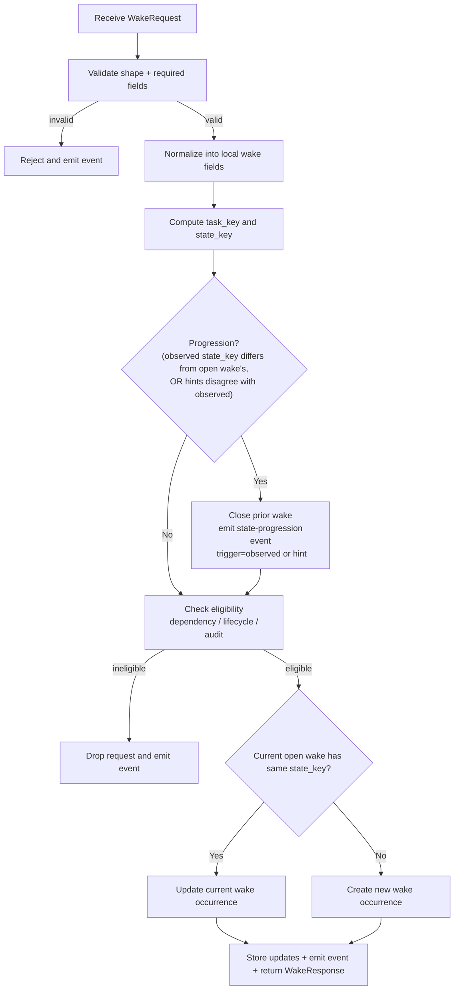

# Wakery Ingress API

## Introduction

This spec defines Stage 1 of the Wakery: the REST/webhook-facing ingress service.

## Purpose

Stage 1 exists to:
- take in an inbound `WakeRequest`
- validate request data
- normalize request data into local wake fields
- reconcile state progression against the current open wake occurrence (closing the prior wake when the task has moved on — the wake ledger only; leases belong to the dispatch worker)
- verify eligibility before storage
- either drop the request or create/update local wake data
- end the web request lifecycle cleanly

After Stage 1, local storage owns the work. Later stages should think in terms of `wake`, not in terms of requests.

State-progression reconciliation runs **before** eligibility checking. A task moving into a new lifecycle+audit state terminates the prior work item even when the new state is not agent-routable (for example, a principal-owned state such as `Todo:Revise` with a human owner). If reconciliation ran only on eligible requests, any transition into a principal-owned state would leave the prior wake permanently open.

Reconciliation recognises two progression signals: **observed-state progression** (canonical `task_status` / `task_audit` produce a different `state_key` than the open wake) and **hint-driven progression** (canonical fields still match the open wake's `state_key`, but the source adapter parsed a `task_status_expected` / `task_audit_expected` hint from the agent's transition comment that disagrees with canonical). The hint-driven path exists because GitHub's ProjectV2 read API is eventually consistent — the same agent that just posted the transition comment may have updated the `Status` field a moment earlier, but a webhook-driven canonical fetch can still observe the pre-transition value. Treating the transition comment itself as authoritative for progression closes the prior wake and lets the field-sync sweep graduate the new pending wake to `queued` once canonical catches up, instead of swallowing the transition into a `wake.updated` no-op against the still-dispatched prior wake.

## Scope

This spec covers:
- ingress API shape
- validation
- request normalization
- state-progression reconciliation (close prior wake on observed state change — wake ledger only, per the two-ledger rule in `spec_wakery-queue-and-leases.md`)
- eligibility checking
- wake creation/update rules

This spec does not cover:
- route resolution after storage
- worker ordering logic
- downstream OpenClaw dispatch

## Upstream / Downstream Context

### Upstream
- GitHub adapter
- direct REST callers
- operator tooling
- workflow/scheduler callers

### Downstream
- wake store
- JSONL event logs

## Interfaces / Shared Contracts

Depends on:
- `WakeRequest`
- `WakeResponse`
- `wake`
- `github_agent`
- `event`

## Inputs

### Endpoint
- `POST /wake`

Body:
- `WakeRequest`

## State Surfaces / Dependencies

- wake store
- `github_agent` store (for identity resolution during eligibility)
- dependency/task-state lookup surface when request data is insufficient for eligibility checks
- JSONL event writer

## Diagrams

### Stage 1 request flow

## Procedure

### Stage 1 — Validate request
**Objective**
- ensure the inbound request is structurally usable.

**Reads**
- HTTP request body

**Rules**
- required fields must exist
- `assignee_id` or `assignee_name` must exist
- malformed requests are rejected synchronously

**Writes / Side Effects**
- rejection response or normalized request data
- JSONL event record

### Stage 2 — Normalize request into local wake data
**Objective**
- transform request-carried data into the local wake abstraction.

**Reads**
- validated `WakeRequest`

**Rules**
- normalize into fields required by the `wake` entity
- after this stage, local processing should think in terms of `wake`, not request semantics
- preserve the optional `task_status_expected` and `task_audit_expected` hints from the request as-is. These are populated by source adapters when an external signal (e.g. a GitHub transition comment) claims a new state but the upstream source-of-truth has not yet caught up. The hints are *not* a substitute for the observed `task_status` / `task_audit` — they are a marker that an upstream transition is expected to materialize and Stage 5 should hold the wake in `pending` until upstream confirms.

**Writes / Side Effects**
- normalized wake field set in memory (including any `task_status_expected` / `task_audit_expected` hints)

### Stage 3 — Reconcile state progression
**Objective**
- detect whether the task state has moved past the current open wake occurrence and close the prior work item, independently of whether the new state is eligible for routing. Progression can be signalled in two ways:
  - **observed-state progression** — the newly fetched canonical `task_status` / `task_audit` produce a different `state_key` than the open wake. Upstream is ahead.
  - **hint-driven progression** — the newly fetched canonical state still matches the open wake's `state_key`, but the request carries `task_status_expected` and/or `task_audit_expected` (parsed by the source adapter from the agent's transition comment) that disagree with the canonical values. The agent posting the transition comment is the strongest possible signal that the transition has been performed (TASK.md requires the transition comment as the final operational act of the transition), so the task is treated as having progressed even though the upstream ProjectV2 read path has not yet caught up.

**Reads**
- normalized wake field set (including any `task_status_expected` / `task_audit_expected` hints)
- current open `wake` record for the computed `task_key`, if any

**Rules**
- compute `task_key = md5(project_id + task_id)`
- compute `state_key = md5(project_id + task_id + task_status + task_audit)` (the observed state_key)
- "open wake" means any `wake` row for the given `task_key` whose `status` is non-terminal: explicitly `status IN ('pending', 'queued', 'parked', 'dispatched')`
- **observed-state progression**: if an open wake exists for `task_key` and its `state_key` differs from the newly observed `state_key`, the task has progressed in canonical:
  - mark all open wake rows for that `task_key` as `completed` — **including** any `pending` rows whose field-sync retry budget was exhausted (this is the only automatic exit for such rows)
  - emit the state-progression event
- **hint-driven progression**: if an open wake exists for `task_key` AND its `state_key` matches the newly observed `state_key` AND the request carries hints that disagree with the corresponding observed values (i.e. `task_status_expected` is set and differs from `task_status`, or `task_audit_expected` is set and differs from `task_audit`), the agent has signalled a transition that upstream has not yet reflected:
  - close the open wake(s) identically to the observed-state path (same `completed` semantics; this is real progression, just signalled by the agent's comment rather than by canonical fields)
  - emit the state-progression event with a `trigger: "hint"` payload field so operators can distinguish hint-driven closures from observed-state closures in the JSONL log
  - after closure there is no current open wake for `task_key`, so Stage 5 takes the new-row path. Per the existing fieldLagged decision, since hints disagree with observed the new row is stored with `status='pending'`, `task_status`/`task_audit` set to the **observed** canonical values, and `task_status_expected`/`task_audit_expected` set to the hints. The field-sync sweep re-reads upstream; once canonical matches the expected hints, it graduates the row by updating `task_status`/`task_audit` to the freshly-fetched values, clearing the expected fields, recomputing `state_key`, and flipping status to `queued`. The dispatch worker then routes the now-correctly-stated wake to the actor lane for the *expected* state.
- if no open wake exists for `task_key`, there is nothing to reconcile (the request still proceeds to Stage 4/5 — hint disagreement on a fresh wake is handled by Stage 5's existing fieldLagged path)
- if the open wake has the same `state_key` AND the request carries no hint disagreement, this is not a progression; reconciliation is a no-op and the same-state update path is handled later in Stage 5
- **This stage runs before eligibility checking.** Progression closure must not be gated by whether the incoming state is agent-routable; a task transitioning into a principal-owned state (e.g. `Todo:Revise` with a human owner) still terminates the prior wake. The same is true for hint-driven progression: closure must fire even if the *expected* state would be ineligible (e.g. an agent's comment signalling `To: Cancelled` still closes the prior wake).
- **Leases are never touched here** (two-ledger rule, `spec_wakery-queue-and-leases.md`): lease completion is the dispatch worker's, driven by the gateway's turn-end signal. A progression that closes a wake mid-turn leaves the turn's lease open — the task-turn gate is what holds the successor wake until that turn truly ends.

**Writes / Side Effects**
- optional completed previous `wake` rows
- JSONL event record for state-progression closure (carries `trigger: "observed"` or `trigger: "hint"`)

### Stage 4 — Verify eligibility
**Objective**
- decide whether the item should enter the wake store based on TASK.md lifecycle/audit rules and actor identity.

**Reads**
- normalized wake field set (including `task_status`, `task_audit`, `assignee_id`, `assignee_name`, `owner_id`, `owner_name`)
- `github_agent` entries resolved by matching BOTH `github_node_id` (from `*_id` fields) AND `github_login` (from `*_name` fields) to determine roles
- dependency/task-state data required for eligibility checks

**Rules**

Eligibility is determined by the combination of lifecycle state, audit state, and resolved actor roles. The wakery must handle the full TASK.md lifecycle, not just a narrow subset.

**Terminal states — chain cues, not drops (conduction-chaining feature):**
- `Completed` / `Cancelled` transitions are eligible owner-lane wakes — the chain cues that drive Sarge's conduction (`spec_wakery-conduction-chaining.md` Stage 2). Stage 3 progression closure still runs first (prior wakes complete), then the terminal wake stores as a new occurrence. A Principal-owned task's terminal transition takes the `principal_handled` drop below — Principal-owned checkpoints chain on the Principal's own direction, not on a cue.

**Principal-handled — ineligible for agent routing, recorded as a distinct outcome:**

Two cases collapse here. Both are recorded with `wake.request.principal_handled` (not the generic `wake.request.dropped_ineligible`) so the audit trail is queryable:

- **State-based** (reason `state_based`): the responsible actor for the current state is `principal` per the actor matrix (`Todo:Govern`, `Done:Govern`). The state itself is for principal action — but it is **not silent**: alongside the 1009 event, ingress stores a **notification cue wake** for the same state, routed as an owner-lane wake so Sarge's turn sends the Principal's checkpoint notice (`spec_wakery-govern-notice-message.md`). The cue wake is a normal wake row (the govern-notice template selects on `task_audit='Govern'`); it completes by ordinary progression closure when the Principal's verdict transitions the task, and it is exempt from empty-run re-wake recovery. The state-based test runs before identity resolution, so a Govern on a Principal-owned task still cues.
- **Identity-based** (reason `identity_based`): the responsible actor is `owner` or `assignee` in the matrix, but the resolved GitHub identity for that actor has `role: principal` in `github_agent` (e.g., `Pending:Approved` with owner = the Principal).

Both cases produce the same downstream effect: no wake row is stored, no dispatch happens. The event captures lifecycle, audit, resolved actor identity, and the disambiguating reason for operator-driven trail queries.

**Eligible states and their responsible actors:**

The responsible actor depends on the lifecycle + audit combination:

This table is the canonical eligibility-and-actor mapping. The dispatch worker re-derives the same `actor` value from (`wake.task_status`, `wake.task_audit`) when resolving the route in `spec_wakery-dispatch-worker.md` Stage 2, the value must match `route.actor` on the selected route, and the OpenClaw adapter places the same value on the dispatched wake message.

| Lifecycle | Audit | Responsible actor | Notes |
|---|---|---|---|
| Init | Gated | Owner | Owner preparation lane — eligible if owner resolves to an agent, then route via `(project_id, task_type, actor=owner)` with `task_type IS NULL` fallback |
| Todo | Gated | Auditor | Pre-execution queue (first gate) — route via `(project_id, task_type, actor=auditor)` with `task_type IS NULL` fallback (the Heimdall catch-all) |
| Todo | Approved | Assignee | Ready for acceptance — eligible if assignee resolves to an agent, then route via `(project_id, task_type, actor=assignee)` |
| Todo | Revise | Owner | Pre-execution audit failed — owner reclaim lane; route via `(project_id, task_type, actor=owner)` |
| Todo | Govern | Principal (cue → Owner lane) | Escalated at the first gate — Principal decides; a notification cue wake routes to the owner lane so Sarge sends the checkpoint notice |
| Progress | Gated | Assignee | Active execution lane, re-gated on entry (`TASK.md §Transition`) — the execution wake; route via `(project_id, task_type, actor=assignee)` |
| Done | Gated | Auditor | Post-execution queue (second gate) — the Auditor's work-product Review (`SECURITY.md §Review`); same auditor-lane routing as `Todo+Gated` |
| Done | Approved | Owner | Review passed — owner acceptance lane (`Reviewed` or cancel); route via `(project_id, task_type, actor=owner)` |
| Done | Revise | Assignee | Review failed within scope — assignee redo lane (`Progress+Gated` re-gate, or `Pending+Revise` bounce) |
| Done | Govern | Principal (cue → Owner lane) | Escalated at the second gate — Principal decides; same notification cue as `Todo:Govern` |
| Pending | * (any) | Owner | Returned to the owner carrying the prior audit value — owner lane regardless of audit |
| Reviewed | Approved | Assignee | Final closeout — route via `(project_id, task_type, actor=assignee)` |
| Completed | Approved | Owner | Chain cue (`spec_wakery-conduction-chaining.md`) — `Reviewed+Approved → Completed+Approved` is the only arrival |
| Cancelled | * (any) | Owner | Chain cue — Cancelled carries its source lane's audit value |

`Rework` does not exist in the two-gate machine and has no row; a request carrying it is an unknown state and drops ineligible. The table is exhaustive over the reachable states of `TASK.md §Transition`.

**Special rules:**
- `Progress + Gated` is the execution wake, not a dropped probe-only state — its audit value is `Gated` because entering an actor lane re-gates in the same atomic transition; it is an actor lane, not an audit queue (`TASK.md §Transition` Enforcement). Stored as a normal wake and routed to the assignee; its turn's lease completes at the gateway's turn end like any other (`spec_wakery-dispatch-worker.md`).
- Turn supervision is not specific to `Progress`. The dispatch worker's quiet-lease reconcile covers every open lease regardless of the lifecycle state on the associated wake (`spec_wakery-dispatch-worker.md` Stage 6; the standalone probe worker is retired).
- The `Todo + Approved -> Progress + Gated` transition is the assignee acceptance step — a paired atomic re-gate. The assignee inspects the task packet, decides whether it has enough context, transitions, and stops. The resulting `Progress+Gated` wake is what starts actual execution.
- **The two audit queues route identically.** `Todo+Gated` and `Done+Gated` both resolve to the auditor lane; what differs is Heimdall's behavior at each — Preview classification vs work-product Review at the `risk:`-selected Depth (`SECURITY.md`) — none of which wakery interprets.
- **Heimdall's Principal Fast-Pass spans both queues.** At `Todo+Gated` or `Done+Gated`, when owner or assignee on the task resolves to `role: principal` via `github_agent` (matched on both `github_node_id` + `github_login`), Heimdall applies the fast-pass per `SECURITY.md §Principal Fast-Pass`; checkpoint Stage Task types and failed Deployment reviews Govern unconditionally, taking precedence over fast-pass (`SECURITY.md §Outcome`). Wakery routes to the auditor lane as normal in every case — verdicts are Heimdall's behavior, not wakery's. Other `(lifecycle, audit)` combinations with principal identity are handled by the principal-handled drop above.
- The auditor responsible actor is routed like any other actor lane: Stage 2 selects the active route for `(project_id, task_type, actor=auditor)`, with `task_type IS NULL` as the project-level fallback. There is no `agent_id = heimdall` special case — Heimdall is selected by virtue of being the agent configured on the auditor-lane route for the project.

**General eligibility rules still apply:**
- verify dependency readiness
- ineligible items are dropped rather than stored as queued wakes
- later upstream task changes should generate new requests; Stage 1 should not queue premature work and wait on it if it is already known to be ineligible

**Writes / Side Effects**
- drop event or eligible wake candidate

### Stage 5 — Create or update local wake occurrence
**Objective**
- store eligible work into the local wake system without collapsing task history. Decide between the normal `queued` path and the `pending` path when an upstream field-lag is detected.

**Reads**
- eligible wake candidate (may carry optional `task_status_expected` / `task_audit_expected` hints from Stage 2)
- current open `wake` record for the same `task_key` when present (its prior state has already been reconciled in Stage 3 if it differed)

**Rules**
- `task_key` and `state_key` were already computed in Stage 3
- `request_id` is not the durable local identity
- **ingress must not change `wake.status` on an existing row.** Once a wake is stored, its lifecycle status (`pending → queued → dispatched/parked/completed`) is owned exclusively by the dispatch worker. Ingress writes `status` only when creating a new row.
- **decide initial status (new-row only)**:
  - if both `task_status_expected` and `task_audit_expected` are absent, or each present hint matches the corresponding observed value (`task_status` / `task_audit`), the wake is fully synced. Initial status is `queued`. Do not write `task_status_expected` / `task_audit_expected` on the row.
  - if at least one hint is present and disagrees with the corresponding observed value, the upstream source-of-truth has not yet caught up. Initial status is `pending`. Persist the hints into `task_status_expected` and `task_audit_expected` on the row exactly as supplied. The dispatch worker's field-sync sweep is the sole authority that will graduate the wake to `queued`; ingress does not perform any retries of its own and does not graduate pending wakes.
- **same-state update path**: if the current open wake for that `task_key` already has the same `state_key`, update that wake occurrence instead of creating a duplicate. The update is field-scoped — ingress and dispatch worker each own a disjoint set of fields on the row, and ingress never touches worker-owned fields:
  - if the open wake is `pending` and the new request's hint/observed values agree (i.e., the new request would have produced an initial status of `queued` if it were a new row), reset `queue_attempts` to `0` and bump `update_time`. This re-opens the field-sync attempt budget so the dispatch worker can resume re-checking a wake that may have been frozen by `WAKERY_PENDING_MAX_ATTEMPTS`. The row stays `pending`; the worker's next field-sync tick remains the authority for the `pending → queued` transition. Emit `wake.pending.refreshed`.
  - if the open wake is `pending` and the new request's hint/observed values still disagree, the request carries no new information for graduation. Leave `status`, `queue_attempts`, `task_status_expected`, and `task_audit_expected` untouched. Bump `update_time` and emit `wake.updated`.
  - if the open wake is `queued`, `parked`, or `dispatched`, leave `status`, `queue_attempts`, and `dispatch_attempts` untouched (worker-owned). Bump `update_time` and emit `wake.updated`.
- otherwise (no current open wake, or the prior one was closed in Stage 3), create a new wake occurrence
- if an older historical wake already has the same `state_key` but is not the current open wake, still create a new wake occurrence; repeated visits to the same state at different times must not collapse history
- new rows initialize `queue_attempts = 0`, `dispatch_attempts = 0`

**Writes / Side Effects**
- created or updated `wake` (with `status` set to `queued` or `pending` per the decision above; `task_status_expected` / `task_audit_expected` populated only on the `pending` path)
- JSONL event records (including `wake.created.pending` when initial status is `pending`)
- `WakeResponse`

## Invariants

- the web request ends at Stage 1
- only eligible work becomes local `wake` storage
- `wake.id`, not `request_id`, is the durable local identity for one wake occurrence
- `task_key` groups wake occurrences by logical task
- `state_key` distinguishes lifecycle+audit state signatures
- ingress never changes `wake.status` on an existing row. The `pending → queued` transition is owned exclusively by the dispatch worker's field-sync sweep. Ingress' only mutation of a `pending` row is to reset `queue_attempts` to `0` on the same-state update path when the new request reports a fully-synced state.

## Failure / Recovery

- malformed requests are rejected
- ineligible requests are dropped, but any state-progression reconciliation against an existing open wake has already been applied before the drop
- repeated valid requests with the same current state update the same current wake occurrence
- valid requests with a changed state create a new wake occurrence under the same `task_key`, after the prior open wake has been closed by Stage 3
- valid requests whose observed state matches the open wake but whose hints signal an upstream-lagged transition are handled identically to observed-state progression in Stage 3 (close prior wake, `trigger="hint"`), then Stage 5 takes the new-row pending path so the field-sync sweep can graduate the wake once canonical catches up

## Observability

Must emit at minimum:
- request received
- request rejected
- request dropped as ineligible
- wake created
- wake updated
- prior wake completed by state progression (carries `trigger` field: `"observed"` when canonical state moved, `"hint"` when the request's expected hints signalled the progression while canonical lagged)

## References

- `spec_wakery.md`
- `spec_wakery-contracts.md`
- `spec_wakery-queue-and-leases.md` — the two-ledger contract this spec's Stage 3 writes into
- `spec_wakery-dispatch-worker.md` — the lease side of the turn loop
- `specs/data/spec_event.md`
