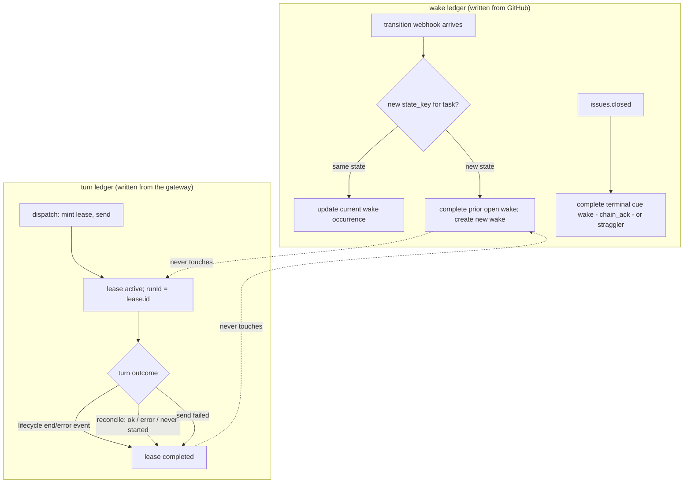

# Wakery Queue and Leases

## Introduction

This spec defines wakery's two local durable ledgers and the contract between them:

- `wake` — the **task-state ledger**: one row per observed task-state occurrence, written by ingress from GitHub webhooks.
- `wake_route_lease` — the **turn ledger**: one row per agent turn started, written by the dispatch worker from OpenClaw gateway signals.

The two ledgers are fully independent: they record different things, are written by different sources, and neither ledger's events complete the other's rows. This is the **two-ledger rule**: upstream task progression never completes a lease, and a session lease is never a durable (route, task) occupancy holder.

## Purpose

These surfaces exist so the router can:
- store eligible wake occurrences durably and preserve task history as task state changes arrive
- record every agent turn explicitly — which route, which wake, which run — with the turn's true boundaries
- represent route occupancy as the set of open turns, released on the gateway's turn-end signal rather than on inference
- keep unrouted, capacity-bound, field-lagged, and empty-run wakes visible rather than losing them

## Scope

This spec covers:
- wake lifecycle and closure rules (the wake ledger)
- lease lifecycle, the runId contract, and completion causes (the turn ledger)
- the two-ledger rule and the task-turn gate as data invariants
- storage semantics

This spec does not cover:
- REST request validation (`spec_wakery-ingress-api.md`)
- dispatch mechanics, empty-run recovery, or the gateway link (`spec_wakery-dispatch-worker.md`)
- snooze hold semantics (`spec_wakery-snooze.md` — the stateless dispatch-admission hold predicate)

## Definitions

- **wake** — local durable record of one observed task-state occurrence, identified by a minted `wake.id`, grouped by `task_key`, signatured by `state_key`.
- **wake_route_lease** — local durable record of one agent turn: one route, engaged by one wake, executed as one gateway run. The lease id **is** the run's `runId`.
- **open lease** — `status = 'active'`: a turn believed to be running. The unit of route occupancy.
- **empty run** — a `dispatched` wake with no open lease that is still its task's newest open wake: its turn ended without producing observed progression (`spec_wakery-dispatch-worker.md` Stage 5).

## Upstream / Downstream Context

### Upstream
- ingress writes new wakes, updates current occurrences, and closes superseded ones (GitHub webhooks; `spec_wakery-ingress-api.md` Stage 3)
- the `issues.closed` webhook handlers close cue and straggler wakes (`spec_wakery-conduction-chaining.md`)
- the dispatch worker writes leases from dispatch acts and gateway signals

### Downstream
- the dispatch worker reads both ledgers for the task-turn gate, selection, capacity, and empty-run recovery
- the snooze module's hold predicate reads wakes at dispatch admission (`spec_wakery-snooze.md`)

## Interfaces / Shared Contracts

Depends on: `wake`, `route`, `wake_route_lease`, `event` (column contracts: `specs/data/spec_database.md`).

## Diagrams

### The two ledgers around one task

## Procedure

### Stage 1 — Wake storage semantics

**Objective**
- store durable wake occurrences without collapsing task history.

**Rules**
- `wake.id` is a minted unique occurrence id
- `task_key = md5(project_id + task_id)` groups all occurrences of one logical task; `state_key = md5(project_id + task_id + task_status + task_audit)` signatures the occurrence
- repeated requests for the same current `task_key + state_key` update the same current occurrence; a changed `state_key` creates a new occurrence under the same `task_key`
- `wake.task_branch` is written at INSERT only — immutable once stored
- **`wake.wake_attempts`** (new) counts agent turns started for this wake — 0 until first dispatch, incremented at every send, selecting the wake vs re-wake template and enforcing the `WAKERY_REWAKE_MAX_ATTEMPTS` cap (`spec_wakery-dispatch-worker.md` Stages 4–5)
- wake status represents the local routing process state (`pending`/`queued`/`parked`/`dispatched`/`completed`), not a duplicate of the task lifecycle model

### Stage 2 — Wake closure (the single progression path)

**Objective**
- one closure rule for live work wakes, owned by ingress.

**Rules**
- **Progression closure:** when a later inbound request observes a different `state_key` for the same `task_key`, the older open wake occurrence is marked `completed`. This is the wake ledger's one closure path for live work, triggered by the observed state change alone — **not** gated by the eligibility of the new state (a progression into a principal-owned state still closes the prior wake), and **never** accompanied by any lease write.
- Hint-driven progression closes the same way: a request whose canonical fields still match the open wake's `state_key` but whose `task_status_expected`/`task_audit_expected` hints disagree with canonical closes the older wake (`trigger: "hint"`), per `spec_wakery-ingress-api.md` Stage 3. Leases are untouched on this path too.
- A wake under an open lease may be closed by progression — that is the normal mid-turn case (the agent posted its transition before its turn ended). The task-turn gate, not wake closure, is what keeps the successor wake from dispatching until the turn ends.
- **Terminal paths (closure for wakes that can have no successor):** a terminal cue wake completes on the `issues.closed` acknowledgment (`chain_ack`; a leftover non-terminal open wake on the same close completes as `straggler`), with the dispatch worker's terminal verifier as the lost-event backstop (`spec_wakery-dispatch-worker.md` Stage 5). Pre-dispatch hygiene completions (field-sync principal-terminal suppression, phantom termination) are unchanged.
- No other component completes wake rows. In particular, **turn end never closes a wake** — a turn that ends without progression leaves its wake `dispatched`, which is precisely the empty-run signal the dispatch worker recovers from.

### Stage 3 — Lease semantics (the turn ledger)

**Objective**
- record every agent turn explicitly, with the gateway as the source of truth for its boundaries.

**Rules**
- **One lease = one turn = one send.** A lease is created by the dispatch worker at dispatch (post-render, pre-send) and sends exactly once, with `idempotencyKey = lease.id`; the gateway adopts the key as the run's `runId`, so the lease knows its run before the send completes and a crash-resend cannot double-fire the turn.
- The lease id is minted per lease. A wake accumulates **one lease per turn** over its lifetime — first dispatch plus each re-wake — with **at most one open**.
- Lease fields (contract detail in `specs/data/spec_database.md` §3): `id` (= runId), `route_id`, `wake_id`, `task_key`, `wake_task_status`, `status` (`active` | `completed`), **`activity_time`** (new — the last moment the gateway showed the run doing anything: set at send, refreshed by the watcher on any event carrying this runId), `create_time`, `update_time`. `update_time` is record bookkeeping only; operational recency lives in `activity_time`.
- **Completion causes — all owned by the dispatch worker, none by wake events:**
  - lifecycle `end` or `error` event for the lease's runId (the watcher; the canonical path)
  - reconcile verdicts: run finished unobserved (`ok`), died (`error`), or unknown to the gateway (`never-started`)
  - `send_failed` — the send never took; the wake stays `queued` and retries with a fresh lease
- **Retired from the lease contract:** `repointToWake` and every re-pointing semantic; the E9 durable (route, task) session identity; progression-triggered completion; probe-nudge accounting (`probe_attempts`); the `paused` status and born-paused creation (holds act at dispatch admission and never touch lease state — `spec_wakery-snooze.md`); and `dispatch_time` (`create_time` is the send moment under one-lease-one-send). A lease is never paused, never re-pointed, never completed by a wake arrival, and holds no meaning past its one turn.
- **Route occupancy** is the count of open leases on a route versus `route.max_run` (`delivery=session` routes are capacity 1). Occupancy is turn-scoped by Principal ruling: a session lane is occupied exactly while a turn runs in it; nothing reserves a session for one task between turns — the `route` table's `delivery` column carries the per-task-type intent that makes shared-session interleaving deliberate.
- **Task-turn gate (data invariant):** at most one open lease exists per `task_key`, system-wide, at any moment — enforced by the dispatch worker's selection (`spec_wakery-dispatch-worker.md` Stage 1).

### Stage 4 — Wake status transitions and parking semantics

**Objective**
- preserve non-terminal routing states visibly without overloading status meanings.

**Rules**
- upstream field-lag at intake → `pending` with expected fields populated; field-sync graduates `pending → queued` (exclusively); ingress same-state refresh resets `queue_attempts` — all unchanged
- missing route at dispatch → `parked`; render failure → `parked` (E7); capacity or snooze hold → stays `queued` with bumped pacing fields
- routed-and-sent → `dispatched`, `wake_attempts` incremented
- **`dispatched` + no open lease + still the task's newest open wake = empty run** — not a new status; a described condition the dispatch sweep re-derives each tick and recovers by re-wake, cooldown-paced, capped
- a wake superseded by progression, acknowledged terminal cue, or verifier-completed cue → `completed`
- a wake at the re-wake cap stays `dispatched` and leaves the selection pool; only external reconciliation (progression, operator action) moves it — the max-attempts surfacing event is its alert

## Invariants

- **Two-ledger rule:** wake rows are completed only by ingress progression closure and the terminal paths; lease rows are written only by the dispatch worker. A wake arrival never completes a lease; a lease completion never completes a wake.
- **Task-turn gate:** ≤ 1 open lease per `task_key`, system-wide.
- **One lease = one turn = one send;** `runId = lease.id`; lease completion is idempotent and terminal.
- A logical task has many wake occurrences over time; at most one current open wake represents its latest observed state. A wake has many leases over time; at most one open.
- Route occupancy = open-lease count; released only by the gateway-derived completion causes, never by wakery's own downstream judgment of task content and never by upstream progression.
- `wake.task_branch` immutable; `update_time` on both ledgers is record bookkeeping only.
- Wake storage is durable; parked, pending, capped, and empty-run wakes remain visible for later action.

## Failure / Recovery

- route absence parks the wake; capacity/hold exhaustion leaves it queued with pacing fields bumped — nothing is lost
- a turn that ends without progression is recovered by the empty-run path (re-wake, cap, surface) — see `spec_wakery-dispatch-worker.md` Stage 5 for the webhook-delay property: false positives self-heal by content (outcome-blind re-wake), bounded by the cap
- gateway link loss degrades to "leases complete late": the reconnect bulk reconcile restores the turn ledger from `agent.wait` truth, and every sweep predicate re-derives from durable rows — no in-memory state exists to lose
- a lease whose send never took (`send_failed`, or crash before send caught by reconcile's `never-started`) completes without side effects; the wake retries with a fresh lease
- upstream field-lag recovery (pending/field-sync/phantom) unchanged

## Observability

Must emit at minimum (event names per `spec_wakery-dispatch-worker.md` and `specs/data/spec_event.md`):
- wake created / created-pending / updated / pending-refreshed
- wake completed by state progression (observed and hint triggers); chain_ack / straggler / terminal-verified completions
- wake parked / capacity rebound / dispatched (carrying `wake_attempts` and template) / rewake dispatched / rewake max-attempts
- lease created; `lease.completed` carrying its cause (`lifecycle_end`, `lifecycle_error`, `reconcile_ok`, `reconcile_error`, `reconcile_never_started`, `send_failed`)
- link connected / disconnected / reconciled

## References

- `spec_wakery.md`
- `specs/data/spec_database.md` — §3 lease column semantics, `wake.wake_attempts`
- `spec_wakery-dispatch-worker.md` — the turn machine that writes this spec's turn ledger
- `spec_wakery-ingress-api.md` — the intake that writes this spec's wake ledger
- `spec_wakery-conduction-chaining.md` — terminal-ack closure paths
- `specs/data/spec_database.md`
- `docs/research/research_20260729_openclaw-turn-signal-verification/research.md` — the verified turn-end boundary; Principal rulings on the lease contract and turn-scoped occupancy
