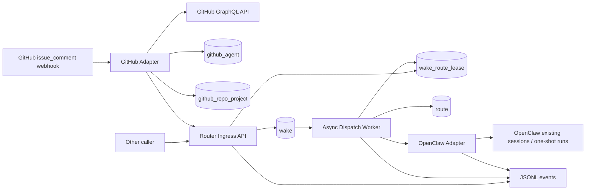
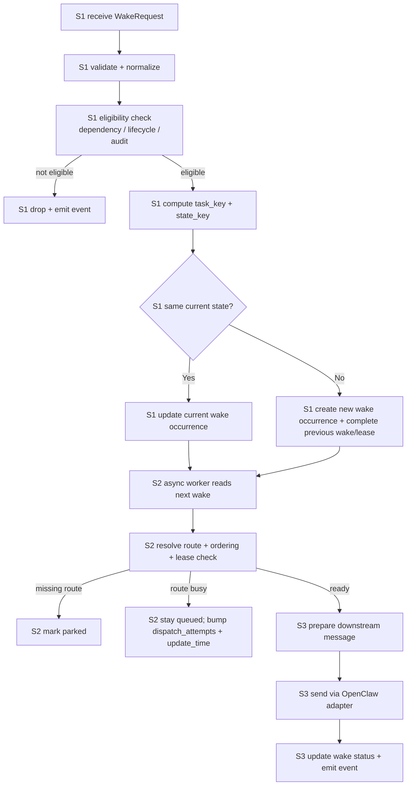

# Wakery

## Introduction

The Wakery is a small service system that accepts upstream task-change requests, validates and normalizes them into local `wake` occurrences, then routes stored wakes toward downstream OpenClaw agents.

The critical design boundary is:
- Stage 1 works with **requests**
- Stage 2 and Stage 3 work with **stored wakes**

Once a request has been normalized and stored, the request is over. Storage owns the wake.

## Purpose

The Wakery exists to:
- take in webhook/API wake requests
- validate and normalize them
- perform first-pass eligibility checks before storing work
- store only eligible `wake` records in the local system
- route stored wakes asynchronously
- dispatch messages into OpenClaw without turning the router into a shadow task system

## Scope

This spec covers:
- service architecture
- strict module boundaries
- end-to-end stage flow
- local wake abstraction
- route/lease/dispatch ownership boundaries

This spec does not cover:
- full task-state ownership
- broad durable task snapshots
- probing behavior in the MVP
- automatic creation of persistent long-standing downstream sessions in the MVP

## Definitions

- **WakeRequest** — inbound REST/webhook payload delivered to Stage 1.
- **wake** — local durable wake occurrence stored after Stage 1 normalization.
- **task_key** — stable grouping key for all wake occurrences belonging to the same logical task.
- **state_key** — stable signature for one task lifecycle+audit combination.
- **wake_route_lease** — local record connecting one wake occurrence to one route while the route slot is occupied.
- **pending** — wake was accepted at intake but the upstream source-of-truth fields have not yet caught up to the expected state hint; the field-sync sweep retries until upstream catches up or the retry budget is exhausted.
- **queued** — wake is eligible for dispatch. Capacity-bound retry attempts stay in `queued` (no separate `deferred` status); `dispatch_attempts` and `update_time` provide visibility and cooldown.
- **parked** — wake has no valid route and remains stored pending later operator/config changes.
- **dispatched** — wake has already been sent downstream and a `wake_route_lease` is `active`.

For full status semantics including entry/exit conditions, see `specs/data/spec_database.md §wake_status semantics`.

## Upstream / Downstream Context

### Upstream
The router accepts external input from:
- GitHub webhook adapter (triggered by `issue_comment.created` events; canonical state fetched from GitHub GraphQL API)
- other REST callers
- operator tooling
- workflow/scheduler callers

### Downstream
The router writes or emits to:
- wake store
- wake-route lease store
- route store
- JSONL event logs
- OpenClaw adapter

## Interfaces / Shared Contracts

This spec depends on:
- `WakeRequest`
- `WakeResponse`
- `wake`
- `route`
- `wake_route_lease`
- `github_agent`
- `github_repo_project`
- `event`

Exact field definitions are governed by `specs/data/spec_database.md`.

## Inputs

Minimum request fields:
- `request_id`
- `source`
- `project_id` (the platform project key — `project.id`, `specs/data/spec_database.md §11`)
- `task_id` (GitHub issue number)
- `task_type`
- `task_status` (from GitHub Project custom field `Status`)
- `task_audit` (from GitHub Project custom field `Audit`)
- `assignee_id` or `assignee_name`
- `timestamp`

## State Surfaces / Dependencies

### Canonical behavior requirements
The Wakery depends on:
- REST/webhook ingress service
- wake store
- route store
- wake-route lease store
- append-only event log surface
- OpenClaw adapter

### Current implementation binding direction
A practical v1 may bind these using:
- HTTP service for ingress
- Postgres for wake/route/lease/github_agent/github_repo_project entities
- JSONL event logging
- GitHub `issue_comment.created` webhook as the sole wake trigger + GitHub GraphQL API for canonical state resolution
- `github_agent` table for GitHub login → agent identity resolution
- `github_repo_project` table for GitHub repo → GitHub Project resolution at intake
- OpenClaw existing-session messaging and short-lived one-shot run-session creation for downstream dispatch

## Diagrams

### Service architecture

### End-to-end processing flow

## Procedure

### Stage 1 — Router ingress
**Objective**
- take in a web request, validate it, normalize it into local wake data, and either drop it or store it.

**Reads**
- inbound `WakeRequest`
- current open wake(s) for the same `task_key` when they exist
- current active `wake_route_lease` rows linked to those open wake(s) when they exist
- dependency/task status data required for eligibility checks

**Rules**
- Stage 1 owns the web request and ends the request lifecycle.
- Stage 1 validates request shape and required fields.
- Stage 1 normalizes request data into local wake fields.
- Stage 1 verifies eligibility before storing using the full TASK.md lifecycle/audit state matrix and resolved actor roles from `github_agent` (see `spec_wakery-ingress-api.md` for the complete eligibility table)
- ineligible items are dropped and not queued/stored as active wakes
- Stage 1 computes `task_key` and `state_key` before storing
- if the current open wake for a `task_key` already has the same `state_key`, Stage 1 updates that current wake occurrence
- if the current open wake for a `task_key` has a different `state_key`, Stage 1 creates a new wake occurrence, then completes the previous open wake(s) and related active lease(s)
- if the task later revisits an older lifecycle+audit combination, that should still create a new wake occurrence; do not collapse repeated state visits into one historical row

**Writes / Side Effects**
- created or updated `wake`
- optional completed previous `wake` rows
- optional updated `wake_route_lease`
- JSONL event records
- `WakeResponse`

### Stage 2 — Async dispatch control
**Objective**
- read stored wakes, determine routeability, check route availability, and decide the next state.

**Reads**
- stored `wake`
- route store
- wake-route lease store

**Rules**
- Stage 2 does not work with web requests.
- Stage 2 should not mention or depend on REST request processing.
- wake ordering and priority must be defined over stored `wake` records.
- if no valid route exists, mark the wake `parked`
- if the target route is busy, leave the wake `queued` and bump `dispatch_attempts` and `update_time` (no separate `deferred` status)
- if a route is valid and available, Stage 2 should create or confirm the active `wake_route_lease` before handing the wake to Stage 3
- by the end of Stage 2, the worker has a `wake`, a routing decision, and when dispatchable an active lease ready for Stage 3
- no escalation path is required in MVP for normal missing-route cases; keep them stored and diagnosable instead

**Writes / Side Effects**
- updated `wake`
- optional active `wake_route_lease`
- JSONL event records

### Stage 3 — OpenClaw dispatch
**Objective**
- take a routed wake and deliver a downstream message through OpenClaw.

**Reads**
- routed `wake`
- selected `route`
- active `wake_route_lease`

**Rules**
- Stage 3 only works with routed local wakes, not with web requests.
- Stage 3 resolves the downstream OpenClaw target and dispatches the message.
- current MVP may dispatch to already-existing downstream sessions.
- current MVP may also create short-lived one-shot run sessions.
- current MVP must not create persistent long-standing sessions.

**Writes / Side Effects**
- updated `wake`
- JSONL event records
- downstream OpenClaw call

## Invariants

- web requests end at Stage 1
- only stored `wake` entities move into Stage 2 and Stage 3
- the router does not keep broad durable task snapshots
- `wake.id` is the local durable identifier for one wake occurrence, not `request_id`
- `task_key` groups occurrences by logical task
- `state_key` identifies the lifecycle+audit signature of an occurrence
- missing-route cases are parked, not lost

## Failure / Recovery

- malformed requests are dropped in Stage 1 with event logs
- ineligible requests are dropped in Stage 1 and left for future upstream requests to re-trigger when task state changes again
- route-missing wakes remain parked for later operator/config action
- busy-route wakes stay `queued` with bumped `dispatch_attempts` / `update_time`; the next dispatch tick will pick them up once the route has capacity
- field-lagged wakes remain `pending` with `task_status_expected` / `task_audit_expected` populated; the field-sync sweep retries until upstream catches up or the retry budget is exhausted

## Observability

The system must make it easy to answer:
- was the request accepted or dropped at Stage 1?
- did it become a local wake or not?
- was a current wake updated or was a new wake occurrence created?
- was a prior wake closed because a new state arrived?
- was a wake parked because routing was missing?
- was a wake held in `pending` because upstream fields had not yet caught up to a transition signal?
- did a wake rebound on capacity exhaustion (and how many times)?
- was a downstream OpenClaw message sent?

## Deliverables

Implementation under this spec must produce:
- ingress API
- local wake entity/store
- route and wake-route-lease entities/stores
- github_agent entity/store
- github_repo_project entity/store
- async dispatch worker
- OpenClaw adapter
- GitHub adapter (comment-trigger + GraphQL state resolution)
- template renderer (file-based rendering of the dispatch templates — `spec_wakery-template-renderer.md`)
- JSONL event logging

## Verification

The system is acceptable when it can demonstrate:
- ineligible requests are dropped before queue/storage ownership proceeds
- repeated task-change requests with the same current state update the same current wake occurrence
- task-change requests with a changed lifecycle/audit state create a new wake occurrence under the same `task_key`
- missing-route wakes become `parked`
- busy-route wakes stay `queued` with `dispatch_attempts` and `update_time` reflecting each rebound attempt
- field-lagged wakes (transition signal vs upstream) enter `pending` and graduate to `queued` once the field-sync sweep observes upstream catch up
- Stage 3 sends to existing OpenClaw sessions or creates short-lived one-shot run sessions in MVP
- Stage 3 does not create persistent long-standing sessions in MVP

## References

- `prd_wakery.md`
- `spec_wakery-contracts.md`
- `spec_wakery-ingress-api.md`
- `spec_wakery-queue-and-leases.md`
- `spec_wakery-dispatch-worker.md`
- `spec_wakery-openclaw-adapter.md`
- `spec_wakery-wake-message.md`
- `spec_wakery-template-renderer.md`
- `specs/data/spec_database.md`
- `specs/data/spec_event.md`
- `spec_wakery-github-adapter.md`
