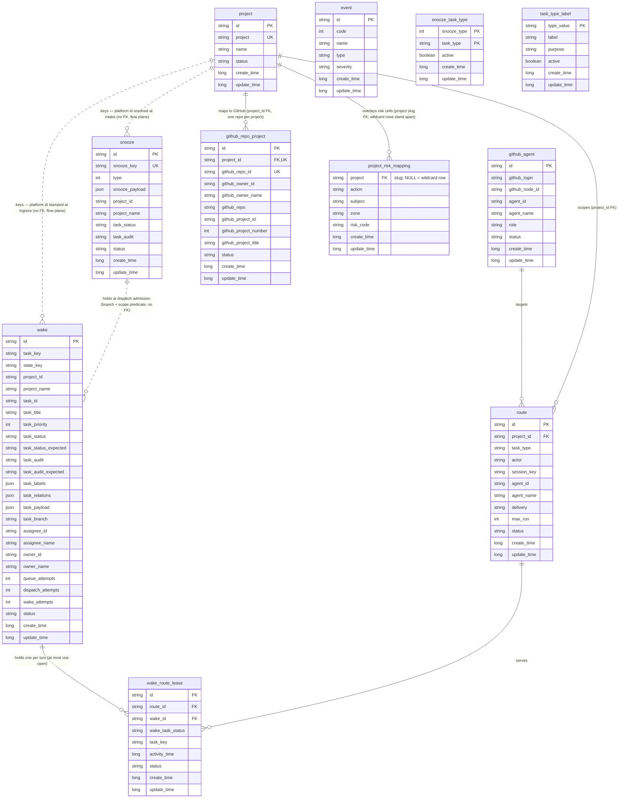

# Vork Database

The transactional data layer — the Postgres store that controls the resources the platform manages and defines how data relates. Postgres on <db-host> (`<db-host>:5432`), database `vork` (`wakery` before the cutover rename), runtime role `vork_app` (DML-only, shared by every app connection and operator seeding act) after the connection-role flip (#35); structure changes run under the owner role `vork_owner`. Structure via idempotent additive migrations and canonical rows via idempotent seed — the migrate=structure / seed=data split — both owned by the data-layer module `apps/data/` (`@vork/data`: `src/migrate.ts`, `src/seed.ts`, the cutover data acts, and the key derivation of §Durable identity), the code home of this spec set; apps consume it, none migrates at startup. Environment-specific registry rows (`project`, `github_repo_project`, `github_agent`, `project_risk_mapping`) are deploy-time data acts, recorded in deployment records.

The data layer's sibling specs: `specs/data/spec_config.md` (operational — env contracts, config files, template homes, keystore convention) and `specs/data/spec_event.md` (analytical — the event registry). App specs define mechanisms and envelopes and consume all three by pointer.

## Naming Rules

### Time fields
Use unix timestamp with millisecond precision.
If a field means “time this thing happened or arrived”, call it `timestamp` on ingress payloads.
For durable local entities, use `create_time` and `update_time`.

`create_time`/`update_time` are **record bookkeeping only** — when the row was created and last written. Operational recency is never read off `update_time`; a field carrying operational meaning gets its own column (e.g. `wake_route_lease.activity_time`).

### Column-value semantics

When a table column's values need meaning beyond the field table's one-line note — status enums, registered value sets — the explanation lives in a subsection **directly under that table's section**, one heading level below the table title, named `<table>_<column> semantics`. Value semantics are never consolidated at the end of the document. Status values are not informal flags: each value has a single meaning, and a new behavior gets a new value, not an overload of an existing one.

### Durable identity
- `request_id` identifies an inbound request
- local durable entity ids identify local records
- `wake.id` is not the same thing as `request_id`
- `task_key` groups all wake occurrences that belong to the same logical task
- `state_key` identifies one task-state signature for that task

## Data Entity Contracts

### ERD

### Entity relationship notes

- `github_agent` maps GitHub user accounts to agent identities and roles. Accounts are not dedicated per agent — dispatch routes by `route (project_id, task_type, actor)`, not by the assignee's account; the assignee account need only resolve to a `github_agent` with `role=agent` (one shared worker account is the norm for non-auditor work).
- `github_repo_project` is the GitHub integration mapping: one row binds a platform `project_id` to its GitHub coordinates — repo, owner, board — all under the `github_` prefix. One repo per project (`project_id` UNIQUE), one project per repo (`github_repo_id` UNIQUE). It supplies the `github_project_id` that filters issue `projectItems` at intake and the `github_repo_id` the GraphQL `node(id:)` queries address.
- `wake` is the occurrence record; one logical task may accumulate many wake rows over time.
- `route` is the routing target/config record selected by Stage 2. Route resolution uses `project_id + task_type + actor` to find the active matching route, with a `task_type IS NULL` row acting as the project-level wildcard within the same `actor` lane. The three actor lanes — `owner`, `assignee`, `auditor` — are routed independently; each lane may have its own exact and wildcard routes. Assignee/owner GitHub identity on the wake is used for ingress eligibility filtering, not as a route-resolution key; the `actor` field on the route is what selects between routes.
- `wake_route_lease` is the connecting occupancy record between one wake occurrence and one route.
- `project` is the registry parent for per-project data (§11) and the platform key of the runtime: `route.project_id` (FK), `wake.project_id`, and `snooze.project_id` carry `project.id`; GitHub identifiers appear only inside `github_*`-prefixed fields of the integration mapping.
- `snooze_task_type` and `task_type_label` are standalone lookup tables: they facilitate wakery's operations (correlation constraint, Stage-6 validation) and hold no foreign-key relationships with the flow entities. `project_risk_mapping` is not in this class — it is the per-project overlay child of `project`.
- A `wake` may have zero or one lease total. If the wake never gets dispatched, it may have zero; if it is dispatched, it should have exactly one.
- `route` may serve many leases over time.
- Active lease concurrency is constrained by route delivery mode:
  - `delivery = session` -> at most one active lease at a time
  - `delivery = run` -> at most `max_run` active leases at a time

### 1) `wake`

Local durable wake entity.

`wake.id` is a minted unique local id for one observed wake occurrence.

Additional grouping/signature fields:
- `task_key = md5(project_id + task_id)`
- `state_key = md5(project_id + task_id + task_status + task_audit)`

This means:
- `wake.id` identifies one local wake occurrence
- `task_key` groups all wake occurrences for the same logical task
- `state_key` identifies one lifecycle+audit state signature for that task

| Field | Type | Required | Notes |
|---|---|---:|---|
| `id` | string | yes | Minted unique local wake id for one observed wake occurrence. |
| `task_key` | string | yes | Stable grouping key: `md5(project_id + task_id)`. |
| `state_key` | string | yes | Stable state signature: `md5(project_id + task_id + task_status + task_audit)`. |
| `project_id` | string | yes | The platform project key: `project.id` — stamped at ingress from the `github_repo_project` mapping. By-convention reference, no FK (flow plane). |
| `project_name` | string | no | Informational display text (`project.name`). |
| `task_id` | string | yes | Canonical task id. For GitHub sources, the issue number. |
| `task_title` | string | no | Mapped from request. |
| `task_priority` | integer | no | Mapped from request. |
| `task_status` | string | yes | Current task lifecycle status as observed in the upstream source of truth. For GitHub sources, from the Project custom field `Status`. |
| `task_status_expected` | string | no | Lifecycle status the wake is **waiting for** the upstream source to reflect. Populated only on the `pending` path when a transition comment hint disagrees with `task_status` at intake; null otherwise. Cleared once `pending → queued` resolves. |
| `task_audit` | string | yes | Current task audit/security status as observed in the upstream source of truth. For GitHub sources, from the Project custom field `Audit`. |
| `task_audit_expected` | string | no | Audit status the wake is **waiting for** the upstream source to reflect. Same semantics as `task_status_expected`. |
| `task_labels` | jsonb | no | JSON array of all label names on the upstream Task at intake (e.g. `["task:parent","priority:high"]`). Empty array `[]` when no labels are present. Refreshed on each ingress same-state update of the wake. Used by label-driven routing/gating logic such as the `task:parent` check in `spec_wakery-task-relations.md`. Literal-label existence is checked with the JSONB exists operator: `task_labels ? '<label>'`. |
| `task_relations` | jsonb | no | Structured capture of the Task's relations to other Tasks at intake. Each entry is gated on its corresponding label: `parent: { task_id: <string> }` when the Task is labeled `task:child` and has an upstream parent; `children: { total: <int>, completed: <int> }` when the Task is labeled `task:parent`; `blocked_by: { total: <int>, completed: <int> }` when the Task is labeled `task:blocked`; `blocking: { total: <int>, completed: <int> }` when the Task is labeled `task:blocking`. The `children` and `blocked_by` summary entries are included even when `total == 0` (the empty summary is the label-only signal that drives gate suspension); `blocking` similarly carries a `total: 0` placeholder when labeled but no relations are attached. `parent` omits the entry entirely when no upstream parent exists, since it has no gate to feed. `NULL` when none of the four labels are present. Refreshed on the GitHub adapter's `sub_issues`, `issue_dependencies`, and `issues.closed` / `issues.reopened` webhook events. See `spec_wakery-task-relations.md` for population, refresh, and dispatch-filter (Parent gate + Blocked gate) semantics. |
| `task_payload` | jsonb | no | Arbitrary extra bag from request. |
| `task_branch` | string | no | The working branch bound to this wake's task, resolved at wake build — own `linkedBranches`, else Parent hop, else Blocked-by hop (`spec_wakery-conduction-chaining.md`). NULL for laneless task types or an unresolved binding; immutable once stored (each wake resolves at its own build, no retroactive updates). Correlation surface for the branch-based snooze types (`spec_wakery-snooze.md`). |
| `assignee_id` | string | no | Upstream identity id for the task assignee. For GitHub sources, the GitHub user node ID. |
| `assignee_name` | string | no | Upstream identity name for the task assignee. For GitHub sources, the GitHub login. |
| `owner_id` | string | no | Upstream identity id for the task owner. For GitHub sources, the GitHub user node ID. |
| `owner_name` | string | no | Upstream identity name for the task owner. For GitHub sources, the GitHub login. |
| `queue_attempts` | integer | yes | Number of times the field-sync tick has re-fetched upstream source-of-truth fields trying to advance this wake from `pending` to `queued`. Capped by `WAKERY_PENDING_MAX_ATTEMPTS`. Incremented only by the field-sync sweep while the row is in `pending`. May be reset to `0` by the ingress same-state update path when a fresh request reports a fully-synced state for an existing pending wake — this is the only mutation ingress performs on this field and the only way a frozen-pending row re-opens its attempt budget short of full state-progression closure. |
| `dispatch_attempts` | integer | yes | Number of times the dispatch worker has pulled this wake and tried to dispatch it. Bumped on every dispatch tick that selects the wake, regardless of whether the attempt resulted in `dispatched`, capacity-rebound (still `queued`, `update_time` bumped), or `parked`. Selection-pacing counter only. |
| `wake_attempts` | integer | yes | Number of agent **turns actually started** for this wake — incremented at each successful send (first dispatch and every re-wake). `0` selects the wake-message template, `>0` the re-wake template; capped by `WAKERY_REWAKE_MAX_ATTEMPTS` (`spec_wakery-dispatch-worker.md` Stages 4–5). |
| `status` | enum | yes | One of `pending`, `queued`, `parked`, `dispatched`, `completed`, `deleted`. See [wake_status semantics](#wake_status-semantics). |
| `create_time` | long | yes | Entry creation time in unix milliseconds. |
| `update_time` | long | yes | Last update time in unix milliseconds. |

#### wake_status semantics

| status | meaning | how a wake gets here | how a wake leaves |
|---|---|---|---|
| `pending` | A transition was signalled (e.g. a transition comment) but the upstream source-of-truth fields (`task_status` / `task_audit`) do not yet reflect it. The wake is on hold; the field-sync tick will re-read upstream up to `WAKERY_PENDING_MAX_ATTEMPTS` times at `WAKERY_PENDING_RETRY_INTERVAL_MS` cadence, comparing against `task_status_expected` / `task_audit_expected`. | Stage 5 stores the wake as `pending` when the comment hint disagrees with the freshly fetched upstream fields. | → `queued` once the field-sync tick observes upstream catching up to the expected values. **The `pending → queued` transition is owned exclusively by the dispatch worker's field-sync sweep; ingress never graduates a pending wake.** → `completed` when reconciliation closes the wake because a later transition for the same `task_key` arrives. If the retry budget is exhausted with no match, the wake **stays** `pending`; it does not auto-park. The frozen-pending row re-opens its budget when ingress observes a same-state request whose hint/observed values agree and resets `queue_attempts` to `0`. |
| `queued` | The wake is eligible for dispatch. It may have been pulled by the dispatch worker and rebounded one or more times because route capacity was exhausted; `dispatch_attempts` and `update_time` together provide rate-limiting and visibility for those reattempts. There is no separate "deferred" state. | Wake created with synced upstream state, or graduated from `pending`. | → `dispatched` when the dispatch worker creates a lease and hands the wake to the OpenClaw adapter. → `parked` when the dispatch worker selects the wake but no route resolves. → `completed` if reconciliation closes the wake before dispatch. |
| `parked` | The dispatch worker selected the wake but route resolution returned no match (no exact route, no project catch-all, and the wake is not the auditor lane). The wake is set aside; there is no automatic retry. Wakery does not unstick `parked` wakes on its own. | Dispatch worker found no route. | → `completed` when reconciliation closes the wake because a later transition for the same `task_key` arrives. (No automatic exit otherwise.) |
| `dispatched` | A turn has been started for this wake. While the turn runs, an open lease exists; after the turn ends the wake may legitimately sit `dispatched` with **no** open lease — the empty-run condition the dispatch worker recovers by re-wake (`spec_wakery-dispatch-worker.md` Stage 5). | Dispatch worker created the lease and sent the turn. | → `completed` on ingress progression closure (a later transition for the same `task_key`), on the `issues.closed` terminal paths, or by the terminal verifier. **Never** by lease completion — turn end closes leases, not wakes (two-ledger rule, `spec_wakery-queue-and-leases.md`). |
| `completed` | Terminal. Either the work was acknowledged finished, the wake was superseded by a newer wake for the same `task_key`, or the wake was reconciled away as the task progressed past it. | Reached from any non-terminal status via the conditions above. | — |
| `deleted` | Soft-deleted. Treated as gone for all routing/probe purposes. Reserved for administrative cleanup; not part of the normal lifecycle. | Manual or automated cleanup. | — |

Reconciliation rule: a fresh transition for the same `task_key` closes any prior open wakes (`pending`, `queued`, `parked`, `dispatched`) by transitioning them to `completed`. This is what unsticks a `pending` wake whose retry budget was exhausted and a `parked` wake whose route eventually exists.

### 2) `route`

Local route entity.

Route resolution precedence for v1:

1. Determine the wake's responsible actor (`owner`, `assignee`, or `auditor`) from the eligibility matrix in `spec_wakery-ingress-api.md` Stage 4 (lifecycle + audit → actor).
2. Select the active exact route for `project_id + task_type + actor`.
3. If no exact match, fall back to the project-level wildcard within the same actor lane: `project_id + task_type IS NULL + actor`.
4. If neither exists, the wake parks (no `agent_id`-based fallback; routing is actor-scoped).

The route defines the downstream agent and delivery target. Assignee and owner GitHub identities on the wake are used for ingress eligibility filtering, not for route lookup. `agent_id` is dispatched-to, not resolved-on; the auditor lane is handled by `actor='auditor'` rather than by special-casing `agent_id='heimdall'`.

#### Route provisioning

A project's route set is written once, at its creation, by `foundry bootstrap`'s register stage (`spec_foundry.md §Register`) from the **route template** — a pure function of the project key and the bundle's specialists, exported by `@vork/data` (`routeTemplate(project_key, specialists)`; the platform's own seed is the same function applied to the platform project). Every row is `run` delivery with session key `agent:<agent_id>:<project_key>:<lane>:run:[wake_route_lease_id]`:

| Rows | `actor` | `task_type` | `agent_id` | lane | `max_run` |
|---|---|---|---|---|---:|
| one per stage type (`project_inception` … `project_hotfix`, the nine `project_*` types) | `assignee` | the type | `main` | `stage` | 1 |
| assignee wildcard — every execution type not claimed below | `assignee` | NULL | `main` | `all` | 1 |
| auditor wildcard | `auditor` | NULL | `heimdall` | `audit` | 3 |
| owner wildcard | `owner` | NULL | `sarge` | `task` | 1 |
| one per specialist task | `assignee` | the type | the specialist | the type | 1 |

A specialist's claim on a stage type replaces that type's `main` row. Uniqueness is `(project_id, task_type, actor)` among active rows — provisioning and seeding are idempotent on that key: an existing row reports existing; an existing row bound to a different agent is ops state and stands (foundry records drift, never overrides). Later changes — specialist swaps, lane overrides, `session` delivery — are ops acts on this table, not re-provisioning.

| Field | Type | Required | Notes |
|---|---|---:|---|
| `id` | string | yes | Route id. |
| `project_id` | string | yes | The platform project key: references `project.id` (FK). |
| `task_type` | string | no | Route-specific task type binding. When null/empty, this row is the project-level wildcard within its `actor` lane, used only when no exact `task_type` match exists. |
| `actor` | enum | yes | One of `owner`, `assignee`, `auditor`. Identifies which TASK.md role the route serves. Each `(project_id, task_type)` pair may have at most one route per actor. The dispatch worker derives the wake's required actor from the eligibility matrix and selects the route matching that actor. |
| `session_key` | string | no | Downstream session key string. For `delivery = session`, store the concrete target session key (for example `agent:main:<project_key>` or `agent:visor:<project_key>:coding`). For `delivery = run`, store the template session key string using `[wake_route_lease_id]` as the substitution token (for example `agent:heimdall:<project_key>:run:[wake_route_lease_id]` or `agent:main:<project_key>:task:run:[wake_route_lease_id]`). |
| `agent_id` | string | yes | Target OpenClaw agent id for delivery. Used by the adapter to dispatch the selected route; not a route-resolution key. |
| `agent_name` | string | no | Human-readable agent name. |
| `delivery` | enum | yes | `session` or `run`. `session` maps to existing-session delivery. `run` maps to short-lived one-shot run-session creation using the route `session_key` template with `[wake_route_lease_id]` substituted at dispatch time. Persistent long-standing session creation is not allowed in MVP. |
| `max_run` | integer | no | Maximum active concurrency when `delivery = run`. |
| `status` | enum | yes | `active`, `disabled`, `deleted`. |
| `create_time` | long | yes | Entry creation time in unix milliseconds. |
| `update_time` | long | yes | Last update time in unix milliseconds. |

### 3) `wake_route_lease`

Turn record: one row per agent turn started — one route, engaged by one wake, executed as one gateway run. One lease = one turn = one send; the lease id **is** the run's `runId` (sent as the idempotency key). Leases are written exclusively by the dispatch worker (two-ledger rule, `spec_wakery-queue-and-leases.md`).

| Field | Type | Required | Notes |
|---|---|---:|---|
| `id` | string | yes | Lease id, minted per lease. Doubles as the gateway run's `runId`: every send carries `idempotencyKey = lease.id`, which the gateway adopts as the run identity. |
| `route_id` | string | yes | Related route id. |
| `wake_id` | string | yes | Related wake id. **Not** unique: a wake accumulates one lease per turn over its lifetime (first dispatch plus each re-wake), with at most one open at any moment. |
| `wake_task_status` | string | yes | The wake task status at the moment the turn was started. Informational/diagnostic only — progression detection does not read it. |
| `task_key` | string | yes | The task this turn serves — set on every lease, both delivery modes. The task-turn gate reads it: at most one open lease per `task_key`, system-wide (`spec_wakery-dispatch-worker.md` Stage 1). |
| `activity_time` | long | yes | The last moment the gateway showed this run doing anything: set at send, refreshed by the lifecycle watcher on any `agent`-family event carrying this lease's runId (assistant chunks, tool traffic, heartbeats). The quiet-lease reconcile selects on it (`spec_wakery-dispatch-worker.md` Stage 6). Operational recency lives here, never in `update_time` (§Naming Rules). |
| `status` | enum | yes | One of `active`, `completed`, `deleted`. See [wake_route_lease_status semantics](#wake_route_lease_status-semantics). |
| `create_time` | long | yes | Entry creation time in unix milliseconds. |
| `update_time` | long | yes | Last update time in unix milliseconds. |

#### wake_route_lease_status semantics

| status | meaning | how a lease gets here | how a lease leaves |
|---|---|---|---|
| `active` | The turn is believed to be running. The route's capacity slot is consumed; `activity_time` tracks observed run activity; the quiet-lease reconcile checks silent leases against gateway truth (`agent.wait`). | Dispatch worker created the lease and sent the turn (the wake moved to `dispatched` in the same act). | → `completed` on any of the gateway-derived causes: the run's lifecycle `end`/`error` event (the watcher), a reconcile verdict (`ok`, `error`, or `never-started`), or `send_failed`. Never by wake arrivals or task progression. |
| `completed` | Terminal. The turn is over (however it went — the wake ledger and the empty-run predicate carry the consequences). Capacity is released. | Reached from `active` by the causes above; idempotent — watcher, reconcile, and send-failure completion converge on the same terminal state. | — |
| `deleted` | Soft-deleted. Reserved for administrative cleanup. | Manual or automated cleanup. | — |

Not part of this contract: probe-nudge accounting (`probe_attempts`, `WAKERY_PROBE_MAX_ATTEMPTS`) — turn supervision is the dispatch worker's fact-based reconcile; a `paused` status or born-paused creation — holds act at dispatch admission and never touch lease state (`spec_wakery-snooze.md`); and `dispatch_time` — `create_time` is the send moment under one-lease-one-send.

### 4) `github_agent`

Identity mapping between GitHub user accounts and agent identities. Accounts are not dedicated per agent: dispatch routes by `route (project_id, task_type, actor)` and discards the assignee's resolved agent_id, so the assignee account need only resolve here with `role=agent`. The shared worker account (`<worker-login>`) covers all non-auditor work; the auditor account (`<auditor-login>`) and the Principal (`<owner>`) keep distinct logins.

| Field | Type | Required | Notes |
|---|---|---:|---|
| `id` | string | yes | Mapping entry id. |
| `github_login` | string | yes | GitHub user login (e.g. `<auditor-login>`). Appears in issue assignee, author, and comment user fields. |
| `github_node_id` | string | yes | GitHub user global node ID (e.g. `U_kgDOxxxxxxxx`). Immutable identifier that survives username changes. |
| `agent_id` | string | yes | Corresponding OpenClaw agent id. |
| `agent_name` | string | no | Human-readable agent name. |
| `role` | enum | yes | `principal`, `auditor`, `agent`. Used by eligibility rules to determine routing behavior. |
| `status` | enum | yes | `active`, `disabled`. |
| `create_time` | long | yes | Entry creation time in unix milliseconds. |
| `update_time` | long | yes | Last update time in unix milliseconds. |

The v1 mapping shape — one row per account, seeded per environment with that account's own node id:

| github_login | github_node_id | agent_id | role |
|---|---|---|---|
| `<owner>` | the Principal's node id | — | `principal` |
| `<worker-login>` | the worker account's node id | (OpenClaw agent id) | `agent` |
| `<auditor-login>` | the auditor account's node id | (Heimdall agent id) | `auditor` |

### 5) `github_repo_project`

The GitHub integration mapping: binds one platform project to its GitHub coordinates — every GitHub-native field carries the `github_` prefix, and nothing outside this table (and `github_agent`) stores a GitHub identifier. One repo per project and one project per repo, both enforced. A webhook delivery for a repo with no row is not eligible for wake processing. Seeding order: `project` → `github_repo_project`.

| Field | Type | Required | Notes |
|---|---|---:|---|
| `id` | string | yes | Local mapping entry id. |
| `project_id` | string | yes | The platform project: references `project.id` (FK). Unique — one repo per project, the reverse-lookup invariant the runtime relies on. |
| `github_repo_id` | string | yes | GitHub repository global node ID (e.g. `R_kgDOL1abCd`). Unique; immutable — the address the GraphQL `node(id:)` queries use, which is what makes the mapping rename-proof. |
| `github_owner_id` | string | yes | Repository owner global node ID. Stored, unread by runtime paths. |
| `github_owner_name` | string | yes | Repository owner login (e.g. `<owner>`). Display-only: `project_url` rendering and `owner/repo` labels — never API addressing. The URL form hardcodes `/users/` (personal-owner assumption). |
| `github_repo` | string | yes | Repository name. Display and diagnostics. |
| `github_project_id` | string | yes | ProjectV2 global node ID (e.g. `PVT_kwHOxxxxxxxxxxxxx`) — matched against `projectItems.nodes[].project.id` to select the tracked board's item at intake. |
| `github_project_number` | integer | yes | Board dashboard number (`project_url` rendering). |
| `github_project_title` | string | no | Board title, display. |
| `status` | enum | yes | `active`, `disabled`. |
| `create_time` | long | yes | Entry creation time in unix milliseconds. |
| `update_time` | long | yes | Last update time in unix milliseconds. |

### 6) `event`

Definition entity for supported event kinds.

This is **not** the event log record storage — runtime events are append-only JSONL records (`specs/data/spec_event.md`).

| Field | Type | Required | Notes |
|---|---|---:|---|
| `id` | string | yes | Event definition id. |
| `code` | integer | yes | Numerical event code. Maintain the supported code list in `specs/data/spec_event.md §Event code appendix`. |
| `name` | string | yes | Semantic event name. |
| `type` | enum | yes | `wakery`, `system`. Extend later as the system grows. |
| `severity` | enum | yes | `debug`, `info`, `warn`, `error`, `fatal`. |
| `create_time` | long | yes | Entry creation time in unix milliseconds. |
| `update_time` | long | yes | Last update time in unix milliseconds. |

### 7) `snooze`

Durable hold record: one external process instance running (or believed running) against one branch — read by the dispatch-admission **hold predicate** (`spec_wakery-snooze.md`). Pure delay: carries no outcome, references no wake and no lease. This table is the data contract.

| Field | Type | Required | Notes |
|---|---|---:|---|
| `id` | string | yes | Minted unique snooze id. |
| `snooze_key` | string | yes | Upsert identity, one form: `md5(type + correlation value)`. Unique. See [snooze_snooze_key semantics](#snooze_snooze_key-semantics). |
| `type` | integer | yes | Integer type code. See [snooze_type semantics](#snooze_type-semantics). |
| `snooze_payload` | jsonb | yes | Type-interpreted bag from the source event, including the type's correlation values. See [snooze_snooze_payload semantics](#snooze_snooze_payload-semantics). |
| `project_id` | string | no | The platform project key (`project.id`), resolved from the source event's repo at arrival via `github_repo_project`. By-convention, no FK. |
| `project_name` | string | no | Human-readable project name, same resolution. |
| `task_status` | string | yes | The lifecycle state this snooze holds — the type's expected state, known at arrival (`CI`/`PR`: `Progress`). |
| `task_audit` | string | yes | The audit state this snooze holds — same source (`CI`/`PR`: `Gated` — the execution lane's audit value; entering `Progress` re-gates in the same atomic transition (`TASK.md §Transition`), so no `Progress+Approved` state exists to hold). |
| `status` | enum | yes | `active`, `completed`, `timeout`. See [snooze_status semantics](#snooze_status-semantics). |
| `create_time` | long | yes | Entry creation time in unix milliseconds. |
| `update_time` | long | yes | Last update time — refreshed by repeat start events; the timeout clock reads this field. |

No task identity is stored, and no correlation to a wake ever happens at intake: the row records only that an external process runs against a branch. The hold match is the consult-time predicate — payload `branch` against `wake.task_branch`, the stored `task_status`/`task_audit` scope against the wake's state, and the wake's task type against the `snooze_task_type` rows (§8) — evaluated fresh at every dispatch admission (`spec_wakery-snooze.md` Stage 2).

#### snooze_snooze_key semantics

One form: `md5(type + <type's correlation value>)` — for `CI` the `ci_head_sha`, for `PR` the `pr_number`. The key is the upsert identity: repeat start events for the same external process instance land on the same row and refresh `update_time`; a new process instance (a force-push's new head sha, a new PR) is a new key, a new row. 

#### snooze_type semantics

The valid `snooze.type` values supported by the current wakery version. This section — not a DB table — is the value registry; the code registry keyed by the same integer carries each type's logic (`spec_wakery-snooze.md §Type registry`). Adding a type means a new row here plus its code-registry entry; a retired type keeps its row, marked retired, and its integer is never reused. Names are one word, rendered in events and messages; rows store the integer.

| Value | Name | Meaning |
|---:|---|---|
| `1` | `CI` | Holds a task while its gate workflow runs on its lane (`workflow_run` requested/in_progress → completed; claims only `workflow_run.name` = the canonical `CI` workflow — `check_suite` is repo-webhook-undeliverable for starts, scope #16). |
| `2` | `PR` | Holds a task while its pull request awaits merge (`pull_request` opened → closed). |

#### snooze_snooze_payload semantics

The type-interpreted bag from the source event — the snooze analog of `wake.task_payload`, read only by the owning type's logic. Keys are type-native, not normalized across types. Current shapes:

| Type | Payload keys |
|---|---|
| `1 — CI` | `branch`, `ci_head_sha`, `workflow_run_id` |
| `2 — PR` | `branch`, `pr_number`, `base_ref` |

`branch` is each current type's correlation surface against `wake.task_branch`; `ci_head_sha` / `pr_number` are the correlation values feeding `snooze_key`. A future type declares its own keys (a `DEPLOY` type would carry vendor event fields and no `branch` at all).

#### snooze_status semantics

| status | meaning | how a snooze gets here | how a snooze leaves |
|---|---|---|---|
| `active` | The external process is believed running; the hold predicate defers scope-matched wakes on the row's branch while this row is unexpired. Never references a wake or lease. | Start event upserted (create or re-arm). | → `completed` on the end event; → `timeout` on clock expiry. |
| `completed` | Terminal. The external process ended: the type's end event arrived and settled the hold. Outcome never read. | End-event match on `(type, correlation value)`. | — |
| `timeout` | Terminal. Self-relief: `now - update_time` exceeded `WAKERY_SNOOZE_TIMEOUT_MS` with no end event — a lost signal or hung external process. Emits `snooze.timeout` (warn); the re-waked agent owns the missing-signal judgment (the settled-holds context shows the `timeout`). The predicate applies expiry lazily, so holding-correctness never waits on this flip. | The timeout sweep on the dispatch worker's tick (bookkeeping). | — |

Not statuses of this contract: `parked` — intake never correlates, so no event waits for a wake; `revoked` — a predicate that matches nothing already holds nothing.

### 8) `snooze_task_type`

Standalone lookup table — like `task_type_label` and `project_risk_mapping`, it facilitates wakery's operations without foreign-key relationships to the flow entities. It links each snooze type to the task types it may hold — one row per pair, read inside the dispatch-admission **hold predicate** (`spec_wakery-snooze.md` Stage 2). Data, not code: the mapping evolves by row changes, no deploy. Rows are seeded (structure/data split) and adjusted by the operator; retire a pair by `active = FALSE`, never delete.

| Field | Type | Required | Notes |
|---|---|---:|---|
| `snooze_type` | integer | yes | A valid value per [snooze_type semantics](#snooze_type-semantics). Composite PK with `task_type`. |
| `task_type` | string | yes | A `task_type_label.type_value`. Composite PK with `snooze_type`. |
| `active` | boolean | yes | Logical delete: retire a mapping with `active = FALSE`; the correlation query reads `WHERE active = TRUE`. |
| `create_time` | long | yes | Entry creation time in unix milliseconds. |
| `update_time` | long | yes | Last update time in unix milliseconds. |

Seed content: types `1 — CI` and `2 — PR` each map to the repo-changing task types — the seven lane-bearing Stage types (`project_inception`, `project_draft`, `project_decomposition`, `project_integration`, `project_review`, `project_release`, `project_hotfix`) and the repo-changing execution types (`spec`, `research`, `deliberation`, `coding`, `bug`, `enhancement`, `defect`). Excluded from the seed: `project_operation`, `project_deployment`, `dbops` — no lane, no CI/PR to wait on. The exclusion is a seed choice, not a rule: future types and future mappings are new rows.

### 9) `task_type_label`

The runtime task-type registry: Stage-6 validation reads the valid `type:` set from this table, not from code or `constants.md` (`spec_wakery-task-type-registry.md`). Structure by migration, data by seed; managed live via `add-task-type.ts` (insert-or-reactivate / retire).

| Field | Type | Required | Notes |
|---|---|---:|---|
| `type_value` | string | yes | The `type:` label value (e.g. `project_draft`, `coding`). Primary key. |
| `label` | string | yes | Human label. |
| `purpose` | string | no | What the type is for. |
| `active` | boolean | yes | Retire = `active = FALSE`, never delete — Stage-6 reads `WHERE active = TRUE`. |
| `create_time` | long | yes | Entry creation time in unix milliseconds. |
| `update_time` | long | yes | Last update time in unix milliseconds. |

### 10) `project_risk_mapping`

The Resolver's deterministic mapping from an extracted operation cell to a Risk Code (`SECURITY.md` Preview; consumed by the Resolver, seeded per project). 

| Field | Type | Required | Notes |
|---|---|---:|---|
| `project` | string | no | Project scope of the row — the project key slug; **NULL = wildcard row** applying to all projects. References `project.project` (FK); NULL wildcard rows pass FK semantics untouched. Named `project` because it carries the slug; the Resolver input-envelope field carries the same name per the cross-surface naming rule. |
| `action` | string | yes | Operation-cell dimension. |
| `subject` | string | yes | Operation-cell dimension. |
| `zone` | string | yes | Operation-cell dimension. |
| `risk_code` | string | yes | One of `R100`, `R200`, `R300`, `R999` (DB CHECK-constrained to the Resolver-emit set). |
| `create_time` | long | yes | Entry creation time in unix milliseconds. |
| `update_time` | long | yes | Last update time in unix milliseconds. |

#### project_risk_mapping_project semantics

Row identity is the composite `(project, action, subject, zone)` with `project` nullable — a literal Postgres PRIMARY KEY cannot express it (PK columns are implicitly NOT NULL, which would reject wildcard rows). Identity is enforced as two partial unique indexes: `project_risk_mapping_project_cell_idx` over rows `WHERE project IS NOT NULL`, `project_risk_mapping_wildcard_cell_idx` over `(action, subject, zone) WHERE project IS NULL` . Resolution prefers the project row; the wildcard is the fallback. Non-null values are FK-bound to `project.project` — an overlay row cannot name an unregistered project.

### 11) `project`

The project registry — the parent entity for per-project data and the platform key of the runtime. One row per Vork-governed project; pure platform identity — GitHub coordinates live only in the integration mapping (§5). A row's existence IS the project's creation: existing projects land by dbops in the deployment window; new projects are written by `foundry bootstrap`'s register stage (foundry's own DB layer, the `vork_app` seeding act — `spec_foundry.md §Register`).

| Field | Type | Required | Notes |
|---|---|---:|---|
| `id` | string | yes | Registry entry id (minted, table-tag prefix). |
| `project` | string | yes | The project key slug, `[a-z][a-z0-9_]*` (e.g. `vork`, `field_notes`). Unique. The canonical cross-system key: what `project_risk_mapping.project` and the Resolver input envelope carry, and what foundry derives the repo and local folder names from. |
| `name` | string | yes | Human title (also the board title, by foundry convention). |
| `status` | enum | yes | `active`, `suspend`, `deleted`. Retire by status, never DELETE — inbound FKs are `ON DELETE RESTRICT`. |
| `create_time` | long | yes | Entry creation time in unix milliseconds. |
| `update_time` | long | yes | Last update time in unix milliseconds. |

#### project reference planes

Who writes the referencing row decides the enforcement:

- **Config plane — constraint-enforced.** Rows written by human or seeding acts gain real FKs, all `ON DELETE RESTRICT`: `project_risk_mapping.project REFERENCES project(project)`, `github_repo_project.project_id REFERENCES project(id)` (UNIQUE — one repo per project), and `route.project_id REFERENCES project(id)` (routes are provisioned with the project — §2 Route provisioning — and changed by ops afterwards). An overlay row, repo mapping, or route cannot name an unregistered project.
- **Flow plane — by convention.** Runtime-minted rows (`wake`, `snooze`) carry `project.id` by shared value only, no constraint. This permits no orphans: an unregistered project's delivery is dropped at the adapter's config-miss (no mapping row → no wake row is ever created; `wake.project_id` is NOT NULL), and every minted wake carries a valid registry id by construction — the adapter stamps it from the mapping row, whose `project_id` is FK-bound. The no-FK choice keeps the guard at the adapter (one graceful check, not a second one surfacing as insert exceptions in the hot path) and keeps the append-heavy occurrence history decoupled from registry state. `snooze.project_id` is nullable by its own contract — holds correlate by `snooze_key`, project fields informational.

Constraint mechanics on populated DBs: FKs are added `NOT VALID` — new writes enforced immediately, pre-existing rows left unvalidated — and the deployment window runs `VALIDATE CONSTRAINT` after the data migration. Fresh and test DBs validate trivially on empty tables.

#### Cutover migration

Ordered acts, single wakery stop/start on the deployment window (DB rename + registry + re-key + role flip):

1. Stop wakery; `ALTER DATABASE wakery RENAME TO vork`; update deployed `.env` surfaces (`WAKERY_DATABASE_NAME`, `RESOLVER_DATABASE_NAME`).
2. Create `project`; insert registry rows for the live projects plus the retired legacy identities (a pre-rename board's own key, status `deleted` from birth): predecessor boards' flow/config history survives under a distinct registry identity, never folded into a live project (old task ids would collide in the `task_key` space).
3. `github_repo_project`: rename GitHub-native columns to their `github_` names; add `project_id`; backfill from the registry; set NOT NULL + UNIQUE.
4. Re-key `route.project_id`, `wake.project_id`, `snooze.project_id` from GitHub node ID → `project.id` (join through the mapping; legacy boards re-key to their retired registry identities). Any route still unresolvable aborts the window by name — registered or deliberately disposed, never silently dropped (lease history references routes). Recompute `wake.task_key`/`wake.state_key` for **all** rows (both derive from `project_id`); re-sync `wake_route_lease.task_key` from each lease's wake — skipping this orphans every open wake and lease at the cutover.
5. `project_risk_mapping`: rename `project_name` → `project`; rebuild the two partial unique indexes; add the FK.
6. Add remaining FKs (`NOT VALID` → `VALIDATE`); flip the connection role to `vork_app` (#35); start wakery; smoke: a live webhook routes, an open wake's turn completes, the Resolver resolves a chain on a second project through the renamed column.

### Data-semantic notes

- `project_id` on core rows is the platform project key (`project.id`) — never a GitHub identifier; GitHub node IDs live only in `github_*`-prefixed fields of the integration mapping.
- `project_name` on flow rows (`wake`, `snooze`) is informational display text; the canonical project key slug and its mapping to the board identity live in the `project` registry (§11).
- `github_agent` connects GitHub user accounts to agent identities. Accounts are not dedicated per agent — routing keys on `route (project_id, task_type, actor)`, and the assignee account need only resolve here with `role=agent`. Identity resolution must match on both `github_login` AND `github_node_id` to ensure the mapping is unambiguous — GitHub allows username changes, so login alone is not a stable identity.
- `github_repo_project` is the authoritative source for "which GitHub Project should this repo's issues be routed under?". It replaces any ambient/global project-id configuration. Lookup uses `github_repo_id` (GitHub repository global node ID from the webhook payload); `github_owner_id` / `github_owner_name` and `github_repo` are stored for readability and seed-time ergonomics but are not the lookup key, because logins and repo names can change under rename or transfer.
- `route` carries no `assignee_id` or `assignee_name`. Actor resolution is determined by TASK.md lifecycle/audit rules applied to identity data carried on the wake, not by static route configuration. Stage 2 uses the actor only to distinguish Heimdall's auditor lane from normal project/task-type routing.
- event payload fields such as `request_id`, `task_id`, `task_key`, `state_key`, `wake_id`, `route_id`, and `wake_route_lease_id` belong in emitted JSON event records rather than as separate durable event-log database rows in MVP.

## Constants

Value-set ownership map — every hardcoded value has exactly one owning home; everything else reflects or consumes:

| Value set | Owner | Reflections / consumers |
|---|---|---|
| Lifecycle (`Status`) + Audit states | `docs/policy/TASK.md`; reachable-set table: `specs/apps/wakery/spec_wakery-ingress-api.md` Stage 4 | board field options seeded by foundry (`spec_foundry-data.md §GitHub artifacts`) |
| Risk codes `R100 R200 R300 R999` (+ Auditor-direct `R0, R994–R998`, excluded from the mapping table) | `docs/policy/SECURITY.md §Risk Codes` | `project_risk_mapping.risk_code` CHECK; `risk:` labels |
| Task types | `task_type_label` registry (§9; managed via `add-task-type.ts`) | `docs/conventions/constants.md §Task types` (human reflection); `type:` labels |
| Label names | `docs/conventions/constants.md` | label colors pinned in `spec_foundry-data.md §GitHub artifacts` (bootstrap product) |
| Snooze types | §snooze_type semantics (§7) + `snooze_task_type` seed (§8) | — |
| Event codes | `specs/data/spec_event.md §Event code appendix` | — |
| github_agent identity seed | §4 known-mappings table | seeded per environment |

## References

- `docs/policy/TASK.md`, `docs/policy/SECURITY.md` — value-set owners (lifecycle/audit, risk codes)
- `docs/conventions/constants.md` — label-name inventory + task-type reflection
- `specs/apps/wakery/spec_wakery-contracts.md` — wakery ingress envelopes (`WakeRequest`/`WakeResponse`)
- `specs/apps/resolver/spec_resolver-contracts.md` — resolver wire envelopes + exit codes
- `specs/apps/foundry/spec_foundry-data.md` — foundry bootstrap artifacts, registry writes, run events
- `apps/data/` (`@vork/data`) — the data-layer module: structure/data implementation surfaces (`src/migrate.ts`, `src/seed.ts`, `src/cutover-platform-keying.ts`, `src/ids.ts`)
- `docs/milestones/milestone_v2026.08.18_foundry-v1/milestone.md` — governing milestone
