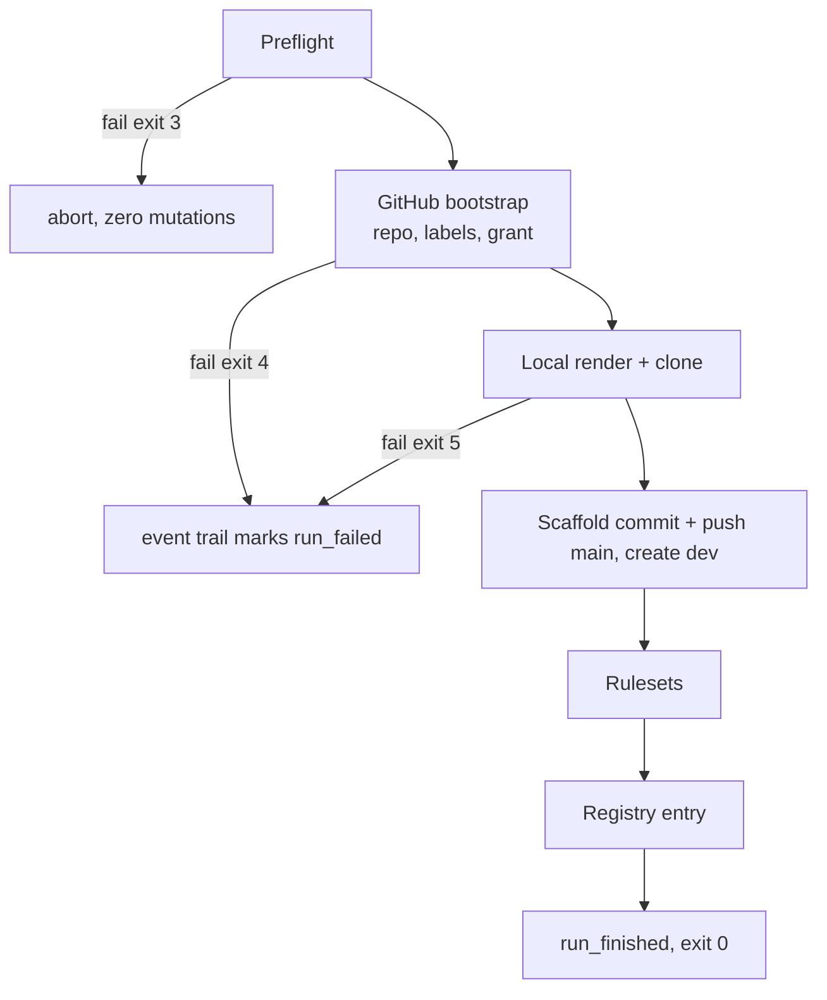

# Foundry

Foundry turns an input bundle into a project container that follows `rules/PROJECT.md` in one invocation, GitHub side and local side, records the founding in the machine's project registry, opens milestones: `kickoff` creates the milestone record on its draft lane for the Principal and the agent to settle in conversation, and publishes releases: `publish` tags a release's publishing merge and creates its GitHub Release from the release record. Foundry scaffolds structure; conversation fills content. Contracts: `spec_foundry-interface.md`. Artifacts and identifiers: `spec_foundry-data.md`.

Source lives at `apps/foundry/` (TypeScript/Node CLI, Node 22 + tsx, `@octokit/rest` with every request naming GitHub REST API version `2026-03-10`; the token-file model is the single auth surface). It runs from the operator's Vork clone at a release tag (`spec_kit.md §Run surface`).

## Bootstrap flow

Every act streams a `resource` event into the run event log as it completes (`spec_foundry-data.md §Run events`); a failed run's trail already covers everything that ran.

### Preflight

Every check passes before the first mutation:

- Load the environment (`spec_foundry-interface.md §Environment`); a missing required var exits 2.
- Validate the bundle per `spec_foundry-interface.md §Input bundle`.
- Load the owner token from `FOUNDRY_OWNER_TOKEN_PATH`; its `GET /user` login is the owner and its `plan.name` the owner's plan; verify scopes (`repo` on a classic token; a fine-grained token exposes none and passes). Load and authenticate the Vork token from `FOUNDRY_VORK_TOKEN_PATH`, the Vork account every session commits and pushes with.
- Plan gate: `plan.name` is `free`, the bundle's `visibility` is `private` and its `ruleset` is `standard` → exit 3: "a free plan takes no branch protection on a private repository: set visibility public, or ruleset none, in the bundle". Every other combination passes. A response without `plan` records the plan as `unknown` and passes; a ruleset the plan refuses then fails at its own stage, exit 4, named.
- Repo name: exists under the owner → resume case, continue; exists under a foreign owner → abort.
- Storage path exists and is writable; `<project_key>/` may pre-exist only when it is a prior run of the same project: its `main/` clone's git origin points at the owner's `<project_key>` repo. Anything else at that path aborts.
- Startup lint on the skeleton (`spec_foundry-data.md §Verification`).

### GitHub bootstrap

Sub-steps in order, each streaming its resource event; artifact shapes per `spec_foundry-data.md §GitHub artifacts`:

- Create the repo (REST `POST /user/repos` under the owner token, `private` per the bundle's `visibility`), then PATCH settings.
- Upsert the issue-queue labels; GitHub's auto-generated defaults stand; Foundry adds.
- Grant: probe repo membership for the Vork account → invite `push` under the owner token → accept with the Vork token. A failed grant records `failed` and continues.
- Failure anywhere here: the event trail carries the completed sub-steps plus `run_failed`; exit 4.

### Local render + clone

- `mkdir -p` the project folder; clone the repo into `main/`; create an empty `team/` (0755), per-agent clones being made on demand where concurrency arises. On a fresh founding the remote is empty, the scaffold being the repository's first commit, so the clone sits on an unborn branch named by the machine's default; Foundry pins it to `main` (`git symbolic-ref HEAD refs/heads/main`) before rendering, and any `main/` left by a run that never pushed is removed and re-cloned. With history on the remote, a `main/` left by a run interrupted mid-clone (origin set, `HEAD` unresolvable) is removed and re-cloned, recorded as drift: its only possible content was Foundry's own render.
- Render the skeleton inventory deterministically; existing path → skip and record. Unknown variable or filesystem failure → exit 5; render aborts before the first write on a missing required variable, so every landed write is whole.

### Scaffold commit, push, `dev`

- Identity for the scaffold commit is the owner's: `user.name = <owner_login>`, `user.email = <owner_login>@<project_key>.localhost`; `git add -A`; message `Foundry: initial project scaffold`, the repository's first commit; push `main` under the owner token (the push creates the branch and lands before any ruleset, the lockout guard); a rejection from an operator-created ruleset is reported by name, exit 5.
- Create `dev` at the scaffold commit (`POST git/refs`), so both standing branches exist before protection.
- Re-bind `main/` to the Vork account's commit identity, `user.name = FOUNDRY_VORK_NAME`, `user.email = FOUNDRY_VORK_EMAIL`: from here on `main/` is the working clone (`rules/PROJECT.md §Storage`), starting from that identity until the actor working it sets its own (`rules/PROJECT.md §Identity`); the owner's identity leaves with the push.

### Rulesets

Apply `protect-main` and `protect-dev` per the committed shapes (skipped wholly when the bundle's `ruleset` is `none`); an existing same-name ruleset converges by delta, recording it.

### Registry entry

Upsert the project's entry in `<foundry-var>/projects.json` (`spec_foundry-data.md §Registry`): key, name, owner, repository, visibility, ruleset, owner plan, the Vork account's login and commit identity, path, `founded_at` (kept from the first run), `updated_at` and `run_id` (this run). Written whole and atomically (temp file, rename); a `registry` resource event records `created` or `updated`. The registry is the machine's inventory of founded projects and the seed for anything built on it later; nothing in the kit reads it except `foundry list`.

### Run close

`run_finished` ends the event trail; the log's path prints once, on stdout. The trail and the registry live in Foundry's own runtime `var/`; execution by-products are runtime data.

## Idempotency and resume

Re-running with the same bundle always resumes, state-based: existing artifacts are skipped with node IDs captured, drift is recorded in the event trail, existing state stands. `foundry verify` is the validation surface.

| Resource | Detect by | On collision |
|---|---|---|
| repo | name under owner | capture node ID, continue |
| label | name on repo | record color drift |
| skeleton file | path exists | skip; existing wins |
| repo grant | membership probe | `already_collaborator` |
| `main/` clone | `HEAD` resolves | torn → remove, re-clone, drift |
| `dev` / ruleset | ref / name | skip / converge by delta, recorded |
| registry entry | key in `projects.json` | `updated`, `founded_at` kept |

A failed run re-runs and resumes, whatever stage it died at; resumption is state-based against the live surfaces, and the run's event trail names what completed, the cleanup target list. Recovery is always a re-run. Rate limits are honored with bounded waits (two retries, `Retry-After` capped at 60 s).

## Verify

`foundry verify --against <path>`: compare structure only: every canonical path present, record templates byte-identical to the kit's set, the root README present. Report per path, a read-only comparison, exit 0/7. The Vork clone's own tree is the standing fixture: it carries every skeleton path and the canonical template set, so `verify --against <vork clone>` exits 0 at every release; a failure there means the skeleton inventory and the tree disagree, and Foundry is fixed before anything real is bootstrapped.

## List

`foundry list`: print the registry as a table, one row per entry: key, name, visibility, ruleset, path, founded date. An absent or empty registry prints `no projects founded from this clone`, exit 0. An unparseable registry exits 5 naming the file.

## Kickoff

Opens a milestone, in the project's `main/` clone:

- `git fetch origin`; `docs/milestones/milestone_v<YYYY.MM.DD>_<slug>/` present on `origin/dev` or locally → print its path and exit 0 without creating.
- Create the lane `feature/milestone_v<YYYY.MM.DD>_<slug>/draft` from `origin/dev`; render `milestone.md` from the canonical template: title, slug, `Status: Active (started <date>)`, Scope seeded with `--note`, every other section left as the template's placeholder; commit under the clone's bound identity (`kickoff: open milestone_v<date>_<slug>`); push the lane with the Vork token.
- Print the lane and the record path, exit 0; git or filesystem failure exits 5 naming the act.

The Draft is then settled in conversation on that lane; its merge to `dev` marks the milestone Active in the charter. Kickoff leaves the registry untouched.

## Publish

Closes the publication of one release, in the project's `main/` clone, from the release record already on `origin/main` (`rules/PROJECT.md §Records — Releases`). The Vork token carries every act; the Principal's approval of the publishing merge is the approval this act runs under. Artifact shapes: `spec_foundry-data.md §Release artifacts`.

Resolve, every check before the first mutation:

- Read and authenticate the Vork token (exit 3, named). The repository is `main/`'s origin, `https://github.com/<owner>/<repo>` with or without `.git`; any other origin exits 3 naming it. `main/` absent or not a git clone exits 5.
- `git fetch origin --tags`.
- Records: the folders `docs/releases/release_<version>/` on `origin/main` (`git ls-tree`), ordered by version (`spec_foundry-data.md §Identifier system`); none → exit 6.
- Target: `--version` when given, its folder on `origin/main` or exit 6; else the newest record.
- Heading: the first line of the target's `release.md` reads `# Release <version>` or `# Release <version> — <title>`, `<version>` equal to the folder's; any other first line exits 6 naming the file.
- Latest: the target is the newest record → the Release is made Latest; else it is not.

Tag `v<version>`:

- Present → it must be reachable from `origin/main` (`git merge-base --is-ancestor`), else exit 6 naming the commit it points at; reported `present`, and an annotated tag's subject becomes the Release's name.
- Absent → the target must be the newest record, else exit 6: an older release is tagged by hand at its own publishing merge. `origin/main`'s tip must be that record's publishing merge — a commit with two parents whose tree carries `docs/releases/release_<version>/release.md` while its first parent's tree does not — else exit 6 naming the failed condition: a commit landed on `main` after the publishing merge, or the tip is no merge. Create the annotated tag at the tip under `main/`'s configured identity, push `refs/tags/v<version>` with the Vork token (exit 5 on a git failure); reported `created`.

Release:

- `GET /repos/{owner}/{repo}/releases/tags/v<version>`: found with the same name and body → `present`; found with either different → `drift`, reported, the existing Release left as it stands; not found → create it (`POST /repos/{owner}/{repo}/releases`), `created`. An API failure exits 4.

Output: one line per act — `tag <created|present> v<version> <sha>`, `release <created|present|drift> <html_url> latest=<true|false>`; with `--dry-run`, `would create` where an act would mutate. A failure after the tag push leaves the tag standing; the re-run finds it `present` and completes the Release.

### Verification

- A fixture remote with the newest record merged at `main`'s tip and no tag → an annotated tag at the tip carrying the release name, pushed; a Release with that name, the notes and `make_latest: "true"`; a second run reports `present` twice and mutates nothing.
- The tip a commit after the publishing merge, or no merge → exit 6 naming the condition, no tag, no write.
- `--version` of an older record whose annotated tag exists and whose Release is absent → the Release is created under the tag's subject, `make_latest: "false"`; `--version` of an older untagged record → exit 6.
- A tag pointing outside `origin/main`'s history → exit 6 naming its commit.
- A first line other than the two heading forms, or a heading version unequal to the folder's → exit 6 naming the file.
- An existing Release whose body differs → `drift`, no write to it.
- A Release create failing after the tag push → exit 4; the re-run reports the tag `present` and creates the Release.
- `--dry-run` against the same fixture → zero pushes, zero GitHub writes, the plan printed with `would create`.

## Verification

- Fresh bootstrap: the artifact set equals the `spec_foundry-data.md` inventory exactly, and only it; the registry holds one entry for the key; the run event trail under Foundry's var ends `run_finished`.
- Kill the run after the repo step → re-run completes the remainder without disturbing existing artifacts; the two event trails together cover every resource exactly once as created-or-skipped; the registry entry is one, `updated`, `founded_at` from the first run.
- Manual label-color change → re-run completes, the event trail records the drift, live label untouched.
- Plan gate: a mocked `plan.name: free` with `visibility: private` and `ruleset: standard` exits 3 before any API mutation; the same with `visibility: public`, or with `ruleset: none`, passes preflight; a `pro` plan passes every combination.
- `--dry-run` leaves GitHub, the storage path and the registry untouched.
- `verify --against <vork clone>` exits 0; deleting one canonical template from a copy exits 7 naming the path.
- `list` after two foundings prints two rows; on a fresh clone prints the empty message.
- Kickoff → the milestone folder and `milestone.md` on the pushed draft lane; a second call reports the existing folder; a malformed `--milestone` exits 2.
