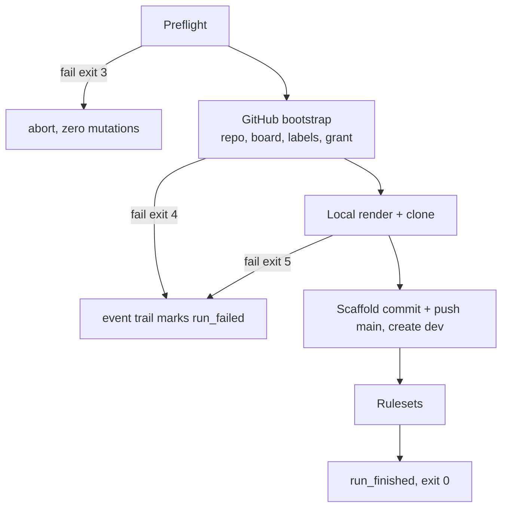

# Foundry

Foundry turns an input bundle into a project container that follows `rules/PROJECT.md` in one invocation, GitHub side and local side, and opens milestones: `kickoff` creates the milestone record on its draft lane for the Principal and the agent to settle in conversation. Foundry scaffolds structure; conversation fills content. Contracts: `spec_foundry-interface.md`. Artifacts and identifiers: `spec_foundry-data.md`.

Source lives at `apps/foundry/` (TypeScript/Node CLI, Node 22 + tsx, `@octokit/rest` + `@octokit/graphql`; the token-file model is the single auth surface). It runs from the operator's Vork clone at a release tag (`spec_kit.md §Run surface`).

## Bootstrap flow

Every act streams a `resource` event into the run event log as it completes (`spec_foundry-data.md §Run events`); a failed run's trail already covers everything that ran.

### Preflight

Every check passes before the first mutation:

- Load the environment (`spec_foundry-interface.md §Environment`); a missing required var exits 2.
- Validate the bundle per `spec_foundry-interface.md §Input bundle`.
- Load the owner token from `FOUNDRY_OWNER_TOKEN_PATH`; its `GET /user` login is the owner; verify scopes (`repo`, `project` on a classic token; a fine-grained token exposes none and passes). Load and authenticate the work token from `FOUNDRY_WORK_TOKEN_PATH`, the work account every session commits and pushes with.
- Repo name: exists under the owner → resume case, continue; exists under a foreign owner → abort. Board title: more than one existing match → abort.
- Storage path exists and is writable; `<project_key>/` may pre-exist only when it is a prior run of the same project: its `main/` clone's git origin points at the owner's `<project_key>` repo. Anything else at that path aborts.
- Startup lint on the skeleton (`spec_foundry-data.md §Verification`).

### GitHub bootstrap

Sub-steps in order, each streaming its resource event; artifact shapes per `spec_foundry-data.md §GitHub artifacts`:

- Create the repo (REST `POST /user/repos` under the owner token), then PATCH settings.
- Create the board (GraphQL `createProjectV2`); existing same-title board → capture node ID. GitHub's default fields stand as shipped: the board is the project's bugs, enhancements and defects queue on stock vocabulary.
- Link repo to board (`linkProjectV2ToRepository`, idempotent).
- Upsert the issue-queue labels; GitHub's auto-generated defaults stand; Foundry adds.
- Grant: probe repo membership for the work account → invite `push` under the owner token → accept with the work token → GraphQL Project `WRITER` grant (an upsert, applied every run). A failed grant records `failed` and continues.
- Failure anywhere here: the event trail carries the completed sub-steps plus `run_failed`; exit 4.

### Local render + clone

- `mkdir -p` the project folder; clone the repo into `main/`; create an empty `team/` (0755), per-agent clones being made on demand where concurrency arises. On a fresh founding the remote is empty, the scaffold being the repository's first commit, so the clone sits on an unborn branch named by the machine's default; Foundry pins it to `main` (`git symbolic-ref HEAD refs/heads/main`) before rendering, and any `main/` left by a run that never pushed is removed and re-cloned. With history on the remote, a `main/` left by a run interrupted mid-clone (origin set, `HEAD` unresolvable) is removed and re-cloned, recorded as drift: its only possible content was Foundry's own render.
- Render the skeleton inventory deterministically; existing path → skip and record. Unknown variable or filesystem failure → exit 5; render aborts before the first write on a missing required variable, so every landed write is whole.

### Scaffold commit, push, `dev`

- Identity for the scaffold commit is the owner's: `user.name = <owner_login>`, `user.email = <owner_login>@<project_key>.localhost`; `git add -A`; message `Foundry: initial project scaffold`, the repository's first commit; push `main` under the owner token (the push creates the branch and lands before any ruleset, the lockout guard); a rejection from an operator-created ruleset is reported by name, exit 5.
- Create `dev` at the scaffold commit (`POST git/refs`), so both standing branches exist before protection.
- Re-bind `main/` to the work identity (`FOUNDRY_WORK_TOKEN_PATH`'s login): from here on `main/` is the working clone (`rules/PROJECT.md §Storage`); the owner's identity leaves with the push.

### Rulesets

Apply `protect-main` and `protect-dev` per the committed shapes (skipped wholly when `FOUNDRY_RULESET=none`); an existing same-name ruleset converges by delta, recording it.

### Run close

`run_finished` ends the event trail; the log's path prints. The trail lives in Foundry's own runtime `var/`; execution by-products are runtime data.

## Idempotency and resume

Re-running with the same bundle always resumes, state-based: existing artifacts are skipped with node IDs captured, drift is recorded in the event trail, existing state stands. `foundry verify` is the validation surface.

| Resource | Detect by | On collision |
|---|---|---|
| repo / board | name / title under owner | capture node ID, continue |
| label | name on repo | record color drift |
| skeleton file | path exists | skip; existing wins |
| repo grant / Project grant | membership probe / (upsert) | `already_collaborator` / `granted` again |
| `main/` clone | `HEAD` resolves | torn → remove, re-clone, drift |
| `dev` / ruleset | ref / name | skip / converge by delta, recorded |

A failed run re-runs and resumes, whatever stage it died at; resumption is state-based against the live surfaces, and the run's event trail names what completed, the cleanup target list. Recovery is always a re-run. Rate limits are honored with bounded waits (two retries, `Retry-After` capped at 60 s).

## Verify

`foundry verify --against <path>`: compare structure only: every canonical path present, record templates byte-identical to the kit's set, the root README present. Report per path, a read-only comparison, exit 0/7. The Vork clone's own tree is the standing fixture: it carries every skeleton path and the canonical template set, so `verify --against <vork clone>` exits 0 at every release; a failure there means the skeleton inventory and the tree disagree, and Foundry is fixed before anything real is bootstrapped.

## Kickoff

Opens a milestone, in the project's `main/` clone:

- `git fetch origin`; `docs/milestones/milestone_v<YYYY.MM.DD>_<slug>/` present on `origin/dev` or locally → print its path and exit 0 without creating.
- Create the lane `feature/milestone_v<YYYY.MM.DD>_<slug>/draft` from `origin/dev`; render `milestone.md` from the canonical template: title, slug, `Status: Active (started <date>)`, Scope seeded with `--note`, every other section left as the template's placeholder; commit under the work identity (`kickoff: open milestone_v<date>_<slug>`); push the lane.
- Print the lane and the record path, exit 0; git or filesystem failure exits 5 naming the act.

The Draft is then settled in conversation on that lane; its merge to `dev` marks the milestone Active in the charter.

## Verification

- Fresh bootstrap: the artifact set equals the `spec_foundry-data.md` inventory exactly, and only it; the run event trail under Foundry's var ends `run_finished`.
- Kill the run after the board step → re-run completes the remainder without disturbing existing artifacts; the two event trails together cover every resource exactly once as created-or-skipped.
- Manual label-color change → re-run completes, the event trail records the drift, live label untouched.
- `--dry-run` leaves GitHub untouched and the storage path empty.
- `verify --against <vork clone>` exits 0; deleting one canonical template from a copy exits 7 naming the path.
- Kickoff → the milestone folder and `milestone.md` on the pushed draft lane; a second call reports the existing folder; a malformed `--milestone` exits 2.
