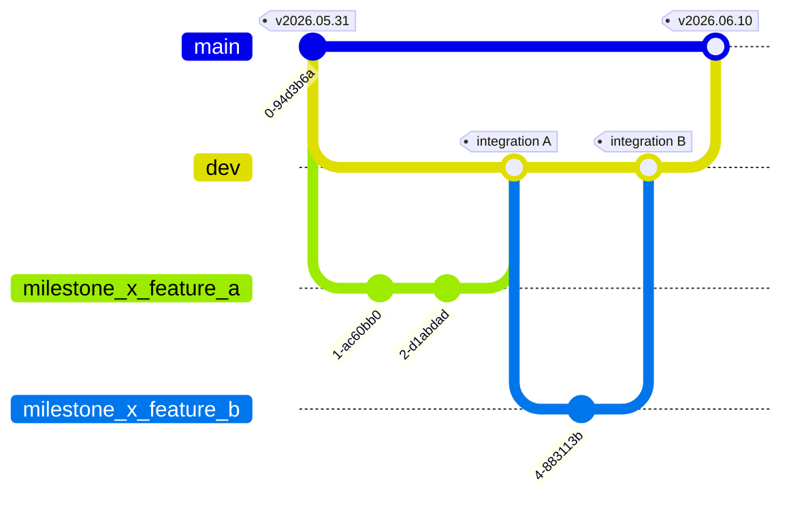
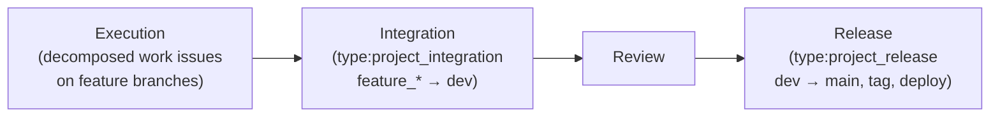

# Spec: Git Integration Model

## Introduction

This spec is the canonical design blueprint for the **git-integration model**: how a Vork project's git repository is branched, how in-progress work is integrated, where that integration is audited, and how agents are attributed in history. It formalizes the converged 2026-06-02 design (`docs/research/research_20260602_git-integration-model/research.md`) at spec altitude so the `project_integration` milestone's canonical-policy amendments can be derived and executed against a stable target. The blueprint here is the *design*; the versioned policy edits that encode it are Execution, governed by this spec.

The goal is to close the active gap where every standalone agent commits directly to a project's shared `main` branch with no branch, integration, or merge discipline — by ratifying a trusted-agent integration model that gates the *integration moment* rather than every Task.

## Purpose

This spec exists to give the `project_integration` milestone one authoritative design to encode, and to give every future project one consistent integration model to adopt. It converts a deliberation record into a durable blueprint: the branching topology, the integration Stage Task, the audit placement, the naming convention, and the attribution scheme — each fixed here so Decomposition can produce amendment Tasks, and so later readers can understand *why* the model is shaped this way without re-running the deliberation.

It deliberately stops at design. The wording of the `PROJECT.md`, `FRAMEWORK.md`, `TASK.md`, `constants.md`, and agent-`AGENTS.md` edits is not reproduced here; this spec governs those edits, it does not pre-write them.

## Scope

In scope — the design of:

- The **two-standing-branch model** (`main`/`dev`) plus feature and hotfix branch conventions, and the no-direct-commit rule.
- The **`type:project_integration` Stage Task**: its lifecycle placement, ownership, cardinality, and integration-record artifact.
- The **audit placement** of the integration Stage Task.
- **Dated milestone and release naming** (`milestone_<slug>_v<YYYY.MM.DD>/`, `release_v<YYYY.MM.DD>/`).
- **Per-clone git identity** and the machine-parseable commit-trailer convention.
- The **task-layer (not git-layer) enforcement** reality the model must hold within.

Out of scope:

- The canonical-policy amendments themselves (`PROJECT.md`, `FRAMEWORK.md`, `TASK.md`, `constants.md`, agent `AGENTS.md`) — Execution, governed by this spec.
- The GitHub *account/identity* model (bounded identity set, route-table dispatch) — WS2 / Wakery-V3, a separate milestone. Only the per-clone git *author* identity carries here.
- Any Wakery code change, branch-protection setup, or `type:project_integration` label/route creation in the live system.

## Requirements

What must be true of the designed model.

### R1 — Branching model: two standing branches per project

Every project repository carries exactly two standing branches, plus transient working branches:

| Branch | Role | Receives work via | Invariant |
|---|---|---|---|
| `main` | Release-truth | integration only | Every commit is a release-tag boundary; never receives in-progress work directly |
| `dev` | Standing integration branch | integration only | Absorbs all in-progress work for the active milestone; staging/QA happens here |
| `<full-milestone-name>_feature_<slug>` | Feature lane off `dev` | direct agent commits | Branch unit is the **feature**, not the Task; multiple Tasks by one agent on one feature share one branch |
| `hotfix_<slug>` | Live-production fix off `main` | direct agent commits | Merged to `main` (new release `.rN` + deploy), then forward-merged into `dev` |

Rules the model fixes:

- **No agent commits directly to `main` or `dev`.** Integration is the only path into either standing branch.
- Feature branches use the **full milestone-name prefix** (e.g. `milestone_git-discipline_v2026.06.02_feature_branch-model`), no `feat/`-style slash prefix — self-describing, searchable names.
- The hotfix forward-merge into `dev` is the one bookkeeping cost the `dev` branch imposes; it exists so a production fix is not lost on the next `dev → main` integration.
- The model is adopted **uniformly across all projects** — deployable apps and policy/spec repos alike — for framework consistency, even where the hotfix benefit is weaker (no live artifact).

### R2 — `type:project_integration` Stage Task

A new Stage Task type sits **after the Execution phase and before the Review stage**. (There is no `project_execution` Stage Task — Execution is carried by the decomposed work issues; integration is meta-work, like the other stages.)

- **Owner:** the AI Lead (`main`). Conflict resolution requires the cross-Task context that bounded-context execution agents structurally lack.
- **Cardinality:** a milestone may have an **arbitrary number of integrations** — one per affected feature. The set of affected features (each getting its own feature branch and integration) is **identified during Decomposition** and recorded in `decomposition.md`.
- **Unit of work:** one `feature_* → dev` merge. The AI Lead performs the merge, resolves conflicts, and produces an integration record.
- **Artifact:** `integration_<feature-slug>_<YYYY.MM.DD.HH.mm.SS>.md` in the milestone folder, alongside `decomposition.md` and `review_*.md`.
- **Record verbosity:** lean by default, verbose on conflict — mirroring the `TASK.md` transition-comment doctrine. A clean fast-forward merge gets a one-liner; a merge requiring judgment between two agents' edits (shared `constants.md`, common utilities) gets the full record: what collided, whose intent each side carried, how it was resolved, and why.
- **`dev → main` integration** is performed as part of the `type:project_release` Stage Task — normally conflict-free (nothing commits to `main` directly), substantive only when a hotfix has diverged `main`. Its `integration.md` lives in the **release folder** (`releases/release_v<YYYY.MM.DD>/integration.md`), not the milestone folder.

### R3 — Audit placement

The `type:project_integration` Stage Task is audited at the standard pre-execution gate (`Todo+Gated`), like every Stage Task — the Auditor reviews the intent to merge a feature branch into `dev` and assigns a Risk Code before the merge runs. The merge's dominant extracted primitive is `Update × Repository × Workspace`. The AI Lead, as owner, reviews the merged result through the Task's own `Done → Reviewed → Completed` lifecycle.

### R4 — Dated milestone & release naming

App-style milestone version identifiers (`Wakery-v2`, `Foundry-v1`) are replaced with **dated versioning**, because dev work is continuous and open-ended.

- **Milestone folder:** `milestone_<slug>_v<YYYY.MM.DD>/` — slug-first, dated-version suffix; the date is the milestone **start** date. Replaces the prior `milestone_<YYYYMMDD>_<slug>/` form.
- **Release folder:** `release_v<YYYY.MM.DD>/` — adds the `release_` prefix it currently lacks (searchability); the date is the **ship** date.
- Milestone and release dates differ (start vs ship) and carry distinct prefixes, so the shared `v<YYYY.MM.DD>` namespace never collides.

**Naming self-bootstrap:** this spec ratifies the convention; the `project_integration` milestone that ratifies it is the first to wear it (`milestone_project_integration_v2026.06.02/`). The divergence from existing folder names (`milestone_20260514_resolver-v1/`, etc.) is a deliberate self-bootstrap, not drift — pre-existing folders are not retroactively renamed.

### R5 — Git identity & attribution

- **Per-clone git identity.** Each agent's clone sets a distinct `user.name` / `user.email`, so `git log` author stays legible even though all non-auditor agents push as one worker bot (the shared-bot push model is WS2's concern). Author identity is independent of the push credential — it is how the AI Lead attributes conflicting hunks during integration.
- **Commit-trailer convention.** A machine-parseable footer carries attribution: `Agent: <id>`, `Task: <ref>`, `Co-Authored-By:`. This recovers per-agent attribution under the shared-bot model and survives a future migration off GitHub.

## Constraints

- **Amendment lineage.** This spec formalizes an already-deliberated, Principal-decided design; it conforms to `FRAMEWORK.md §Amendment`. It authors the blueprint, not the versioned policy edits — those are Execution and must be encoded and versioned per `FRAMEWORK.md §Amendment`.
- **Task-layer, not git-layer, enforcement.** `<owner>/vork` is a free private repo: branch-protection / required-review is unavailable (probe 2026-06-01: `rulesets` → `403 "Upgrade to GitHub Pro or make this repository public"`; `main` → no protection), and the Principal has declined Pro. Enforcement is therefore **task-layer**: the integration merge is gated by Heimdall's Stage-Task audit (a Status/approval on our own surface), and Wakery **divergence detection** is the load-bearing tripwire — **detective, not preventive**. The model must not assume any git-layer gate.
- **House style.** The spec describes *how the model is built*, not runtime data; lean prose; field/convention rows match neighbor brevity.
- **Conflict prevention is structural, not a merge-gate.** Decomposition (`PROJECT.md` The One Rule — "one bounded scope") plus task-type routing (agents separated by nature of work) already prevent most conflicts. The integration model gates the *moment* of merge, not every Task — re-gating audited intent at merge was rejected as anti-human ceremony.

## Deliverables

This spec governs the following Execution outputs (the canonical amendments the `project_integration` milestone encodes and versions per `FRAMEWORK.md §Amendment`). Decomposition (#46) derives the amendment Tasks from them; this spec is their design source.

1. **`PROJECT.md`** — define the `type:project_integration` Stage Task (Type / Scope / Primary Spec / Deliverable); place it in the lifecycle between Execution and Review.
2. **`PROJECT.md §Decomposition`** — Decomposition identifies affected features → feature branches + planned integrations, recorded in `decomposition.md`.
3. **`PROJECT.md §Milestones`** — `milestone_<slug>_v<YYYY.MM.DD>/` naming (start date); `integration_<feature-slug>_<ts>.md` artifact in the milestone folder.
4. **`PROJECT.md §Release`** — `release_v<YYYY.MM.DD>/` folder naming (ship date); `dev → main` `integration.md` in the release folder, produced by the Release Stage Task.
5. **`FRAMEWORK.md` / `PROJECT.md`** — the two-standing-branch model (`main`/`dev`), feature/hotfix branch conventions, no-direct-commits rule.
6. **`constants.md`** — add `project_integration` to the task_type inventory; record branch-naming + integration-artifact conventions.
7. **`TASK.md` / agent `AGENTS.md`** — per-clone git identity, commit-trailer convention, integration as AI-Lead-owned; per-agent rule that execution agents push feature branches only, never `main`/`dev`.

Self-application is itself a deliverable: the `project_integration` milestone runs its own Execution on `dev` + feature branches + integration Stage Tasks, demonstrating the workflow end-to-end before it governs other projects.

## Verification

Work governed by this spec is judged complete when:

- Each of the seven amendment targets is encoded into its named canonical-policy file and versioned per `FRAMEWORK.md §Amendment`.
- `PROJECT.md`'s lifecycle reads Execution → **Integration** → Review, with `type:project_integration` defined (Type / Scope / Primary Spec / Deliverable).
- `constants.md`'s task_type inventory includes `project_integration`, and branch-naming + integration-artifact conventions are recorded.
- The dated naming convention is present in `PROJECT.md §Milestones` / `§Release`, and the `project_integration` milestone's own folder name conforms (self-consistency check).
- A worked example exists: the model is self-applied to its own Execution (this milestone runs on `dev` + feature branches + integration Stage Tasks).
- No amendment assumes git-layer enforcement; integration is gated by Heimdall's Stage-Task audit + Wakery divergence detection.

## References

- `docs/research/research_20260602_git-integration-model/research.md` — converged design + Principal decisions; the substance this spec formalizes.
- `docs/milestones/milestone_project_integration_v2026.06.02/milestone.md` — the active milestone; §Specs names this spec as the Draft deliverable.
- `docs/policy/PROJECT.md` — §Specs (this spec's structure), §Draft, §Decomposition, §Milestones, §Release (amendment targets).
- `docs/policy/FRAMEWORK.md` — §Amendment (the lineage this spec and its encodings follow).
- `docs/policy/TASK.md`, `docs/conventions/constants.md`, agent `AGENTS.md` files — amendment targets.
- `docs/backlog.md` — WS1 "Git discipline + agent integration model" (full pre-migration design); WS2 "Wakery V3 — bounded identity set" (the account/identity model, out of scope here).
- Issue #45 — prior Draft Stage Task (produced milestone + research, deferred spec authoring to this Task). Issue #46 — Decomposition Stage Task, consumes this spec.
